# Abstract {.unnumbered}

Infrared satellites measure the temperature of the sea surface every day, but they cannot see through cloud, so every daily map has holes. We fill the holes by solving the Laplace equation on the missing pixels, with the observed pixels held fixed. This is the Poisson equation with zero source. We solve it with two iterative methods, Jacobi and conjugate gradient (CG), in 2D (one day) and in 3D (a whole year, with time as the third axis). The solver is written once in C++ and compiled as a serial program and as three parallel programs: MPI, MPI+OpenMP and MPI+CUDA. A test problem with a known exact answer shows second-order accuracy, and every parallel build gives the serial answer to all printed digits. On the NUS Vanda cluster the solver runs on up to 256 cores. At 256 cores the speedup is 74 to 137. Inside one node the stencil is limited by memory bandwidth, and efficiency drops to about 0.3 by 32 cores. From one node to four, scaling is linear or better. For CG, the global sums (all-reduce) become the main cost at 256 cores. Pure MPI was as fast as or faster than every MPI+OpenMP split we tried. One NVIDIA A40 GPU was 1.9 to 2.7 times faster than 36 CPU cores on large grids, and slower on small ones. On one year (2025) of 4 km maps around India, the 2D fill is off by about 0.15 °C on 64 km holes, against 0.92 °C for filling with the mean. The 3D fill helps only for holes wider than about 250 km.

# Introduction

Satellites measure the temperature of the sea surface every day, but the infrared sensors that give the sharpest maps cannot see through clouds. Over the seas around India the monsoon keeps the sky covered for months, and a single day's map from the VIIRS instrument can be missing more than nine tenths of its sea pixels. A heat-wave study, a coral-bleaching alert or a weather model needs a complete daily field, so the holes have to be filled.

The oldest and simplest way to fill a hole is to make the temperature inside it vary as smoothly as possible while matching the observed pixels around it. That condition is the Laplace equation, solved on the missing pixels with the observed pixels as boundary data. In two dimensions a hole is filled from the clear pixels around it on the same day. In three dimensions we stack a year of maps with time as the third axis, so a pixel hidden today is also filled from the same place yesterday and tomorrow.

The Laplace equation is the Poisson equation with zero source. The Poisson equation also describes the steady temperature of a plate with fixed edges, the shape of a loaded membrane and the electric potential of a charge distribution. Discretising it on a grid of $n^d$ points gives a sparse linear system that is too large to solve directly for any useful $n$, so it is solved by iteration: start from a guess, apply a cheap update to every point, and repeat.

We implement two such iterations in C++, Jacobi and conjugate gradient. We check them on a manufactured Poisson problem with a known exact solution, then apply them to one year (2025) of daily 4 km sea-surface temperature maps of the Arabian Sea and the Bay of Bengal from NOAA CoastWatch: $801 \times 534$ pixels per day for 365 days. Each solver exists as a serial program and in three parallel forms:

1. **MPI.** The grid is cut into blocks, one per process. Before every update the processes swap the outer layer of their blocks (the halo).
2. **MPI+OpenMP.** The same decomposition across processes, with the loops inside each block shared among threads.
3. **MPI+CUDA.** The same decomposition, with each process's block stored and updated on a GPU.

The problem is not embarrassingly parallel. Every update of a point needs its neighbours, so processes communicate at every iteration, and CG also needs two global sums per iteration. The design questions are how to cut the grid, how to exchange halos, how often to synchronise and how to split a node's cores between processes and threads. Section 3 sets these out. Sections 5 to 7 measure them on the manufactured problem, whose size we can choose freely, as strong and weak scaling need. They use up to 256 cores of the NUS Vanda cluster and one GPU. Section 8 turns to the satellite data: how well the holes are filled, measured by hiding observed pixels, and how the solver scales on a real field with coasts and irregular holes.

Both 2D and 3D are implemented, as the lecture 12 feedback asks [1], from one source tree in which a 2D grid is a 3D block one layer thick. The code and a `README.md` with build and run instructions are at https://github.com/vanshikadhamijanus/dsa5208-poisson-mpi. Section 11 lists the commands that download the data and regenerate every figure.

Table 1 explains the terms used in the rest of the report. Table 2 shows where the report answers each part of the project brief.

| Term | Meaning |
|:---|:---|
| Rank | One MPI process. Ranks have separate memory and exchange data only through MPI messages. |
| Stencil | The rule that updates a grid point from its nearest neighbours: 5 points in 2D, 7 in 3D. |
| Domain decomposition | Cutting the grid into blocks and giving one block to each rank. |
| Halo (ghost cells) | A one-cell layer around each block that holds a copy of the neighbouring rank's edge values. It is refreshed by a halo exchange before every sweep. |
| Slab, pencil, block | Ways to cut a 3D grid: in one direction only (slabs), in two (pencils) or in all three (blocks). |
| Contiguous, strided | A face is contiguous if its values sit next to each other in memory, and strided if they are spread out at a fixed step and must be gathered. |
| All-reduce | A collective operation (`MPI_Allreduce`) that adds up one number from every rank and gives every rank the total. Every rank must wait for all the others. |
| Bulk-synchronous | A program that alternates computing and communicating, with every rank waiting for the others at each step. Both of our solvers work this way. |
| Krylov method | An iterative solver, such as CG, that builds its answer from repeated products of the matrix with a vector. |
| Strong scaling | Fixed problem size, more cores. Ideal: time falls in proportion to the cores. |
| Weak scaling | Fixed work per core, more cores. Ideal: time stays constant. |
| Speedup, efficiency | $S = T_s/T_p$ and $E = T_s/(p\,T_p)$, with $T_s$ the serial time and $T_p$ the time on $p$ cores (lecture 7 [1]). For weak scaling, $E = T_1/T_p$. |
| Memory-bound | Limited by how fast data arrive from memory, not by arithmetic. Our stencils do about one floating-point operation per byte moved. |
| Socket, NUMA | A socket is one processor chip with its own memory controllers. On a two-socket node, memory attached to the other socket is slower to reach (non-uniform memory access, NUMA). |
| First touch | Linux places a page of memory on the socket of the thread that first writes it. |
| Fork-join | How an OpenMP loop runs: the master thread starts a team of threads, they share the loop, and they wait for each other at the end. |
| One-sided communication (RMA) | One rank writes directly into another rank's memory (`MPI_Put`) inside an access period opened and closed by `MPI_Win_fence`. |
| TCP, RDMA, UCX | TCP is the ordinary network protocol. RDMA lets the network card write into a remote node's memory without the remote processor. UCX is the Open MPI layer (PML, point-to-point messaging layer) that would use RDMA; on Vanda it did not start, so all messages went over TCP. |
| Pinned memory | Host memory locked in place so the GPU can copy to and from it directly. |
| CUDA-aware MPI, GPUDirect | An MPI library that accepts GPU memory addresses directly. GPUDirect is NVIDIA's mechanism that lets it move data without a copy through host memory. |
| Coalesced access | GPU threads in a group reading consecutive addresses, which the hardware serves in one memory transaction. |
| `atomicAdd` | A GPU operation that adds to one memory location safely when many threads do it at once, one after another. |
| MPI-IO | MPI's parallel file interface. Every rank writes its own part of one shared file in a single collective call. |
| Hold-out validation | Hiding some observed pixels, filling them like the real holes, and comparing the fill with the hidden values. |
| RMSE, MAE | Root-mean-square error and mean absolute error, in °C. |

Table: Table 1. Terms used in this report.

| Part of the brief | Where | What we report |
|:---|:---|:---|
| Introduction to the algorithm | Sections 2 and 3 | Poisson equation, Jacobi and CG, the satellite gap-filling problem, the parallel design |
| Serial and parallel implementations | Section 3.7 | One solver loop compiled as serial, OpenMP, MPI, MPI+OpenMP and MPI+CUDA programs |
| Validation | Section 4 | Convergence order, agreement of every build, automated tests, agreement on the satellite data |
| Serial runtime against problem size | Section 5.2 | Runtime on one Vanda core up to $8192^2$ and $512^3$ points |
| MPI scaling to at least 256 cores | Section 6 | Strong and weak scaling, speedup, efficiency, cost of communication, design study |
| MPI+X, with at least one GPU test | Section 7 | MPI+OpenMP splits on 64 and 256 cores; MPI+CUDA on one A40 GPU |
| Results on Atlas or Vanda | Sections 5 to 8 | All timings except the OpenMP-only sweep come from Vanda |
| Conclusions about real data | Sections 8 and 9.3 | Accuracy of the fill, the 2D and 3D comparison, scaling on the satellite data |
| AI use | Section 10 | Which tools did what, and how we checked the results |
| Code and README | Section 11 | GitHub repository and the commands that reproduce every figure |

Table: Table 2. Where the report answers each part of the project brief.

::: callout
**Where the measurements come from.** Every figure and table was produced by the scripts in the repository from CSV files that the solvers write. The validation in Section 4 and the OpenMP-only sweep in Section 7.1 come from the 16-core Apple M4 Max laptop on which we developed the code. All other performance results come from the NUS Vanda cluster: MPI up to 256 cores on four nodes, MPI+OpenMP splits on one and four nodes, and MPI+CUDA on one NVIDIA A40 GPU. A two-GPU job was prepared but did not run before the deadline.
:::

# The algorithm

## The Poisson equation and its finite-difference form

We solve
$$-\Delta u = f \quad \text{in } \Omega = (0,1)^d, \qquad u = 0 \text{ on } \partial\Omega,$$
with $d = 2$ or $3$. The domain is covered by $n_x \times n_y$ (or $n_x \times n_y \times n_z$) interior grid points with spacings $h_x = 1/(n_x+1)$ and so on. The boundary points hold the value zero. Replacing each second derivative by the central difference $(u_{i-1} - 2u_i + u_{i+1})/h^2$ gives, at every interior point $c$,
$$\Big(\tfrac{2}{h_x^2} + \tfrac{2}{h_y^2} + \tfrac{2}{h_z^2}\Big) u_c
 - \tfrac{u_{c-x} + u_{c+x}}{h_x^2} - \tfrac{u_{c-y} + u_{c+y}}{h_y^2} - \tfrac{u_{c-z} + u_{c+z}}{h_z^2} = f_c,$$
where $u_{c\pm x}$ is the neighbour of $c$ in the $x$ direction. In 2D the $z$ terms are absent, which the code expresses by setting $1/h_z^2 = 0$. This is the five-point (2D) or seven-point (3D) stencil. As a matrix equation $A u = f$, the matrix $A$ is symmetric positive definite with $2d+1$ non-zeros per row. It is never stored; the code applies it on the fly (`apply_A` in `src/kernels.hpp`). The discretisation error is $O(h^2)$, which Section 4.1 confirms.

## Jacobi iteration

Solving the stencil equation at $c$ for $u_c$, with the neighbours frozen at their previous values, gives the Jacobi sweep
$$u_c^{(k+1)} = \frac{1}{D}\Big(f_c + \tfrac{u^{(k)}_{c-x} + u^{(k)}_{c+x}}{h_x^2} + \tfrac{u^{(k)}_{c-y} + u^{(k)}_{c+y}}{h_y^2} + \tfrac{u^{(k)}_{c-z} + u^{(k)}_{c+z}}{h_z^2}\Big), \qquad D = \tfrac{2}{h_x^2} + \tfrac{2}{h_y^2} + \tfrac{2}{h_z^2}.$$
Every new value depends only on old values, so all points of one sweep can be updated in parallel, using two arrays that are swapped after each sweep. The weakness is slow convergence. The slowest error component shrinks by a factor of $\cos(\pi h)\approx 1 - \pi^2 h^2/2$ per sweep [5], so reaching a tolerance $\varepsilon$ takes about $2\ln(1/\varepsilon)/(\pi^2 h^2)$ sweeps, which grows like $n^2$. For $\varepsilon = 10^{-10}$ that is about $4.7\,(n+1)^2$ sweeps, or five million sweeps on a $1024^2$ grid. We therefore use Jacobi in two ways. We run it to convergence on small grids to validate it (Section 4.3), and we run it for a fixed 200 sweeps as a stencil benchmark whose cost per sweep the parallel study measures.

To stop at a tolerance, Jacobi must check the residual $r = f - Au$, and its global norm $\|r\|_2$ needs an all-reduce in parallel. The option `--check-every C` sets how often that happens. In the fixed-sweep benchmark it is 0 (never), so the only communication is the halo exchange. Section 6.6 measures the cost of each check.

## Conjugate gradient

Conjugate gradient is the standard Krylov method for symmetric positive definite systems [4, 5]. With $u_0 = 0$ and $r_0 = p_0 = f$, each iteration computes
$$\alpha_k = \frac{r_k^\top r_k}{p_k^\top A p_k},\quad u_{k+1} = u_k + \alpha_k p_k,\quad r_{k+1} = r_k - \alpha_k A p_k,\quad
\beta_k = \frac{r_{k+1}^\top r_{k+1}}{r_k^\top r_k},\quad p_{k+1} = r_{k+1} + \beta_k p_k.$$
Only the product $A p_k$ touches neighbours, so only the search direction $p$ needs a halo exchange, once per iteration. The two inner products $p^\top A p$ and $r^\top r$ are each a local sum followed by an `MPI_Allreduce`. CG therefore has two global synchronisation points per iteration, where Jacobi without residual checks has none. In return, CG converges in $O(\sqrt{\kappa}) = O(n)$ iterations rather than $O(n^2)$, because the condition number of $A$ is $\kappa \approx 4/(\pi^2 h^2)$. Both solvers stop when the relative residual $\|r\|_2/\|f\|_2$ falls below $\varepsilon$, with $\varepsilon = 10^{-8}$ unless stated. We use no preconditioner, to keep the communication pattern simple enough to analyse. Adding one is the obvious next step.

## Manufactured solution and validation metrics

To check the solvers against a known answer, we choose the solution first and derive the source from it (the method of manufactured solutions):
$$u(x,y,z) = e^{x}\sin(\pi x)\sin(\pi y)\,[\sin(\pi z)], \qquad
f = -\Delta u = e^{x}\sin(\pi y)[\sin(\pi z)]\big((d\pi^2 - 1)\sin(\pi x) - 2\pi\cos(\pi x)\big).$$
This solution is zero on the boundary and smooth, so the discrete solution should approach it with error $O(h^2)$. The factor $e^{x}$ matters. Our first version used $u = \sin(\pi x)\sin(\pi y)$, which is an eigenvector of the discrete Laplacian. Its right-hand side is then a multiple of the same eigenvector, and CG converged in exactly one iteration on every grid, which made the CG timings meaningless. The exponential factor spreads the solution over many eigenvectors and restores the expected $O(n)$ iteration count (Tables 3 and 4).

Each run reports three numbers, all computed after the timed loop. The relative residual $\|f - Au\|_2/\|f\|_2$ shows how well the linear system was solved. The discrete $L_2$ error $\big(\sum_c (u_c - u(x_c))^2\, h_x h_y h_z\big)^{1/2}$ and the maximum error $\max_c |u_c - u(x_c)|$ show how close the answer is to the true solution. We establish parallel correctness by running the same problem through every implementation and comparing these numbers.

## Cost per iteration

Let $N = n_x n_y n_z$ be the number of grid points and $P$ the number of ranks. One Jacobi sweep performs $2d + 2$ floating-point operations per point. In principle it reads the old value, the source and the new value's location once per point (the neighbours come from cache), which is 24 bytes per update. On a machine with memory bandwidth $B$ bytes per second, a sweep therefore takes at least $24N/B$ seconds. Our 2D kernel moves more than this. Because 2D is stored as a 3D block one layer thick, the kernel also reads the two $z$ halo planes, which are full-size planes of zeros. That adds two more streams, about 40 bytes per update in 2D (Section 3.1). One CG iteration costs one stencil application plus about 10 more operations per point for the two dot products and three vector updates, and streams about six arrays. Per rank, the compute cost is proportional to $N/P$.

Communication per iteration has two parts. The halo exchange moves the surface of each block. For a block with $m$ points per side in $d$ dimensions, that is $2d\,m^{d-1}$ values out and the same number in, against $m^d$ values of work, a ratio of $2d/m$. With $N = 2048^2$ on 16 ranks arranged $4 \times 4$, $m = 512$ and each rank sends 2048 doubles (16 KB) per sweep against 262 144 updates, so the volume is under one percent of the data touched. At this scale the cost that matters is latency: four messages per sweep. The second part is the all-reduce, whose time grows like $\log P$ and is almost pure latency. CG pays it twice per iteration. The strong-scaling study in Section 6 measures these two terms with separate timers.

## The application: filling cloud gaps in satellite sea-surface temperature

**The data.** The maps are daily sea-surface temperature from the VIIRS radiometer on the NOAA-20 satellite, gridded at $0.0375^\circ$ (about 4 km) by NOAA's ACSPO processing and served by the NOAA CoastWatch ERDDAP server [9, 10]. We use the box $5^\circ$N to $25^\circ$N, $65^\circ$E to $95^\circ$E, which holds the Arabian Sea and the Bay of Bengal with India and Sri Lanka between them: $801 \times 534$ pixels per day, one third of them land. The year 2025 gives 365 days and $1.56 \times 10^8$ pixels. The land mask comes from NOAA's gap-free blended analysis [11], resampled to the 4 km grid. On a given day a pixel is observed (a temperature), missing (cloud) or land.

**How cloudy it is.** Averaged over the sea pixels, 25% were missing on a February day and 29% on a March day. The share rises to 70% in May, 84% in June, 88% in July and 84% in August, and falls back to 35% in December. Over the whole year 57.5% of all sea-pixel-days are missing, so gap filling is the normal case here. Our 2D experiments use 10 April 2025 (day index 99), which is missing 65% of its sea pixels: cloudy enough to be a real test, with clear pixels spread across the map.

**The equations.** Filling a hole by the smoothest possible interpolation means choosing the missing values $u_c$ to minimise the sum of squared differences between neighbouring sea pixels, $\sum_{(a,b)} w_{ab}(u_a - u_b)^2$, with the observed pixels held at their measured values $T_c$. Setting the derivative with respect to each missing value to zero gives, for every missing pixel $c$,
$$\sum_{n \in \mathcal N(c)} w_n\,(u_c - u_n) = 0, \qquad\text{i.e.}\qquad u_c = \frac{\sum_n w_n u_n}{\sum_n w_n},$$
where $\mathcal N(c)$ are the sea neighbours of $c$ (observed or missing; land neighbours are left out). The weights are $w = 1$ for the four neighbours in space and $w = \lambda$ for the two neighbours in time when a year is stacked in 3D (`--tweight`, default 1). This is the five- or seven-point Laplace stencil of Section 2.1 with three changes. The source is zero. The observed pixels are fixed values inside the domain rather than on its edge. A pixel next to the coast averages over fewer neighbours, which means no heat crosses the coastline (a zero-flux boundary).

Collecting the missing pixels into a vector $u_U$ gives a linear system $A_U u_U = b$. Its diagonal holds the sum of the weights of the sea neighbours, it has $-w$ for every missing neighbour, and the right-hand side $b_c = \sum_{n \in \mathcal N(c) \cap O} w_n T_n$ collects the observed neighbours. $A_U$ is symmetric. It is positive definite as long as every connected group of missing pixels touches at least one observed pixel, so Jacobi and CG apply unchanged. A group of missing pixels enclosed by land and never observed would make $A_U$ singular; the code gives such pixels the identity row, which sets them to the mean temperature. The code solves for the anomaly $a = u - \bar T$ around the mean observed temperature $\bar T$, so the starting guess $a = 0$ is already a sensible fill and the residual norms stay well scaled.

**What to expect.** This is classical harmonic (Laplace) in-painting, the baseline against which operational methods such as optimal interpolation [12] and DINEOF [13] are judged. It has no tuned parameters apart from $\lambda$ and no training step, and it is exactly the computation this project parallelises. Its weakness is known in advance. Inside a large hole the solution is a smooth blend of the hole's edge, so fronts and eddies that lie entirely under a cloud are flattened. The 3D version is the more promising one, because the sea changes slowly from day to day while clouds move, so yesterday's and tomorrow's clear pixels are evidence about today's hidden ones.

**Measuring accuracy.** We hide pixels that were actually observed. The option `--holdout 0.1` hides 10% of the observed pixels, chosen by a hash of the global pixel coordinates so that the same pixels are hidden whatever the number of ranks. `--holdout-block B` hides them in $B \times B$ patches. Single hidden pixels are surrounded by observed ones and are easy to fill; patches of 16 to 64 pixels (60 to 250 km) look more like real cloud gaps. The hidden pixels are filled like any other hole, and we report the RMSE, the MAE and the maximum error against the hidden truth. We also report the RMSE of the trivial fill that sets every hole to $\bar T$, the baseline any method must beat. As an independent check, `--ref` compares the filled field with NOAA's blended analysis, a gap-free product that merges infrared, microwave and in-situ data [11]. That product is not the truth either, so we report its disagreement with our fill next to its disagreement with the observed pixels.

# Parallel design

## Domain decomposition

The ranks form a Cartesian process grid built with `MPI_Dims_create` and `MPI_Cart_create` (`make_decomp` in `src/decomp.hpp`; MPI standard, chapter 8 [6]). For a 2D problem the third dimension of the process grid is one. Along each dimension the $n_d$ interior points are split into $P_d$ contiguous blocks that differ in size by at most one point (`partition` in `src/common.hpp`: the first $n_d \bmod P_d$ ranks get one extra point), so the load differs by at most one layer. The option `--dims` forces a shape, which Section 6.5 uses to compare slabs, pencils and blocks. If the shape does not match the number of ranks, the program stops with a message that says so.

Every rank stores its block as a 3D array of $(n_x+2)(n_y+2)(n_z+2)$ doubles, which includes a one-point halo on every side, indexed as $k\,s_z + j\,s_y + i$ with $i$ the contiguous direction. A 2D problem is a block with $n_z = 1$. Its two $z$ halo planes exist but are multiplied by $1/h_z^2 = 0$, so the same kernels serve both dimensions without a branch in the inner loop. This has a cost we found only after the cluster runs. The kernel still loads the two zero planes, which are as large as the grid, so a 2D update moves about 40 bytes instead of 24. A version of the 2D Jacobi kernel that skips the $z$ terms gave identical answers and ran 1.6 times faster on the laptop (0.51 against 0.31 s for 200 sweeps on $2048^2$, and 1.99 against 1.27 s on $4096^2$). All timings in this report use the original kernel; Section 9.4 discusses what that means for the 2D numbers.

Halo cells on the physical boundary are never written and stay at zero, which gives the Dirichlet condition without extra code. `MPI_Cart_shift` returns `MPI_PROC_NULL` for neighbours outside the grid, and MPI treats sends to and receives from it as empty operations.

## The masked stencil for the satellite data

**Decomposition and input.** The satellite problem uses the same decomposition, with longitude as $x$, latitude as $y$ and the day as $z$. The one-day 2D case is cut into tiles of the map, and the one-year 3D case into boxes of map tiles and day ranges. Each rank reads its own block, halo included, straight from the grid file with `fseek` and `fread` (`read_block` in `src/gridio.hpp`), so no rank ever holds the whole $1.56 \times 10^8$-pixel year. The filled field is written back with one collective MPI-IO call through an `MPI_Type_create_subarray` view (`write_grid_mpi` in `src/decomp.hpp`).

**The mask.** Next to the solution arrays each rank keeps one byte per cell: 0 missing, 1 observed, 2 land, 3 hidden for validation. The masked kernels (`jacobi_sweep_m`, `apply_A_m` and `residual_m` in `src/kernels.hpp`, and their CUDA versions) update only cells with mask 0 or 3, skip neighbours with mask 2, and rebuild the diagonal from the remaining neighbours' weights as they go. Observed and land cells hold the value 0 in every solver array, because their contribution sits in the right-hand side. The halo exchange, the dot products and the vector updates of Sections 3.3 and 3.4 are therefore used unchanged. The mask itself is never exchanged, because each rank reads the mask of its halo cells from the file.

**What is different from the test problem.** The masked kernel reads six extra bytes per cell and branches on them, so it moves about 20% more memory per update and vectorises less well. The work is also no longer uniform. A rank whose tile is mostly land or clear sky has few unknowns, while a rank under the monsoon cloud has many. The kernel still visits every cell of the tile and the skipped cells are cheap, so the compute imbalance stays moderate. Section 8 reports the measured ratio of the slowest rank's compute time to the mean. Partitioning by the number of unknowns instead of by area would need an irregular decomposition (Section 9.5).

## Halo exchange strategies

The faces of a block are not contiguous in memory, except the $z$ faces. We describe them with MPI derived datatypes [6]: `face_type(nx, ny, nz, d, pos)` uses `MPI_Type_create_subarray` to select the plane at index `pos` along dimension `d`, covering only the interior of the other two dimensions. With eight such types per rank (send and receive, low and high, per dimension), MPI packs and unpacks the faces itself, with no copy in our code. The option `--exchange` selects one of four strategies:

- `sendrecv`: for each dimension, two blocking `MPI_Sendrecv` calls, one shifting up and one shifting down. It is simple and cannot deadlock, but the dimensions are handled one after another.
- `isend`: all receives are posted first (`MPI_Irecv`), then all sends (`MPI_Isend`), then one `MPI_Waitall`. Up to 12 messages are in flight at once.
- `overlap`: like `isend`, but between posting and waiting the rank updates the deep interior of its block, the cells that touch no halo. After `MPI_Waitall` it updates the outer layer with the six slabs listed by `for_each_boundary_slab` in `src/kernels.hpp`, which visits every boundary cell once. The messages are hidden if the interior work takes longer than they do. A 3D block needs at least three layers in every direction to have a deep interior; thinner blocks fall back to `isend`.
- `rma`: one-sided. Each rank exposes its array through an `MPI_Win` and uses `MPI_Put` to write its faces straight into the neighbours' halo planes inside an `MPI_Win_fence` epoch. The target datatype must describe the neighbour's layout, which can differ by one point from the sender's, so `make_decomp` recomputes the neighbour's block size with `partition` and builds a second set of datatypes (`nbr_lo_halo`, `nbr_hi_halo`). Jacobi alternates between two arrays, so one window per array is created once and selected by pointer.

Tags $10+d$ and $20+d$ tell the two directions in each dimension apart. The CUDA driver uses the same tags.

## Global reductions and the residual check

Every dot product is a local sum over the interior followed by one `MPI_Allreduce` of a single double on the Cartesian communicator. The code times three things with `MPI_Wtime`: compute (inside kernels), halo (inside the exchange functions, including waiting) and all-reduce. Each run reports the maximum and the mean over ranks. The maximum sets the wall time. The gap between maximum and mean measures load imbalance, or ranks waiting for a late neighbour. In Jacobi a residual check costs an extra halo exchange (the residual needs fresh halos of the new iterate), one residual sweep and one all-reduce.

## MPI+OpenMP

The hybrid version is the MPI code compiled with `-fopenmp`. The parallel work lives in `src/kernels.hpp`, where every loop over the block carries `#pragma omp parallel for collapse(2) schedule(static)` on the two outer loops ($k$, $j$) and `#pragma omp simd` on the contiguous inner loop [7]. Reductions use `reduction(+:sum)` and `reduction(max:m)`. A static schedule suits this code because every row costs the same. MPI starts with `MPI_Init_thread(MPI_THREAD_FUNNELED)`: only the master thread calls MPI, and every MPI call sits outside parallel regions, so no higher thread level is needed. The program checks the level the library actually provides and stops if a threaded run would not be safe. This is the simplest hybrid model, and it has a known cost. Each `parallel for` is a fork-join, and in `overlap` mode the six boundary slabs are six small parallel regions per sweep. Section 7.2 answers the lecture 9 question, how to divide a node's cores between ranks and threads [1], by holding ranks × threads constant and changing the split.

## MPI+CUDA

The CUDA version (`src/cuda/`) keeps each rank's block in GPU memory and reimplements the kernels in CUDA [8]. A sweep is a 3D grid of $64 \times 4 \times 1$ thread blocks over the sub-range being updated. Consecutive threads in $x$ touch consecutive addresses, so loads are coalesced. Dot products and residuals use a grid-stride loop over $1024 \times 256$ threads. Each thread adds up its share and then adds the result to one device variable with `atomicAdd`, so only one double per rank leaves the GPU for the `MPI_Allreduce`. That design is simple, but each dot product ends with about 262 000 atomic additions to one address. Section 7.3 measures what that costs.

Faces are packed by a kernel into contiguous GPU buffers. By default they are copied to pinned host memory, sent with `MPI_Isend`/`MPI_Irecv`, copied back and unpacked. With `--cuda-aware` the GPU buffers go to MPI directly, which lets a CUDA-aware MPI use GPUDirect. The `overlap` mode starts the deep-interior kernel after posting the messages. Any part of that kernel still running when the messages have arrived is counted as compute time, not halo time. Each rank picks GPU number `node_rank mod device_count`, where `node_rank` comes from `MPI_Comm_split_type(MPI_COMM_TYPE_SHARED)`. Every kernel launch is checked for errors, and a CUDA error on one rank stops the whole job through `MPI_Abort`.

No GPU was available during development, so we also compiled the CUDA source as plain C++ through a small emulation header (`src/cuda/cuda_compat.hpp`) that runs each kernel launch as a loop over blocks and threads. That build (`bin/poisson_mpi_cuda_emul`) reproduces the serial results to all printed digits in 2D and 3D, for Jacobi and CG, for the staged and CUDA-aware paths and in overlap mode, on the test problem and on the satellite data (Section 4). It checks the indexing, the packing, the mask handling and the solver logic. It says nothing about GPU speed, which we measured later on a Vanda GPU node (Section 7.3), where the real CUDA build gave the same answers. For the satellite problem the mask is copied to the GPU once and passed to the masked kernels as an extra argument.

## One source, five executables

The solver loop (`src/solver.hpp`) is written once. It takes a small policy object that supplies the wall clock, the halo exchange, the split-phase exchange for overlap, the global sum and maximum, and a barrier. `SerialComm` in `src/serial_main.cpp` makes each of these do nothing. `MpiComm` in `src/mpi_main.cpp` maps them to the functions of `src/decomp.hpp`. Compiling `serial_main.cpp` with and without `-fopenmp` gives `poisson_omp` and `poisson_serial`, and compiling `mpi_main.cpp` the same two ways gives `poisson_mpi_omp` and `poisson_mpi`. The serial baseline therefore does exactly the same arithmetic as every parallel version. That makes the speedups fair and the digit-for-digit agreement in Section 4 possible. The CUDA driver is a separate file because its kernels differ, but it reuses the decomposition, the problem definition, the timers and the CSV writer. The same loop serves both problems: with `--data` the solver gets a block of satellite data and switches to the masked kernels, and without it the manufactured right-hand side is generated in place.

# Validation

Five checks establish that the code solves the right problem and that every parallel version solves it identically. The first three are run by the first block of `scripts/local/run_all.sh` and tabulated by `bin/summarize` (`analysis/summarize.cpp`). The fourth uses the satellite data. The fifth is a pass/fail test script, `make check`.

## Discretisation error

Tables 3 and 4 list the error of the converged solution (CG to a relative residual of $10^{-10}$) against the manufactured solution as the grid is refined. The $L_2$ error falls by a factor that approaches 4.0 each time $h$ halves, and the fitted order is 2.00 in 2D and in 3D. The coarsest 3D grids give ratios of 3.58 and 3.77, because $8^3$ and $16^3$ grids are too coarse for the asymptotic regime; from $n = 64$ on, the ratio is 3.88 or more. The relative residual is below $10^{-10}$ in almost every row ($3.65 \times 10^{-10}$ on the finest 2D grid), so the error is discretisation error, not solver error. This is the behaviour Section 2.1 predicts, and it would not hold if the stencil, the right-hand side or the boundary handling were wrong.

| nx | h | iters | rel_resid | l2_err | linf_err | ratio | order |
|---|---|---|---|---|---|---|---|
| 32 | 0.03030 | 44 | 2.49e-11 | 5.266e-04 | 1.110e-03 | nan | nan |
| 64 | 0.01538 | 93 | 5.99e-11 | 1.357e-04 | 2.866e-04 | 3.88 | 2.00 |
| 128 | 0.00775 | 187 | 4.38e-11 | 3.445e-05 | 7.280e-05 | 3.94 | 2.00 |
| 256 | 0.00389 | 371 | 9.28e-11 | 8.680e-06 | 1.834e-05 | 3.97 | 2.00 |
| 512 | 0.00195 | 738 | 8.16e-11 | 2.178e-06 | 4.604e-06 | 3.98 | 2.00 |
| 1024 | 0.00098 | 1467 | 3.65e-10 | 5.457e-07 | 1.153e-06 | 3.99 | 2.00 |

Table: Table 3. Discretisation error in 2D. `ratio` is the error on the previous, coarser grid divided by the error on this one; 4.0 means the error quarters when $h$ halves (second order). `order` is the measured convergence exponent.

| nx | h | iters | rel_resid | l2_err | linf_err | ratio | order |
|---|---|---|---|---|---|---|---|
| 8 | 0.11111 | 8 | 6.53e-12 | 5.406e-03 | 1.538e-02 | nan | nan |
| 16 | 0.05882 | 22 | 2.82e-11 | 1.511e-03 | 4.413e-03 | 3.58 | 2.00 |
| 32 | 0.03030 | 53 | 8.35e-11 | 4.005e-04 | 1.178e-03 | 3.77 | 2.00 |
| 64 | 0.01538 | 113 | 6.82e-11 | 1.032e-04 | 3.040e-04 | 3.88 | 2.00 |
| 128 | 0.00775 | 228 | 5.00e-11 | 2.620e-05 | 7.722e-05 | 3.94 | 2.00 |

Table: Table 4. Discretisation error in 3D, with the same columns as Table 3.

## Agreement of all implementations

Table S1 runs one 2D and one 3D problem through every executable: the serial baseline, OpenMP with 4 threads, MPI with 6 and 12 ranks under each of the four exchange modes, MPI+OpenMP with 2 threads per rank, and the CUDA driver through its emulation layer on 4 to 8 ranks. Jacobi runs exactly 300 sweeps, so the arithmetic is identical in every case, and CG runs to a tolerance of $10^{-9}$.

For Jacobi the $L_2$ and maximum errors agree to all ten printed digits. The largest difference in `l2_err` from the serial value, over every row of the table, is $3.2\times 10^{-15}$ (from `results/figures/summary.txt`). That is rounding noise from adding up the error over the grid in a different order. The iterates themselves are identical bit for bit, because each Jacobi update reads values that do not depend on where the block boundaries fall. For CG the iteration counts agree exactly (432 and 76) and the errors agree to ten digits. The relative residual differs in its third significant figure (for example $5.665\times 10^{-10}$ serial against $5.660\times 10^{-10}$ on 6 ranks), because the dot products are added up in a different order on each rank count and CG's search directions amplify the difference slightly. Both effects are what floating-point arithmetic predicts (lecture 8 [1]), and neither changes the answer at the accuracy that matters.

The Vanda runs repeat this check at scale. Every run of the same problem reported the same iteration count and the same $L_2$ error on every rank count from 1 to 256, in every MPI+OpenMP split, in both node layouts of Section 6.7 and on the A40 GPU. The one exception is CG 2D under the four exchange strategies, whose errors differ in the seventh significant digit, the rounding effect described above.

## Jacobi to convergence in serial and in parallel

Table 5 runs Jacobi to a tolerance of $10^{-8}$ with the residual checked every 50 sweeps. The serial run and the parallel run stop at the same sweep with the same residual: sweep 15 700 in 2D on $64^2$ with 4 ranks, and sweep 2350 in 3D on $24^3$ with 8 ranks. The global residual, and therefore the decision to stop, is computed identically in parallel. The sweep counts are within 1% of the estimate $2\ln(1/\varepsilon)/(\pi^2 h^2)$ from Section 2.2 (15 790 and 2270).

| impl | dim | nx | ranks | iters | rel_resid | l2_err | t_total |
|---|---|---|---|---|---|---|---|
| serial | 2 | 64 | 1 | 15700 | 9.647e-09 | 1.3569e-04 | 0.035 |
| mpi | 2 | 64 | 4 | 15700 | 9.647e-09 | 1.3569e-04 | 0.017 |
| serial | 3 | 24 | 1 | 2350 | 7.766e-09 | 6.9806e-04 | 0.016 |
| mpi | 3 | 24 | 8 | 2350 | 7.766e-09 | 6.9806e-04 | 0.010 |

Table: Table 5. Jacobi run to a tolerance of $10^{-8}$, serial against parallel.

## Agreement on the satellite data

The satellite problem has no exact solution, but every implementation must give the same error on the hidden pixels, because that error depends only on the linear system and the stopping rule.

**The 2D day.** With 16-pixel hidden patches, MPI on every rank count from 1 to 256 on Vanda stops after 489 CG iterations with an RMSE of 0.1546 °C on the hidden pixels. So do the serial binary and 16 OpenMP threads on the laptop, the emulated CUDA build on 4 ranks in overlap mode, and the MPI+OpenMP build with 7 ranks of 2 threads under one-sided exchange. All of them report MAE 0.1074 and maximum error 1.4477.

**The 3D year.** Every MPI and MPI+OpenMP run up to 256 cores stops after 199 iterations with an RMSE of 0.2318 °C.

**A 30-day window.** On days 90 to 119 (1 to 30 April), the serial binary, 8 MPI ranks with blocking exchange and 4 emulated CUDA ranks all report 100 iterations, RMSE 0.2272, MAE 0.1667 and maximum 2.9675. These numbers come from the corrected code of Section 4.5. Before the correction the window wrongly used 1 May as boundary data and all three builds reported 96 iterations and RMSE 0.2320.

**The output file.** A matching error shows that the solve is correct, but the error is computed in memory, before anything is written. To check the MPI-IO output itself, `make check` writes the same filled field once with the serial writer and once with 6 ranks through MPI-IO, and compares the two files byte for byte. They are identical. We also checked a second process grid by hand, and that writing over a larger existing file cuts it to the right length.

## Automated tests and two bugs found in review

`make check` (script `scripts/local/check.sh`) runs 37 pass/fail tests in about 15 seconds on the laptop, with at most 8 ranks. Each test runs one configuration and compares its iteration count and error with the serial run. The tests cover:

- Jacobi in 2D and 3D on uneven blocks, under all four exchange modes, with OpenMP and with MPI+OpenMP;
- blocks one cell thick, where every cell touches a halo;
- CG with overlap, and Jacobi stopping at a tolerance;
- the CUDA driver through the emulation layer;
- ten invalid command lines, which must be rejected;
- the satellite data: a 2D and a 3D fill in parallel, the MPI-IO file against the serial file, and a `--days` window against a file that holds only those days.

A review of the finished code found two bugs. Neither affects any number measured on Vanda, and both are fixed.

**Overlap with blocks one layer thick.** The overlap mode decided whether a block was 2D by checking whether it had one layer in $z$. A 3D block can also be one layer thick, for example with 16 ranks along $z$ on a $16^3$ grid. The code then updated "interior" cells whose $z$ neighbours were still in flight. Jacobi gave a slightly wrong answer that changed from run to run, and CG did not converge. The code now takes the dimension from the problem and leaves such blocks to the plain exchange. Every overlap run in this report had blocks at least six cells thick in every direction, so none was affected.

**The end of a `--days` window.** When a 3D run used part of the year, the time halo after the last day was read from the next day in the file, as if it were observed data. It is now treated as land (no neighbour). This changed only the 30-day check above. The cluster runs fill the whole year, where the window and the file end on the same day.

The same review added checks on every numeric option. Before, `--n 0` or `--n abc` ran an empty problem and reported zero error, and `--iters -3` was accepted. The old code fails 10 of the 37 tests; the corrected code passes all of them.

# Machines and serial performance

## The machines

**Laptop.** Development and the validation of Section 4 used one Apple M4 Max laptop with 16 cores (12 performance and 4 efficiency cores) and shared memory. Every timing in Sections 5 to 8 was measured on the NUS Vanda cluster, except the OpenMP-only sweep of Section 7.1, which comes from the laptop.

**Vanda CPU nodes.** Each Vanda CPU node has 72 cores (lecture 9 [1]). We asked for 64 cores per node, so that 256 ranks are exactly four nodes. After the main runs we checked one CPU node, CN-006, with a short job (`scripts/vanda/hwinfo.pbs`) that makes the same 64-core request and uses the same `mpirun` placement as the scaling runs. CN-006 has two 36-core Intel Xeon Platinum 8452Y processors with one thread per core, each with its own memory (two NUMA domains), and 503 GB of memory in all. PBS gave the job 36 cores on one socket and 28 on the other, and `--map-by core` placed ranks 0 to 35 on the first socket and ranks 36 to 63 on the second. The scaling runs used other nodes, whose processors we did not record; we assume they are the same model and that PBS split their cores the same way. One difference: the check reserved the whole node (`place=excl`), while the scaling jobs shared theirs. The code was compiled on a compute node with GCC 13.1.0 (`-O3 -march=x86-64-v3`) and Open MPI 4.1.8.

**Network and placement.** Between nodes, Open MPI on Vanda uses TCP by default. A test job showed that the UCX layer, which would use the network's RDMA capability, could not be started (`PML ucx cannot be selected`), so every message between nodes in this report went over TCP. Pure MPI runs placed ranks with `--map-by core --bind-to core`, which fills a node's cores in order. Hybrid runs used `--map-by ppr:R:node:pe=T`, which gives each rank $T$ consecutive cores for its threads.

**What went wrong first.** The first round of jobs failed for two reasons. The remote nodes could not find Open MPI's launcher (`orted: command not found`) until we passed the installation path with `--prefix`. And the site default binds each rank to a whole socket rather than to one core, so `--bind-to core` had to be given explicitly.

**Which nodes ran what.** Serial runs and runs of 1 to 64 ranks used one node (CN-089). The 128-rank runs used two other nodes (CN-105 and CN-108), and the 256-rank runs four more (among them CN-004, CN-120 and CN-134). The jobs did not ask for whole nodes, so other users' jobs could use the 8 cores of each node that we did not request.

**Repeats.** Every configuration ran twice and we keep the faster run. Interference from the operating system or other jobs can only add time, so the minimum is the least noisy estimate of the program's own cost. Table 6 shows how far apart the two runs were. On one node they agreed closely. Across nodes most runs still agreed within a few percent, but a few short runs varied a lot. The worst three are the 2D satellite day with CG on 256 ranks (0.17 against 0.43 s), CG 2D with one-sided exchange on 256 ranks (0.53 against 0.96 s) and CG 2D strong scaling on 256 ranks (3.87 against 5.38 s). All three are short runs dominated by all-reduces or one-sided exchange across nodes.

| Runs | configurations | median difference | 90th percentile | largest |
|---|---|---|---|---|
| One node (1 to 64 ranks) | 126 | 0.2% | 1.3% | 12% |
| Two or four nodes (128 and 256 ranks) | 83 | 1.8% | 8.8% | 149% |

Table: Table 6. Difference between the two repeats of each configuration on Vanda (slower run divided by faster run, minus one), over all CSV files of the 4-node layout.

**GPU node.** The GPU job ran on node GN-A40-003, which has NVIDIA A40 GPUs with 46 GB of memory each (the hostname column of `results/cluster/gpu.csv` and `results/cluster/gpu_info.txt`). We did not record its processor; another A40 node, GN-A40-074, has the same two 36-core Xeon Platinum 8452Y processors as the CPU node above. The job used one GPU and 36 cores.

## Serial runtime against problem size

Figure 1 and Table 7 show the serial runtime on one Vanda core as the problem grows: up to $8192^2$ and $512^3$ points for Jacobi (200 sweeps) and $4096^2$ and $256^3$ for CG (to a relative residual of $10^{-8}$).

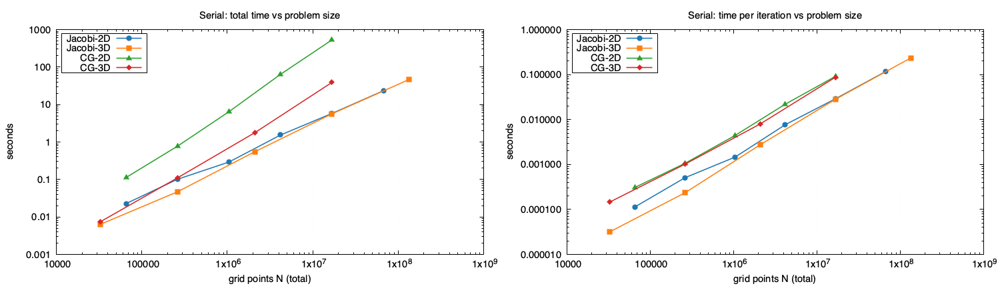{width=100%}

The time per iteration grows linearly with the number of grid points $N$, with fitted log-log slopes of 1.00 (Jacobi 2D), 1.09 (Jacobi 3D), 1.04 (CG 2D) and 1.02 (CG 3D). Total CG time grows with slopes of 1.54 in 2D and 1.37 in 3D, close to the predicted $1 + 1/d$ of 1.50 and 1.33, because the iteration count doubles with $n$: 366, 731, 1458, 2909 and 5809 iterations for $n = 256$ to $4096$ in 2D. The 3D Jacobi slope is above 1 because the two smallest grids ($32^3$ and $64^3$) fit in cache. They run at 1.0 to 1.1 billion updates per second, about twice the rate of the large grids.

| case | n | points | iters | t_total | t_per_iter_ms | Mupdates_per_s |
|---|---|---|---|---|---|---|
| Jacobi 2D | 256 | 65536 | 200 | 0.023 | 0.114 | 575.3 |
| Jacobi 2D | 512 | 262144 | 200 | 0.102 | 0.509 | 514.9 |
| Jacobi 2D | 1024 | 1048576 | 200 | 0.293 | 1.466 | 715.2 |
| Jacobi 2D | 2048 | 4194304 | 200 | 1.539 | 7.697 | 544.9 |
| Jacobi 2D | 4096 | 16777216 | 200 | 5.799 | 28.997 | 578.6 |
| Jacobi 2D | 8192 | 67108864 | 200 | 23.389 | 116.946 | 573.8 |
| Jacobi 3D | 32 | 32768 | 200 | 0.006 | 0.032 | 1028.2 |
| Jacobi 3D | 64 | 262144 | 200 | 0.047 | 0.236 | 1112.5 |
| Jacobi 3D | 128 | 2097152 | 200 | 0.551 | 2.753 | 761.7 |
| Jacobi 3D | 256 | 16777216 | 200 | 5.654 | 28.269 | 593.5 |
| Jacobi 3D | 512 | 134217728 | 200 | 46.761 | 233.806 | 574.1 |
| CG 2D | 256 | 65536 | 366 | 0.113 | 0.309 | 211.8 |
| CG 2D | 512 | 262144 | 731 | 0.777 | 1.063 | 246.5 |
| CG 2D | 1024 | 1048576 | 1458 | 6.478 | 4.443 | 236.0 |
| CG 2D | 2048 | 4194304 | 2909 | 64.026 | 22.010 | 190.6 |
| CG 2D | 4096 | 16777216 | 5809 | 531.240 | 91.451 | 183.5 |
| CG 3D | 32 | 32768 | 51 | 0.007 | 0.146 | 223.7 |
| CG 3D | 64 | 262144 | 109 | 0.111 | 1.019 | 257.2 |
| CG 3D | 128 | 2097152 | 222 | 1.773 | 7.986 | 262.6 |
| CG 3D | 256 | 16777216 | 446 | 39.000 | 87.445 | 191.9 |

Table: Table 7. Serial runtime on one Vanda core. Jacobi runs a fixed 200 sweeps, so its total time grows like $N$. CG runs to a tolerance and its iteration count grows like $n$, so its total time grows like $N^{1+1/d}$.

On grids that do not fit in cache, one Vanda core does about 0.57 billion Jacobi updates per second, roughly 14 GB/s of memory traffic at 24 bytes per update, and 0.18 to 0.26 billion CG point-iterations per second. Per core that is three to four times slower than the laptop (1.6 to 2.3 billion and 0.41 billion), whose performance cores have unusually high single-core memory bandwidth. Both solvers are memory-bound on both machines: the floating-point units spend most of their time waiting for data. The parallel speedup inside a node is therefore limited by how many cores it takes to use up the node's memory bandwidth, which Section 6.1 measures.

# MPI performance

All measurements in this section were made on Vanda with one MPI rank per core, up to 256 ranks on four nodes. The strong-scaling problems have 8 to 19 times as many points as the laptop's, so that each of the 256 ranks still owns between 65 536 and 524 288 points. Speedup and efficiency follow the definitions of lecture 7 [1].

## Strong scaling

Strong scaling holds the problem fixed and adds ranks. The four problems are Jacobi 2D on $8192^2$ points (200 sweeps), Jacobi 3D on $512^3$ (200 sweeps), CG 2D on $4096^2$ (to $10^{-8}$, 5809 iterations) and CG 3D on $256^3$ (to $10^{-8}$, 446 iterations). Speedup is measured against the separate serial executable. The MPI code on one rank is within 4% of it, as the first line of each block of Table 8 shows.

{width=100%}

| case | n | cores | dims | iters | t_total | speedup | efficiency | t_compute_max | imbalance | t_halo_max | t_allreduce_max | comm_frac |
|---|---|---|---|---|---|---|---|---|---|---|---|---|
| Jacobi 2D | 8192 | 1 | 1x1x1 | 200 | 23.510 | 0.99 | 0.99 | 23.510 | 1.00 | 0.000 | 0.000 | 0.0% |
| Jacobi 2D | 8192 | 2 | 2x1x1 | 200 | 12.183 | 1.92 | 0.96 | 12.155 | 1.01 | 0.296 | 0.566 | 7.1% |
| Jacobi 2D | 8192 | 4 | 2x2x1 | 200 | 6.350 | 3.68 | 0.92 | 6.333 | 1.02 | 0.260 | 0.121 | 6.0% |
| Jacobi 2D | 8192 | 8 | 4x2x1 | 200 | 4.040 | 5.79 | 0.72 | 4.013 | 1.02 | 0.151 | 0.092 | 6.0% |
| Jacobi 2D | 8192 | 16 | 4x4x1 | 200 | 3.043 | 7.69 | 0.48 | 3.027 | 1.02 | 0.137 | 0.058 | 6.4% |
| Jacobi 2D | 8192 | 32 | 8x4x1 | 200 | 2.514 | 9.30 | 0.29 | 2.500 | 1.02 | 0.083 | 0.025 | 4.3% |
| Jacobi 2D | 8192 | 64 | 8x8x1 | 200 | 1.381 | 16.94 | 0.26 | 1.366 | 1.27 | 0.703 | 0.014 | 51.9% |
| Jacobi 2D | 8192 | 128 | 16x8x1 | 200 | 0.678 | 34.50 | 0.27 | 0.661 | 1.28 | 0.344 | 0.010 | 52.2% |
| Jacobi 2D | 8192 | 256 | 16x16x1 | 200 | 0.317 | 73.89 | 0.29 | 0.306 | 1.26 | 0.165 | 0.010 | 55.4% |
| Jacobi 3D | 512 | 1 | 1x1x1 | 200 | 48.731 | 0.96 | 0.96 | 48.730 | 1.00 | 0.000 | 0.000 | 0.0% |
| Jacobi 3D | 512 | 2 | 2x1x1 | 200 | 26.735 | 1.75 | 0.87 | 24.871 | 1.01 | 2.219 | 0.297 | 9.4% |
| Jacobi 3D | 512 | 4 | 2x2x1 | 200 | 13.459 | 3.47 | 0.87 | 11.944 | 1.02 | 1.918 | 0.255 | 16.1% |
| Jacobi 3D | 512 | 8 | 2x2x2 | 200 | 7.597 | 6.15 | 0.77 | 7.058 | 1.02 | 0.795 | 0.180 | 12.8% |
| Jacobi 3D | 512 | 16 | 4x2x2 | 200 | 5.283 | 8.84 | 0.55 | 4.503 | 1.02 | 1.009 | 0.123 | 21.4% |
| Jacobi 3D | 512 | 32 | 4x4x2 | 200 | 4.140 | 11.29 | 0.35 | 3.757 | 1.02 | 0.589 | 0.059 | 15.7% |
| Jacobi 3D | 512 | 64 | 4x4x4 | 200 | 2.277 | 20.52 | 0.32 | 2.080 | 1.27 | 1.312 | 0.065 | 60.5% |
| Jacobi 3D | 512 | 128 | 8x4x4 | 200 | 1.249 | 37.42 | 0.29 | 1.048 | 1.36 | 0.770 | 0.024 | 63.6% |
| Jacobi 3D | 512 | 256 | 8x8x4 | 200 | 0.610 | 76.62 | 0.30 | 0.490 | 1.28 | 0.413 | 0.021 | 71.1% |
| CG 2D | 4096 | 1 | 1x1x1 | 5809 | 545.111 | 0.97 | 0.97 | 544.869 | 1.00 | 0.009 | 0.007 | 0.0% |
| CG 2D | 4096 | 2 | 2x1x1 | 5809 | 278.277 | 1.91 | 0.95 | 277.189 | 1.01 | 0.926 | 3.638 | 1.6% |
| CG 2D | 4096 | 4 | 2x2x1 | 5809 | 149.837 | 3.54 | 0.89 | 148.905 | 1.01 | 0.565 | 2.314 | 1.9% |
| CG 2D | 4096 | 8 | 4x2x1 | 5809 | 94.081 | 5.64 | 0.71 | 93.084 | 1.01 | 0.606 | 2.554 | 3.4% |
| CG 2D | 4096 | 16 | 4x4x1 | 5809 | 64.390 | 8.25 | 0.52 | 63.804 | 1.01 | 0.392 | 1.570 | 3.0% |
| CG 2D | 4096 | 32 | 8x4x1 | 5809 | 53.561 | 9.91 | 0.31 | 53.133 | 1.01 | 0.595 | 1.084 | 3.1% |
| CG 2D | 4096 | 64 | 8x8x1 | 5809 | 26.739 | 19.86 | 0.31 | 26.367 | 1.13 | 0.975 | 6.870 | 29.3% |
| CG 2D | 4096 | 128 | 16x8x1 | 5809 | 9.755 | 54.43 | 0.43 | 7.969 | 1.16 | 0.626 | 3.868 | 46.1% |
| CG 2D | 4096 | 256 | 16x16x1 | 5809 | 3.869 | 137.25 | 0.54 | 2.687 | 1.54 | 0.655 | 2.274 | 75.7% |
| CG 3D | 256 | 1 | 1x1x1 | 446 | 40.232 | 0.97 | 0.97 | 40.146 | 1.00 | 0.001 | 0.001 | 0.0% |
| CG 3D | 256 | 2 | 2x1x1 | 446 | 20.552 | 1.90 | 0.95 | 20.075 | 1.01 | 0.428 | 0.272 | 3.4% |
| CG 3D | 256 | 4 | 2x2x1 | 446 | 11.249 | 3.47 | 0.87 | 10.919 | 1.01 | 0.296 | 0.185 | 4.3% |
| CG 3D | 256 | 8 | 2x2x2 | 446 | 6.924 | 5.63 | 0.70 | 6.714 | 1.01 | 0.168 | 0.141 | 4.5% |
| CG 3D | 256 | 16 | 4x2x2 | 446 | 4.890 | 7.98 | 0.50 | 4.627 | 1.01 | 0.249 | 0.145 | 8.1% |
| CG 3D | 256 | 32 | 4x4x2 | 446 | 4.062 | 9.60 | 0.30 | 3.840 | 1.01 | 0.180 | 0.156 | 8.3% |
| CG 3D | 256 | 64 | 4x4x4 | 446 | 1.956 | 19.94 | 0.31 | 1.825 | 1.12 | 0.151 | 0.521 | 34.4% |
| CG 3D | 256 | 128 | 8x4x4 | 446 | 0.662 | 58.90 | 0.46 | 0.464 | 1.14 | 0.113 | 0.282 | 59.6% |
| CG 3D | 256 | 256 | 8x8x4 | 446 | 0.380 | 102.50 | 0.40 | 0.224 | 1.76 | 0.100 | 0.252 | 92.5% |

Table: Table 8. Strong scaling on Vanda. `imbalance` is the slowest rank's compute time divided by the mean over ranks; 1.0 means perfectly balanced work. `comm_frac` is the share of the wall time spent in the halo exchange and the all-reduce, taking the maximum over ranks.

Figure 2 has three regimes, and each matches a piece of hardware.

**Within one socket (1 to 32 ranks).** Efficiency falls steadily, from 0.87 to 0.96 at 2 ranks to 0.29 to 0.35 at 32. Communication is not the cause: it stays under 10% of the time for the 2D problems and at 13 to 21% for Jacobi 3D. The compute time itself stops falling in proportion to the rank count. `--map-by core` fills one socket's cores before moving to the next, so up to 32 ranks share one socket's memory controllers. Jacobi 2D reaches:

| ranks | billion updates per second |
|---|---|
| 8 | 3.3 |
| 16 | 4.4 |
| 32 | 5.4 |

At 24 bytes per update, 5.4 billion updates per second is about 130 GB/s, and our 2D kernel moves more than that per update (Section 3.1). The last 16 ranks added only 21%, so this is close to what one socket delivers. The laptop hit the same ceiling at 8 ranks; Vanda reaches it with more, slower cores.

**The second socket (64 ranks).** Going to 64 ranks brings in the second socket. The speedup nearly doubles (9.3 to 16.9 for Jacobi 2D, 9.9 to 19.9 for CG 2D) because the available memory bandwidth doubles. Two columns of Table 8 also jump, although all 64 ranks are still on one node and no message crosses a network. The imbalance rises from 1.01–1.02 to 1.12–1.27, and the communication share from 3–21% to 29–61%. Some ranks now finish each sweep later than others, and the rest wait for them in the next halo exchange, which the timers book as halo time (Section 6.3).

The jump appears exactly when the second socket comes into use, and the check in Section 5.1 shows why the two sockets are not equal. PBS gives a 64-core job 36 cores on one socket and 28 on the other, so 36 ranks share the first socket's memory bandwidth and 28 share the second's. Each rank on the fuller socket gets $36/28 = 1.29$ times less bandwidth than a rank on the other. That explains which ranks are slow, but not the whole size of the effect. If each socket's bandwidth were shared equally among its ranks, the slowest-to-mean ratio would be about 1.11, below the measured 1.27. We have not found the rest of the cause.

**Across nodes (128 and 256 ranks).** Each new node brings two more sockets of bandwidth, and the speedup roughly doubles with every doubling of nodes:

| problem | 64 ranks | 128 ranks | 256 ranks | efficiency, 64 to 256 ranks |
|---|---|---|---|---|
| Jacobi 2D | 16.9 | 34.5 | 73.9 | 1.09 |
| Jacobi 3D | 20.5 | 37.4 | 76.6 | 0.93 |
| CG 2D | 19.9 | 54.4 | 137.2 | 1.73 |
| CG 3D | 19.9 | 58.9 | 102.5 | 1.29 |

The last column compares each 256-rank run with the 64-rank run. CG does better than linear: the compute time of CG 2D falls by 3.3 times from 64 to 128 ranks, for twice the ranks. The likely cause is cache. CG streams about six arrays, 805 MB in all for the $4096^2$ grid, so each rank's share shrinks from 12.6 MB at 64 ranks to 3.1 MB at 256, small enough for much of it to stay in cache between the passes of one iteration. Jacobi's three arrays of the larger $8192^2$ grid still leave 6.3 MB per rank at 256 ranks, and Jacobi gains less. We did not measure cache misses, and the 64-, 128- and 256-rank runs used different nodes, so this is our best explanation rather than a proven one.

**The final speedups at 256 cores** are 74 (Jacobi 2D), 77 (Jacobi 3D), 137 (CG 2D) and 103 (CG 3D), efficiencies of 0.29 to 0.54. That looks poor, but almost all of the loss happens inside the first node, where 64 cores share the bandwidth of two sockets. Measured against one full node, the four-node runs are 93 to 173% efficient. For a memory-bound stencil on this cluster, the fair unit of strong scaling is the node, not the core.

**How firm these numbers are.** The 1 to 64, 128 and 256 rank runs used different nodes, and we checked the processor of only one CPU node (Section 5.1). The speedups use the faster of two repeats. With the slower repeat, the 256-rank speedups would be 68 (Jacobi 2D), 72 (Jacobi 3D), 99 (CG 2D) and 102 (CG 3D). CG 2D varied most: 3.87 against 5.38 s, with the all-reduce time rising from 2.27 to 3.49 s, probably because of other jobs' traffic on the network.

**Amdahl's law.** Amdahl's law [2] (lecture 7 [1]) says that if a fraction $s$ of a program is serial, the speedup on $p$ cores is $1/(s + (1-s)/p)$, so it can never exceed $1/s$. Inverting the law gives the serial fraction that a measured speedup implies, $s = (1/S - 1/p)/(1 - 1/p)$. Table 9 shows it for our runs.

| problem | 8 cores | 32 cores | 64 cores | 256 cores |
|---|---|---|---|---|
| Jacobi 2D | 5.5% | 7.9% | 4.4% | 0.97% |
| Jacobi 3D | 4.3% | 5.9% | 3.4% | 0.92% |
| CG 2D | 6.0% | 7.2% | 3.5% | 0.34% |
| CG 3D | 6.0% | 7.5% | 3.5% | 0.59% |

Table: Table 9. Serial fraction implied by each measured speedup under Amdahl's law.

If our losses came from a serial part of the code, this fraction would stay constant. Instead it rises to 6–8% at 32 cores and then falls to under 1% at 256. A serial fraction of 7.9% would cap Jacobi 2D at a speedup of 12.7, yet it reached 74. The timed loop has no serial part: every loop is split across ranks, and the setup is outside the timer. What limits us inside a node is memory bandwidth per socket, which is shared, not a serial fraction. Amdahl's law still gives the right warning for the all-reduce, which every rank must wait for. That term grows with $p$ and limits CG at 256 cores (Section 6.3).

## Weak scaling

Weak scaling grows the grid with the rank count so that every rank always owns the same block: $1024^2$ points per rank for Jacobi 2D, $64^3$ for Jacobi 3D, $512^2$ for CG 2D and $48^3$ for CG 3D. CG runs a fixed 300 iterations here, because an iteration count set by a tolerance would grow with the global grid and mix two effects. Ideal weak scaling is a flat line. Figure 3 shows the results, and Table S2 lists every run.

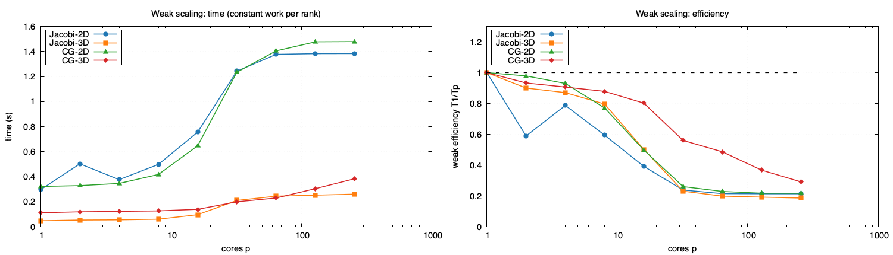{width=100%}

The weak efficiency falls to about 0.2 by 32 to 64 ranks and then stays flat up to 256 (Figure 3):

| problem | 64 ranks | 128 ranks | 256 ranks |
|---|---|---|---|
| Jacobi 2D | 1.377 s | 1.382 s | 1.383 s |
| Jacobi 3D | 0.245 s | 0.253 s | 0.261 s |
| CG 2D | 1.405 s | 1.477 s | 1.479 s |

From one node to four, the weak efficiency is therefore 0.94 to 1.00 for these three problems. All of the loss is inside a node, for the bandwidth reason of Section 6.1. A single rank has a socket's memory controllers to itself, while 64 ranks share two sockets, so a Jacobi 2D rank takes 4.6 times as long for the same work. The laptop version of this report predicted this: ranks on different nodes bring their own bandwidth, so across nodes the weak-scaling curve depends on communication alone.

Only CG 3D drifts: 0.231, 0.305 and 0.385 s at 64, 128 and 256 ranks, an efficiency of 0.60 from one node to four. Its $48^3$ blocks are the smallest in the study, at 110 592 points per rank. Each iteration computes for about 0.4 ms, against six face messages and two all-reduces that each cost roughly 0.1 ms over TCP (Section 6.3). Its imbalance rises to 1.42 at 256 ranks.

**Gustafson's law.** Gustafson's law [3] (lecture 7 [1]) describes this kind of experiment. If the serial part stays fixed while the parallel work grows with $p$, the scaled speedup is $s + (1-s)p$, nearly linear in $p$. Our scaled speedup is $p\,T_1/T_p$. Counted in cores, it reaches 55 (Jacobi 2D), 48 (Jacobi 3D), 56 (CG 2D) and 75 (CG 3D) at 256 cores, well below 256, because a core's share of the bandwidth shrinks as a node fills up. Counted in nodes, with the 64-rank run as the unit, it is 3.98, 3.75 and 3.80 out of 4 for the first three problems and 2.40 for CG 3D. Across nodes the first three behave as Gustafson predicts. CG 3D does not. Its all-reduces act like a serial part, and their cost grows with the number of nodes instead of staying fixed.

## The impact of communication

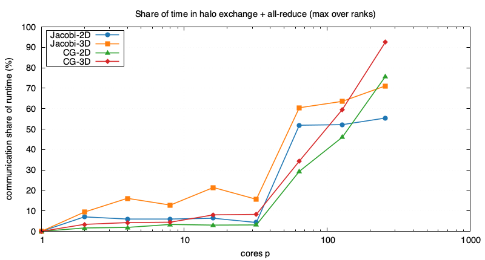{width=70%}

Figure 4 plots the communication share of the strong-scaling runs. It is under 10% for the 2D problems and 13 to 21% for Jacobi 3D from 1 to 32 ranks, jumps to 29 to 61% at 64 ranks, and reaches 55% (Jacobi 2D), 71% (Jacobi 3D), 76% (CG 2D) and 93% (CG 3D) at 256 ranks. The timers record the maximum over ranks, which includes waiting. The CSV files also record the mean over ranks, and comparing the two separates waiting from transfer.

**On one node, most of the "communication" is waiting.** At 64 ranks the slowest rank spends 0.70 s in Jacobi 2D's halo exchange, while the mean over ranks is 0.30 s. The gap between the slowest and the mean compute time (1.37 against 1.08 s) is a matching 0.29 s. The ranks that finish each sweep early wait in the exchange for the others.

**Across four nodes, the all-reduce is a real cost.** At 256 ranks CG 2D spends a mean of 1.97 s in its 11 618 all-reduces. About 0.94 s of that is waiting for the slowest compute, which is the gap between the maximum and the mean compute time. The remaining 1 s works out to about 90 microseconds per all-reduce across four nodes over TCP. CG 3D gives a similar figure: a mean of 0.20 s for 892 all-reduces, of which 0.10 s is waiting, or about 110 microseconds each. On the laptop's shared memory an all-reduce over 12 ranks cost 24 microseconds.

This is the term that limits CG at 256 ranks. In CG 3D the all-reduce takes 0.25 s of 0.38 s. The halo exchange, by contrast, stays cheap across nodes: Jacobi 2D's mean halo time falls from 0.30 s on one node at 64 ranks to 0.07 s at 256, although the messages now cross the network.

## Halo exchange strategies

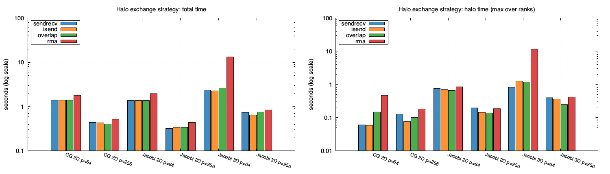{width=100%}

| case | cores | exchange | t_total | t_compute_max | t_halo_max | t_allreduce_max | vs_isend |
|---|---|---|---|---|---|---|---|
| CG 2D | 64 | isend | 1.401 | 1.359 | 0.059 | 0.378 | 1.00 |
| CG 2D | 64 | overlap | 1.404 | 1.356 | 0.152 | 0.380 | 1.00 |
| CG 2D | 64 | rma | 1.813 | 1.366 | 0.478 | 0.336 | 1.29 |
| CG 2D | 64 | sendrecv | 1.407 | 1.364 | 0.061 | 0.385 | 1.00 |
| CG 2D | 256 | isend | 0.430 | 0.217 | 0.077 | 0.338 | 1.00 |
| CG 2D | 256 | overlap | 0.405 | 0.217 | 0.100 | 0.301 | 0.94 |
| CG 2D | 256 | rma | 0.525 | 0.248 | 0.184 | 0.186 | 1.22 |
| CG 2D | 256 | sendrecv | 0.439 | 0.210 | 0.129 | 0.303 | 1.02 |
| Jacobi 2D | 64 | isend | 1.376 | 1.365 | 0.703 | 0.017 | 1.00 |
| Jacobi 2D | 64 | overlap | 1.367 | 1.355 | 0.665 | 0.018 | 0.99 |
| Jacobi 2D | 64 | rma | 1.951 | 1.369 | 0.855 | 0.051 | 1.42 |
| Jacobi 2D | 64 | sendrecv | 1.380 | 1.366 | 0.756 | 0.014 | 1.00 |
| Jacobi 2D | 256 | isend | 0.344 | 0.332 | 0.146 | 0.012 | 1.00 |
| Jacobi 2D | 256 | overlap | 0.344 | 0.327 | 0.136 | 0.013 | 1.00 |
| Jacobi 2D | 256 | rma | 0.437 | 0.340 | 0.185 | 0.017 | 1.27 |
| Jacobi 2D | 256 | sendrecv | 0.322 | 0.309 | 0.197 | 0.014 | 0.94 |
| Jacobi 3D | 64 | isend | 2.283 | 2.103 | 1.274 | 0.036 | 1.00 |
| Jacobi 3D | 64 | overlap | 2.610 | 2.464 | 1.201 | 0.037 | 1.14 |
| Jacobi 3D | 64 | rma | 13.184 | 2.205 | 11.589 | 0.037 | 5.77 |
| Jacobi 3D | 64 | sendrecv | 2.350 | 2.091 | 0.823 | 0.038 | 1.03 |
| Jacobi 3D | 256 | isend | 0.646 | 0.521 | 0.368 | 0.022 | 1.00 |
| Jacobi 3D | 256 | overlap | 0.756 | 0.639 | 0.249 | 0.021 | 1.17 |
| Jacobi 3D | 256 | rma | 0.842 | 0.557 | 0.422 | 0.031 | 1.30 |
| Jacobi 3D | 256 | sendrecv | 0.750 | 0.518 | 0.405 | 0.029 | 1.16 |

Table: Table 10. The four exchange strategies on 64 and 256 ranks. `vs_isend` is the time divided by the `isend` time.

In Table 10, `sendrecv`, `isend` and `overlap` are within 6% of each other in every case except Jacobi 3D, where `overlap` is 14% (64 ranks) and 17% (256 ranks) slower than `isend`. The reason is the one we found on the laptop. The boundary slabs that overlap updates last include strided planes, and in 3D those are a large share of the block.

Overlap pays off in only one case: CG 2D on 256 ranks, at 0.94 of the baseline. That is the one case with network latency to hide and a large interior to hide it behind. The laptop's large penalty for blocking exchange at 16 ranks did not reappear. With identical cores no rank is consistently late, so a blocking `MPI_Sendrecv` loses little. It was even the fastest for Jacobi 2D on 256 ranks, at 0.94 of the baseline.

One-sided `rma` is the slowest everywhere, at 1.22 to 1.42 times the baseline. The one large outlier is Jacobi 3D on one node, at 5.8 times (13.2 s, of which 11.6 s is halo time). The laptop showed the same pattern more strongly (2.5 to 7 times, with a 29 s outlier for Jacobi 3D). With TCP as the transport, Open MPI has no hardware RMA to use: each `MPI_Put` travels as ordinary messages, and each `MPI_Win_fence` synchronises all ranks, twice per sweep. The question the laptop left open, whether one-sided communication pays off on a real interconnect, therefore has only a partial answer: over TCP it does not. Settling it would need a cluster where MPI can use RDMA.

## Shape of the process grid

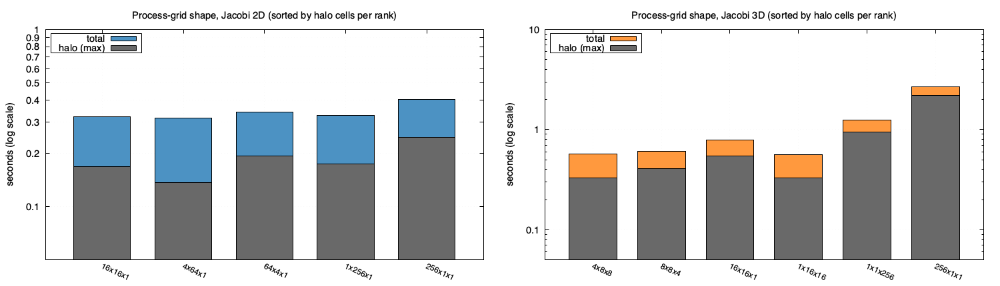{width=100%}

| case | cores | dims | halo_cells_per_rank | t_total | t_compute_max | t_halo_max |
|---|---|---|---|---|---|---|
| Jacobi 2D | 64 | 8x8x1 | 4096 | 1.376 | 1.364 | 0.701 |
| Jacobi 2D | 64 | 16x4x1 | 5120 | 1.393 | 1.377 | 0.695 |
| Jacobi 2D | 64 | 4x16x1 | 5120 | 1.362 | 1.352 | 0.689 |
| Jacobi 2D | 64 | 1x64x1 | 16384 | 1.347 | 1.332 | 0.534 |
| Jacobi 2D | 64 | 64x1x1 | 16384 | 1.513 | 1.439 | 0.744 |
| Jacobi 2D | 256 | 16x16x1 | 2048 | 0.321 | 0.309 | 0.168 |
| Jacobi 2D | 256 | 4x64x1 | 4352 | 0.316 | 0.300 | 0.137 |
| Jacobi 2D | 256 | 64x4x1 | 4352 | 0.341 | 0.319 | 0.193 |
| Jacobi 2D | 256 | 1x256x1 | 16384 | 0.329 | 0.299 | 0.173 |
| Jacobi 2D | 256 | 256x1x1 | 16384 | 0.405 | 0.335 | 0.247 |
| Jacobi 3D | 64 | 4x4x4 | 98304 | 2.283 | 2.103 | 1.274 |
| Jacobi 3D | 64 | 1x8x8 | 131072 | 2.119 | 2.002 | 1.026 |
| Jacobi 3D | 64 | 8x8x1 | 131072 | 2.560 | 2.116 | 1.529 |
| Jacobi 3D | 64 | 1x1x64 | 524288 | 3.181 | 2.751 | 1.699 |
| Jacobi 3D | 64 | 64x1x1 | 524288 | 6.169 | 1.920 | 4.778 |
| Jacobi 3D | 256 | 4x8x8 | 40960 | 0.570 | 0.492 | 0.329 |
| Jacobi 3D | 256 | 8x8x4 | 40960 | 0.612 | 0.508 | 0.407 |
| Jacobi 3D | 256 | 16x16x1 | 65536 | 0.791 | 0.547 | 0.549 |
| Jacobi 3D | 256 | 1x16x16 | 65536 | 0.566 | 0.474 | 0.329 |
| Jacobi 3D | 256 | 1x1x256 | 524288 | 1.247 | 0.581 | 0.952 |
| Jacobi 3D | 256 | 256x1x1 | 524288 | 2.688 | 0.795 | 2.198 |

Table: Table 11. Every process-grid shape tried on 64 and 256 ranks. `halo_cells_per_rank` is the number of values a rank sends per sweep, the surface area that the textbook argument minimises.

In Table 11, the 3D shapes on 256 ranks span a factor of 4.7, from 0.566 s for $1 \times 16 \times 16$ to 2.688 s for $256 \times 1 \times 1$. Two things separate them: the volume each rank sends, and whether its faces are contiguous in memory.

**The best shapes leave $x$ uncut or nearly so.** The two fastest are $1 \times 16 \times 16$ (0.566 s) and $4 \times 8 \times 8$ (0.570 s). $4 \times 8 \times 8$ is also the block shape with the fewest halo cells. The default $8 \times 8 \times 4$ chosen by `MPI_Dims_create` sends the same number of values but cuts the contiguous $x$ direction twice as often, and is 7% slower.

**The slabs show both effects at once.** The $z$-slabs $1 \times 1 \times 256$ have contiguous planes as faces, and that shape was the fastest on the laptop. But each rank sends 524 288 values per sweep, nearly thirteen times the volume of the best block shapes. Over the network that volume costs: 1.247 s, 2.2 times the best. The $x$-slabs $256 \times 1 \times 1$ send the same volume as single doubles gathered with a stride, and are slower by a further factor of 2.2. On 64 ranks the pattern is the same: $1 \times 8 \times 8$ is fastest at 2.12 s and $64 \times 1 \times 1$ slowest at 6.17 s.

**In 2D the order is the same.** The shapes are within 28% of each other on 256 ranks. Cutting mostly $y$ ($4 \times 64$, 0.316 s, the fastest) or only $y$ ($1 \times 256$, contiguous rows) beats cutting only $x$ ($256 \times 1$, 0.405 s).

Both lessons from the laptop hold on the cluster. The number of separate memory locations touched to pack a face matters as much as its size in bytes. And on a network the volume argument gains weight, which is why the slab shapes fell behind the blocks.

## Residual check interval

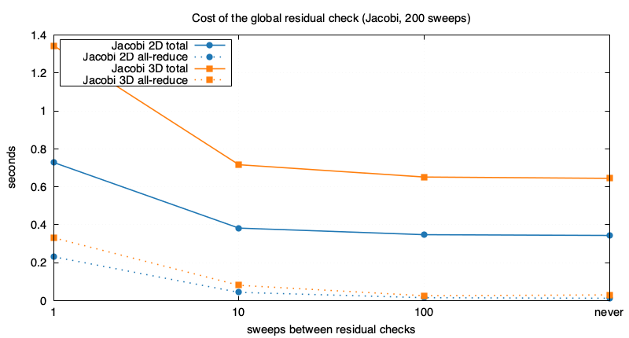{width=70%}

Each residual check costs about as much as one sweep (Table S3). On 256 ranks, Jacobi 2D takes:

| check | time | extra cost |
|---|---|---|
| never | 0.344 s | baseline |
| every 100 sweeps | 0.348 s | +1% |
| every 10 sweeps | 0.383 s | +11% |
| every sweep | 0.728 s | +112% (2.1 times) |

The 3D problem and the 64-rank runs give the same proportions: +1%, +10 to +11%, and +101 to +112%. The cost is linear in the number of checks. A check is an extra halo exchange, a residual sweep that streams the block again, and an all-reduce, which together cost about one more sweep. On the laptop a check every 10 sweeps was lost in the noise; on Vanda it costs a measurable 10%. For long runs a check every 100 sweeps is the better default: it costs 1% and overshoots convergence by at most 100 sweeps.

## Four whole nodes or eight half nodes

The 256-rank jobs waited more than a day in the queue, because PBS had to find four nodes with 64 free cores each. As a fallback we submitted the same jobs with 32 ranks on each of 8 nodes, which PBS can place on partly used nodes, and kept the original jobs queued. Both versions ran, so the 256-rank experiments exist in two layouts. Figure 8 and Table 12 compare them.

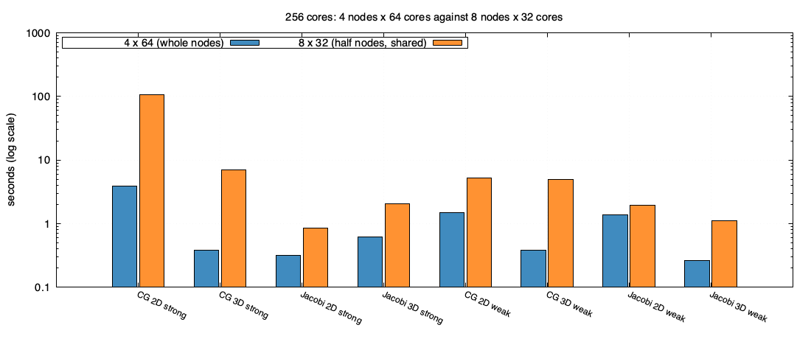{width=100%}

| file | case | ranks x threads | variant | t_main | t_alt | ratio | comm_main | comm_alt |
|---|---|---|---|---|---|---|---|---|
| strong | CG 2D | 256x1 |  | 3.869 | 107.738 | 27.85 | 75.7% | 114.0% |
| strong | CG 3D | 256x1 |  | 0.380 | 7.067 | 18.58 | 92.5% | 118.7% |
| strong | Jacobi 2D | 256x1 |  | 0.317 | 0.861 | 2.72 | 55.4% | 95.7% |
| strong | Jacobi 3D | 256x1 |  | 0.610 | 2.058 | 3.37 | 71.1% | 96.0% |
| weak | CG 2D | 256x1 |  | 1.479 | 5.242 | 3.54 | 37.6% | 96.5% |
| weak | CG 3D | 256x1 |  | 0.385 | 4.958 | 12.89 | 72.0% | 122.8% |
| weak | Jacobi 2D | 256x1 |  | 1.383 | 1.919 | 1.39 | 57.8% | 75.6% |
| weak | Jacobi 3D | 256x1 |  | 0.261 | 1.105 | 4.23 | 66.2% | 97.7% |

Table: Table 12. The same 256-rank runs in the two layouts. `ratio` is the 8-node time divided by the 4-node time; `comm_main` and `comm_alt` are the communication shares in the two layouts. Shares above 100% are explained in Section 8.3.

On 8 nodes of 32 cores every experiment was slower. The geometric mean of the time ratio, by experiment:

| experiment | slowdown on 8 half nodes |
|---|---|
| strong scaling | 8.3 |
| exchange strategies | 6.1 |
| weak scaling | 4.0 |
| satellite runs | 3.6 |
| check interval | 3.2 |
| process-grid shapes | 2.5 |
| hybrid splits | 1.4 |

CG suffered most: 28 times slower for CG 2D strong scaling (107.7 s against 3.9 s) and 19 times for CG 3D. Jacobi was 2.7 to 3.4 times slower. Several things differ between the layouts, and the measurements cannot separate them:

- **More traffic crosses the network.** Twice as many ranks sit at a node boundary, so more halo messages and more steps of every all-reduce leave the node.
- **The nodes were shared.** Each node held only our 32 ranks, so other users' jobs could run on the rest of it and share its memory, network adapter and network links. We could not see how PBS placed our ranks on the sockets.
- **The repeats were noisy.** Over all 8-node runs, the two repeats of a configuration differed by a median of 11% (37% in the hybrid runs), against 0.2% on one whole node, and by up to a factor of 4.3.
- **The hybrid job ran on different hardware.** Six of the eight nodes of the 8-node MPI+OpenMP job were A40 GPU nodes (GN-A40-079, -080, -082, -084, -085 and -086), not CPU nodes. Its slowdown of 1.4 therefore compares different node types as well as different layouts.

CG is hit hardest because each of its thousands of all-reduces waits for the slowest of 256 ranks, so any rank slowed by a neighbouring job stalls all the others. For a bulk-synchronous solver a whole node is worth waiting for, and a timing taken on shared nodes measures the neighbours as much as the code. Every other result in this report uses the 4-node layout.

# MPI+X performance

## OpenMP threads alone

Our Vanda jobs did not include an OpenMP-only sweep, so this subsection reports the laptop measurement (Figure 9 and Table S4). The closest Vanda point is the $1 \times 64$ split of Section 7.2, one rank with 64 threads on one node.

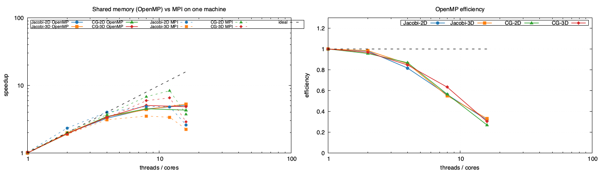{width=100%}

On 16 threads, the OpenMP build of the serial driver (`poisson_omp`) reaches speedups of 5.1 (Jacobi 2D), 5.3 (Jacobi 3D), 4.3 (CG 2D) and 4.8 (CG 3D). Its efficiency is:

| threads | efficiency |
|---|---|
| 2 | 0.96 to 0.98 |
| 4 | 0.82 to 0.87 |
| 8 | 0.55 to 0.63 |
| 16 | about 0.3 |

Up to 8 threads, OpenMP and MPI track each other closely on the laptop, as expected, since both are limited by the same memory bandwidth. At 16 threads OpenMP degrades more gracefully than MPI (5.1 against 2.6 for Jacobi 2D). A static schedule gives the slow efficiency cores the same share of rows, but a late thread delays only the barrier at the end of each loop, whereas a slow MPI rank delays every neighbour at every message.

The 1-thread OpenMP time is 20% slower than the serial binary (0.645 s against 0.529 s), because the `collapse(2)` loops lose some vectorisation and add scheduling overhead. That is the fixed price of the hybrid build.

## Dividing the cores between ranks and threads

The hybrid jobs keep ranks × threads constant and vary the split, at 64 cores on one node and at 256 cores on four nodes of 64 cores (Figures 10 and 11, Tables S5 and S6). Ranks are placed with `--map-by ppr:R:node:pe=T`.

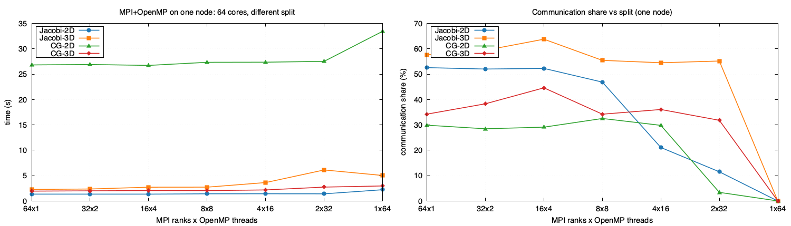{width=100%}

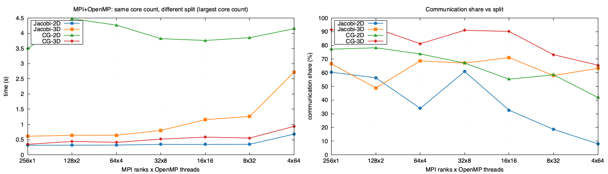{width=100%}

On Vanda the answer to the lecture 9 question differs from the laptop's: pure MPI is the fastest, or tied for fastest, in every case.

**On one node, 2D is a near tie.** The splits from $64 \times 1$ to $2 \times 32$ are within 5% of each other for Jacobi 2D (1.37 to 1.44 s) and within 3% for CG 2D (26.7 to 27.5 s). The nominal winner for both, $16 \times 4$, beats $64 \times 1$ by under 0.5%, which is noise.

**On one node, 3D favours pure MPI.** $64 \times 1$ is the fastest for both 3D problems, and the time rises steadily with the thread count. Jacobi 3D takes 2.28 s at $64 \times 1$, 2.73 s at $16 \times 4$ and 6.13 s at $2 \times 32$.

**On four nodes,** $256 \times 1$ is the fastest for all four problems. Jacobi 2D stays within 9% up to 32 threads per rank. CG 2D's spread of 3.5 to 4.5 s is within the variation between repeats of that problem at 256 ranks (Table 6).

Two effects make threads cost more here than on the laptop.

**Memory placement.** The arrays are `std::vector`s, filled with zeros by the master thread when they are created. Linux places each page on the socket of the thread that first writes it. A rank whose threads span both sockets therefore keeps all its memory on one socket, and half its threads read across the link between the sockets. The splits with one rank per node show it. $1 \times 64$ on one node takes 2.24 s for Jacobi 2D, close to the 2.50 s that 32 ranks on one socket need. $4 \times 64$ on four nodes takes 0.68 s, against 0.32 s for $256 \times 1$. Initialising each array inside the same OpenMP loops that later use it (first-touch placement) would remove this.

**The halo exchange of the 3D problem.** Only the master thread calls MPI (`MPI_THREAD_FUNNELED`), so the other threads wait while it packs and sends the faces. With fewer ranks the faces are larger, and `MPI_Dims_create` cuts the contiguous $x$ direction first, so the 3D faces are strided gathers. At 256 cores the halo time of Jacobi 3D rises from 0.39 s at $256 \times 1$ to 0.80 s at $16 \times 16$ and 1.71 s at $4 \times 64$.

What hybrid offers in principle, fewer and larger messages and fewer partners in each all-reduce, does show in the communication columns. CG 2D's all-reduce time falls from 1.91 s at $256 \times 1$ to 0.92 s at $4 \times 64$. But the computation is bandwidth-bound, and ranks on the same node already exchange through shared memory, so that saving is smaller than the cost of the threaded kernels. The laptop's best split, 8 ranks × 2 threads, won because of its slow efficiency cores, which held up every message from the ranks placed on them. Vanda's cores are all alike.

## MPI+CUDA

The GPU job compiled the CUDA driver with `nvcc` from CUDA 12.4 and ran it with one rank on one NVIDIA A40 on node GN-A40-003. For comparison, it ran the MPI+OpenMP build on the same node as one rank with 36 threads. Figure 12 and Table S7 give the results.

Every GPU run reproduces the CPU run's $L_2$ error to all four printed digits, and the satellite runs give the same hidden-pixel RMSE on the GPU and the CPU (0.1546 and 0.2318). The CUDA code, which we had checked only through the emulation layer during development, is therefore correct on real hardware.

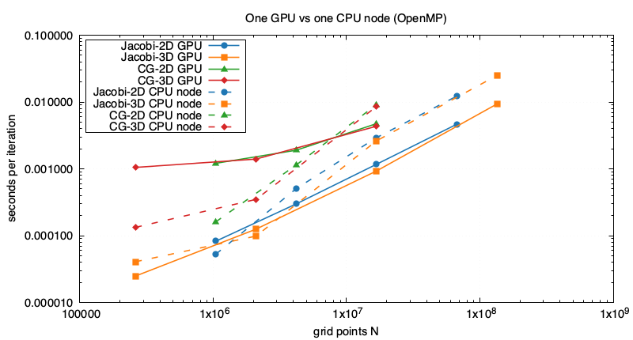{width=80%}

**Large grids: the GPU wins by 1.9 to 2.7 times** against 36 CPU cores:

| run | A40 | 36 CPU cores |
|---|---|---|
| Jacobi, $8192^2$, 200 sweeps | 0.93 s | 2.45 s |
| Jacobi, $512^3$ | 1.87 s | 4.99 s |
| CG, $4096^2$ | 27.6 s | 52.9 s |
| CG, $256^3$ | 1.94 s | 3.81 s |

The GPU's Jacobi kernel does 14 to 18 billion updates per second, about 350 to 430 GB/s at 24 bytes per update, which is half to two thirds of the A40's nominal 696 GB/s. The 2D kernel moves about 40 bytes per update (Section 3.1), which puts 2D Jacobi at about 580 GB/s, close to the card's limit. The CPU side does about 5.5 billion updates per second, close to the one-socket rate of Section 6.1. The GPU's advantage is below the 5 to 10 times predicted in the laptop version of this report, for two reasons. The A40 is a graphics-oriented card with GDDR6 memory rather than a data-centre GPU with HBM, and our 3D kernels use only part of its bandwidth.

**Against a full CPU node, the gap shrinks.** The 36 threads above use about half a node, and they run about as fast as the 32 MPI ranks of one socket in Table 8. A full node with 64 ranks is the fairer comparison. Table 13 uses the 64-rank runs of Table 8, which ran on a different node (CN-089), so the comparison is approximate.

| run | A40 GPU | 36 threads (half node) | 64 ranks (full node) | full node ÷ GPU |
|:---|---:|---:|---:|---:|
| Jacobi, $8192^2$, 200 sweeps | 0.93 s | 2.45 s | 1.38 s | 1.5 |
| Jacobi, $512^3$, 200 sweeps | 1.87 s | 4.99 s | 2.28 s | 1.2 |
| CG, $4096^2$ | 27.6 s | 52.9 s | 26.7 s | 0.97 |
| CG, $256^3$ | 1.94 s | 3.81 s | 1.96 s | 1.0 |

Table: Table 13. The GPU against half a node and against a full node. A ratio above 1 means the GPU is faster.

One A40 beats a full 64-core node by 1.5 times on 2D Jacobi and 1.2 times on 3D Jacobi, and ties with it on CG. The CG result points to the reduction cost below.

**Small grids: the CPU wins by up to 7.5 times.** The widest gap is CG on $1024^2$ (0.235 s against 1.77 s). Two effects add up. The CPU's working set fits in cache: on $128^3$ the 36 cores reach 21 billion Jacobi updates per second, more than any memory-bound rate. And every GPU CG iteration has a fixed cost of about 1 ms. It shows as a floor of 1.05 to 1.21 ms per iteration on the smallest CG grids and on the satellite day, while a Jacobi sweep on $1024^2$ takes 0.08 ms. The difference is the two dot products in each CG iteration. Each ends with about 262 000 `atomicAdd` operations on one address and a copy back to the host for the `MPI_Allreduce`. That is the atomic reduction described in Section 3.6. A block-level reduction in shared memory, as in lecture 10 [1], would cut the atomics by a factor of 256, and it is the first fix to make.

| case | impl | device | grid | iters | t_total | ms_per_iter | rmse_hidden |
|---|---|---|---|---|---|---|---|
| sst2d_cg | mpi_cuda | 1 GPU | 801x534 | 489 | 0.524 | 1.07 | 0.1546 |
| sst2d_cg | mpi_omp | 36 CPU cores | 801x534 | 489 | 0.071 | 0.15 | 0.1546 |
| sst3d_cg | mpi_cuda | 1 GPU | 801x534x365 | 199 | 6.916 | 34.75 | 0.2318 |
| sst3d_cg | mpi_omp | 36 CPU cores | 801x534x365 | 199 | 18.332 | 92.12 | 0.2318 |

Table: Table 14. The satellite problem on one GPU and on 36 CPU cores of the same node.

The satellite data (Table 14) show both regimes. The CPU fills the 2D day ($4.3 \times 10^5$ pixels) 7.3 times faster than the GPU (0.071 s against 0.524 s). The GPU fills the 3D year ($1.56 \times 10^8$ pixels) 2.7 times faster than the CPU (6.9 s against 18.3 s). Both use the same 199 iterations and reach the same error.

The two-GPU job (`gpu_multi.pbs`) needs both GPUs of one node to be free at once. It did not start before the deadline, so we report no multi-GPU or CUDA-aware measurements.

# Results on the satellite data

## The filled maps

Figure 13 shows 10 April 2025. In the observed map (top left) the Bay of Bengal is almost entirely under cloud, with a few clear streaks running south-west to north-east. The Arabian Sea is clear in the north-west and patchy in the south.

The 2D fill (top right) is complete and follows the data closely near every cloud edge. In the middle of the Bay of Bengal, where the nearest clear pixel is hundreds of kilometres away, it is a smooth blend of the edge temperatures (29 to 30 °C) with no structure at all.

The 3D fill (bottom left) is also complete, and it keeps fronts and eddies that the 2D fill erased. The filaments of the Arabian Sea eddy field continue under the cloud, and the Bay of Bengal shows the warmer western boundary and the cooler north-eastern corner that the neighbouring days saw.

The two fills (bottom right) differ by about 0.19 °C root-mean-square over the filled pixels of the day. They agree closely within a few pixels of any observation and differ by up to one degree in the middle of the largest holes, where the 2D fill has no information and the 3D fill carries over the days before and after.

{width=100%}

## Accuracy of the fill

Table S8 and Figure 14 give the error on hidden pixels.

**The fill works.** With 16-pixel patches (64 km squares) the 2D fill of the day is off by 0.15 °C root-mean-square and 0.11 °C on average, against 0.92 °C for filling with the mean temperature. Even the 250 km patches are filled to 0.38 °C. The error grows with the size of the hole, from 0.09 °C for single pixels to 0.13, 0.15 and 0.38 °C for patches of 4, 16 and 64 pixels, as expected for a method that only knows the edge of the hole.

**The third dimension does not help automatically.** On the same hidden pixels of the same day, the year-long 3D fill with equal space and time weights is worse than the 2D fill for every patch up to 16 pixels: 0.12 against 0.09 °C for single pixels, 0.19 against 0.13 for 4 pixels and 0.21 against 0.15 for 16 pixels. It is better only for the 64-pixel patches (0.29 against 0.38). The sea surface changes from one day to the next by a few tenths of a degree, through daytime warming, cloud-biased sampling and sensor noise. When the hole is small, clear pixels a few kilometres away are better evidence than the same pixel a day earlier. When the hole is wider than the distance over which the sea varies smoothly, the neighbouring days win.

**The time weight has to be small.** Lowering $\lambda$ from 1 to 0.01 brings the 3D error on 16-pixel patches down from 0.213 to 0.159 °C on the day, and from 0.232 to 0.193 °C over the year. That matches the 2D fill on that day, at the price of more CG iterations (499 instead of 199), because weak coupling in time makes the system closer to 365 separate 2D problems. The right panel of Figure 14 shows the trend: no weight between 0.01 and 3 beats the 2D fill on 16-pixel patches, so for holes of that size the day alone is the better estimate.

**Against NOAA's blended analysis.** The observed VIIRS pixels of the day differ from the analysis by 0.38 °C root-mean-square (0.26 °C over the year), while our filled pixels differ from it by 0.24 to 0.27 °C. The fill is closer to the smooth analysis than the raw observations are, because both the analysis and the fill average out the pixel-level noise of the sensor.

{width=100%}

## Scaling on the real data

Figure 15 and Table S9 repeat the strong-scaling study for the gap filling on Vanda, up to 256 ranks. The 2D day has $801 \times 534 = 427\,734$ pixels. Of these, 184 848 are missing under cloud and 10 732 are hidden for validation, so 195 580 are unknowns. The 3D year has $1.56 \times 10^8$ pixels, of which $6.4 \times 10^7$ are unknowns ($6.0 \times 10^7$ missing and $4.4 \times 10^6$ hidden).

The hidden-pixel error is the same in every row of Table S9: on the day, 0.1546 °C for CG and 0.1595 °C for Jacobi; on the year, 0.2318 °C for CG and 0.2336 °C for Jacobi. These are the same digits as on the laptop, so the masked kernels and the per-rank file reading are correct at every rank count and thread split. (The MPI-IO output is checked separately, by comparing files, in Section 4.4.)

{width=100%}

**The year scales like the manufactured problems.** CG takes about 197 s serially and 2.52 s on 256 ranks, a speedup of 78. The fastest 256-core configuration, 64 ranks with 4 threads each, takes 2.44 s (speedup 81). Jacobi reaches a speedup of 100: 0.69 s for 200 sweeps, against 68.7 s serially. Four nodes fill the whole year in two and a half seconds, against 18.7 s for the best configuration on the 16-core laptop.

**Load imbalance grows with the rank count.** This is new compared with the test problem. The Jacobi imbalance on the year is 1.19 at 4 ranks, 1.35 at 64 and 1.63 at 256, and on the day it reaches 2.21 at 64 ranks. The masked sweep is cheap on land and on observed pixels and costly on the unknowns, and the unknowns are not spread evenly over the tiles: the Bay of Bengal tiles are nearly all cloud, while the north-western Arabian Sea tiles are nearly all clear. Smaller tiles differ more, so the imbalance worsens as ranks are added. CG is less affected (imbalance 1.04 to 1.18 on the year), because its dot products and vector updates cost the same on every cell and dilute the uneven stencil. The masked kernel is also slower per cell: the serial 3D Jacobi sweep processes 0.45 billion cells per second, against 0.57 billion for the plain kernel of Section 5, because of the mask bytes and the branch in the inner loop.

**The single day does not scale beyond one node.** CG on the day speeds up to 64 ranks (0.028 s) and then becomes six times slower on 128 and 256 ranks (0.17 s). With 256 ranks each rank owns a tile of about $50 \times 33$ pixels, so the computation in one iteration takes a few microseconds. Meanwhile each of CG's two all-reduces per iteration now crosses the network at roughly 0.1 ms (Section 6.3), and 978 of them come to 0.1 to 0.15 s, close to the measured time. Jacobi has no all-reduce, but it still slows down beyond 64 ranks because its 1000 halo exchanges also cross the network. A problem with $4 \times 10^5$ pixels belongs on one node. These small runs are also the noisiest in the study (Table 6).

Two numbers in Table S9 need explaining. The 2D efficiencies above 1 up to 16 ranks are an effect of the reference: the serial binary took 1.17 s on this problem, while the MPI binary on one rank took 0.98 s. Measured against the MPI binary, the efficiency at 16 ranks is 1.02. Communication shares above 100% appear in some rows at 128 and 256 ranks. The halo and all-reduce maxima are taken over ranks separately and can come from different ranks, so their sum can exceed the wall time. A value that high means the run spends almost all of its time waiting.

# Discussion

## How the problem was parallelised, and where the communication is

The problem decomposes along one line. The grid is cut into blocks of nearly equal size, one per MPI rank. Inside a rank, the block's rows are shared among OpenMP threads, or its points among GPU threads. A point needs only its $2d$ neighbours and its own source value, so the only data that must cross a rank boundary is the one-cell halo, once per iteration, and the only global information is a few scalar sums. Table 15 shows which technique parallelises which part.

| Part of the algorithm | Parallelised with | Communication |
|:---|:---|:---|
| Stencil sweep (Jacobi) or $Ap$ (CG) over the interior | MPI across blocks, then OpenMP `parallel for collapse(2)` or CUDA 3D thread grid inside a block | halo exchange before the sweep: $2d$ messages per rank, each a face |
| Dot products $p^\top Ap$, $r^\top r$, residual norm | OpenMP `reduction(+)` or CUDA grid-stride loop + `atomicAdd` inside a block | one `MPI_Allreduce` of one double per product |
| Vector updates (`axpy`, `xpay`), Jacobi array swap | threads inside a block, none across blocks | none |
| Right-hand side and error evaluation | threads inside a block | one all-reduce each at the end, not timed |
| Residual check in Jacobi | as a sweep plus a dot product | one extra halo exchange plus one all-reduce every `check_every` sweeps |

Table: Table 15. Which part of the algorithm is parallelised with which technique, and what it communicates.

On Vanda, which part needs the most communication depends on the solver and on where the ranks are.

- **Jacobi: the halo exchange.** Its cost depends on the memory layout of the faces as much as on their size. On 256 ranks the $x$-slab decomposition is 2.2 times slower than the $z$-slab decomposition with the same message volume, and the fastest shapes leave the contiguous direction uncut.
- **CG: the all-reduce, two per iteration.** Across four nodes over TCP each costs about 0.1 ms, and at 256 ranks the all-reduce takes two thirds of CG 3D's time.
- **On one node: mostly waiting.** Once the second socket is in use, the 36 ranks on the fuller socket compute more slowly than the 28 on the other, and most of what the timers book as communication is the rest waiting for them.

The laptop version of this report made two predictions. First, Jacobi's weak scaling would stay nearly flat across nodes. Second, the all-reduce would overtake the halo exchange as CG's limiting term somewhere between 64 and 256 ranks. Both held. Jacobi's weak-scaling time changes by 0.4% (2D) and 7% (3D) from one node to four. At 256 ranks the all-reduce is the larger term for both CG problems: 2.27 s against 0.66 s for the halo exchange in 2D, and 0.25 s against 0.10 s in 3D. Pipelined or communication-avoiding CG is the standard answer. It overlaps the all-reduce with the stencil, or performs several steps between reductions, and it is the natural next step.

## What the design study showed

Seven results apply beyond this cluster.

1. **Inside a node, memory bandwidth sets the limit, not the core count.** The stencil needs at least 24 bytes per update. One Vanda socket runs out of bandwidth near 32 ranks, so efficiency falls to 0.29 to 0.35 by 32 cores. After that the speedup grows with the number of sockets and nodes rather than cores, and across nodes it is linear or better. An efficiency figure should therefore say what it counts. Per core, 256 ranks are 29 to 54% efficient; per node, they are 93 to 173% efficient. Amdahl's law with a fixed serial fraction does not describe this (Table 9). The same limit explains why the GPU wins by roughly its bandwidth ratio (1.9 to 2.7 times on the A40) and not by its core count.
2. **Unequal ranks hurt a bulk-synchronous solver**, because every iteration waits for the slowest rank. On the laptop the cause was its slow efficiency cores. On Vanda an imbalance of 1.27 appeared as soon as the second socket came into use, which turned about a fifth of each Jacobi step on one node into waiting. A check of the core placement showed why: PBS gives a 64-core job 36 cores on one socket and 28 on the other, so the ranks on the fuller socket get less memory bandwidth each. The diagnostic is the ratio of maximum to mean compute time, which the code reports. The remedy is to give every rank the same share of the hardware, for example by asking for whole nodes and an equal number of ranks per socket.
3. **The layout of a face matters more than the exchange strategy.** `sendrecv`, `isend` and `overlap` were within 6% of each other, except where overlap's strided boundary slabs cost extra in 3D. The shape of the process grid changed the runtime by up to 4.7 times.
4. **Fence-synchronised one-sided communication did not pay off**, either on shared memory (Open MPI 5 on the laptop) or over TCP (Open MPI 4.1 on Vanda). It should be reconsidered only with hardware RMA and lighter synchronisation (`MPI_Win_lock_all` with `MPI_Win_flush`).
5. **Global synchronisation is cheap only if it is rare.** On Vanda each residual check costs about one sweep. Checking every 100 sweeps costs 1%, and checking every sweep doubles the runtime.
6. **Whole nodes are worth waiting for.** The same 256-rank experiments on 8 shared half-nodes ran 1.4 to 8.3 times slower (geometric means per experiment), with CG up to 28 times slower and repeats varying by a median of 11%.
7. **Threads do not pay for themselves automatically.** On Vanda, pure MPI was as fast as or faster than every MPI+OpenMP split. Threads lost to memory placement (arrays first touched by one thread) and to faces packed by one thread. Both can be fixed, and the measurements show where to look.

## What the data say

**The method.** Harmonic in-painting fills the cloud gaps in a daily 4 km temperature map with an RMSE of about 0.15 °C for holes up to 64 km and 0.4 °C for holes of 250 km, against 0.9 to 1.5 °C when every hole is set to the mean. It agrees with NOAA's operational analysis as closely as that analysis agrees with the raw satellite pixels. For small holes that is good enough for most uses of a daily field. In the monsoon months, when nine tenths of the Bay of Bengal is missing for weeks, no method that only knows the edge of a hole can recover the fronts inside it. That is where the 3D fill is worth its cost. On 250 km holes the year-long solve is 25% more accurate than the single day, and the difference map of Figure 13 shows it restoring eddies that the 2D fill smooths away.

**The third dimension needs care.** The hold-out experiment showed something the maps alone would have hidden. Stacking the days with equal weight makes small holes worse, because consecutive days differ by more than neighbouring pixels do. The time weight should be small (0.01 to 0.1 in our units), and ideally it should depend on the size of the hole: trust the days where the nearest clear pixel is far away, and the space neighbours where it is near. A weight that varies with the local distance to the nearest observation is a small change to the masked kernel and the first thing we would try next.

**The parallel computation.** The satellite problem confirmed the manufactured one and added one lesson. An area decomposition of a field with land and clouds leaves some ranks with three times the unknowns of others. The fixed-sweep Jacobi benchmark showed this as an imbalance of 1.4 to 1.5 on 16 laptop cores, growing to 1.6 to 2.2 on 64 to 256 Vanda cores. CG largely hides it behind its uniform vector operations. Weighting the partition by the number of unknowns in each column of the grid, which the mask makes easy to count, would remove most of it.

## Limitations

**Each configuration ran only twice, and we kept the faster run.** On one node the two runs agreed to a median of 0.2%. Across nodes some short runs varied a lot (Table 6). The CG 2D speedup at 256 cores is 99 or 137 depending on which repeat is used, so that headline number is less firm than the others.

**We checked the hardware of only one CPU node.** The 1 to 64, 128 and 256 rank runs used different nodes, so the step from 64 to 128 ranks also changes the machine. The check of Section 5.1 ran on CN-006 after the main runs, and we assume the nodes the runs used are the same. The split of cores across the sockets explains which ranks are slow on one node, but not the full size of the imbalance, and part of the cache explanation for CG's superlinear speedup is an inference.

**The 2D kernel reads two planes of zeros.** Every 2D timing in this report, on the CPU and the GPU, comes from a kernel that moves about 40 bytes per update instead of 24 (Section 3.1). A kernel without this waste ran 1.6 times faster on the laptop. We expect shorter 2D times on Vanda too, but we have not measured how the 2D speedups would change.

**All messages between nodes went over TCP.** The RDMA-capable UCX layer did not start, so the inter-node results are those of a TCP network, and the one-sided results say nothing about hardware RMA.

**Two planned runs are missing.** The OpenMP-only sweep ran only on the laptop, and the two-GPU job did not run.

**The solvers are deliberately simple.** CG is unpreconditioned, which makes its iteration count grow with $n$; a production solver would change that first. Jacobi is a benchmark here, not a method anyone would run to convergence on a large grid. The halo is one cell deep. A deeper halo would allow several Jacobi sweeps per exchange at the price of some repeated computation, a trade worth measuring over TCP, where each message costs tens of microseconds.

## Future work

For the solver, in order of expected value:

1. Skip the $z$ terms in the 2D kernels, which removes about 40% of the 2D memory traffic.
2. Initialise every array inside the OpenMP loops that use it (first-touch placement), and give each socket the same number of ranks. Both are small changes that address the two effects that dominated the single-node results.
3. Replace the per-thread `atomicAdd` reduction on the GPU with a block reduction, which removes the fixed cost of about 1 ms per CG iteration.
4. Run the two-GPU job, and repeat the inter-node study with an MPI build that can use RDMA.
5. Add a Jacobi or incomplete-Cholesky preconditioner to CG, and implement pipelined CG to hide the all-reduce, CG's limiting term at 256 ranks.
6. Add a multigrid cycle, which would make CG's iteration count independent of $n$ and change the communication profile entirely.

For the application, we would weight the time neighbours by how far apart the days are and by the local variability of the sea, so that the 3D fill trusts yesterday more in a calm gyre than in a western boundary current. We would also balance the decomposition by the number of unknown pixels rather than by area, which would remove the imbalance of 1.6 to 2.2 seen on the satellite data at 64 to 256 ranks.

# AI usage

We used Claude (Anthropic) through Claude Code as a programming and writing assistant throughout the project.

**Development (Claude Fable 5.1).** From a design we specified in conversation, it drafted the C++ source files, the Makefile, the data download and conversion tools, the job scripts, the C++ summariser and the gnuplot scripts. It ran the local validation and timing experiments and the data download, and it drafted this report, the README and an accompanying handbook. We reviewed, ran and edited what it produced. Three technical decisions came out of that review and are recorded in the text because they matter. We changed the manufactured solution from a product of sines to $e^x\sin(\pi x)\sin(\pi y)$ after the first version made CG converge in one iteration (Section 2.4). We validated the CUDA code through a CPU emulation layer because no GPU was available during development (Section 3.6), and later confirmed it on an A40 (Section 7.3). And we built the application on NOAA CoastWatch data after the NASA Earth Observations server we first planned to use was retired in September 2026 (Section 2.6).

**Cluster work and review (Claude Opus 5.5).** In the final week we used Claude Opus 5.5 to diagnose the failed first round of Vanda jobs (Section 5.1), prepare the corrected job scripts and the 8-node fallback, check the returned results, extend the summariser with the node-layout comparison and rewrite Sections 5 to 9 around the cluster measurements. Before submission we also asked it to review the whole project against the brief. That review found the two bugs and the missing input checks described in Section 4.5, factual errors in our description of the Vanda hardware, a wrong bandwidth formula, and plots with linear time axes. It made those corrections, added the `make check` tests, wrote the hardware check of Section 5.1 (which we ran ourselves) and edited the language of this report. We checked each change and re-ran the local tests ourselves.

We submitted and monitored the cluster jobs ourselves. Every number in this report was produced by running the code in the repository on the downloaded data; none was generated by the assistant from memory. The DSA5208 lecture slides (lectures 7 to 12, A. Chen) [1] were our reference for the definitions of speedup and efficiency, for strong and weak scaling, and for the MPI, OpenMP and CUDA constructs.

# Reproducibility

The code is at https://github.com/vanshikadhamijanus/dsa5208-poisson-mpi. Its `README.md` gives every command with the full option table.

**Build and test.** `make all CXX=clang++` (macOS) or `make all` (Linux) builds the four CPU executables and `bin/gridtool`. `make cuda` builds the GPU executable where `nvcc` exists. `make check` builds everything, including the CUDA emulation, and runs the 37 tests of Section 4.5.

**Data.** `scripts/data/download.sh india 2025 ref` downloads the 365 daily maps, the land mask and the reference analysis from NOAA CoastWatch (about 1.1 GB). `bin/gridtool convert` and `bin/gridtool regrid` turn them into `data/india_2025.grid` and `data/india_2025_ref.grid`.

**Local runs.** `scripts/local/run_all.sh 16 2` runs every local experiment, including the satellite stage. It writes `results/local/*.csv`, the filled fields in `results/fields/` and the map figure.

**Vanda runs.** The cluster runs were generated by `scripts/atlas/gen_jobs.sh` with `PPN=64` and `RANKS="1 2 4 8 16 32 64 128 256"`. The `mpirun` line added `--prefix` for the Open MPI installation, `-hostfile $PBS_NODEFILE` and `--bind-to core`; pure MPI runs also used `--map-by core`. The one-sided runs at 256 ranks were wrapped in `timeout 900`, which none of them reached. The 8-node layout of Section 6.7 is the same generator with `PPN=32 RANKS=256`. The GPU study is `scripts/vanda/gpu.pbs`. The exact job files are in `vanda_jobs/`. `scripts/vanda/hwinfo.pbs` is the hardware and core-placement check of Section 5.1.

**Figures and tables.** `make figures` compiles `analysis/summarize.cpp`, which derives every table in Sections 4 to 8 from the CSV files, and runs `analysis/plots.gp` with gnuplot to draw every figure. Axes for time, problem size and core count are logarithmic, as lecture 12 asks [1]. The Vanda figures were made with:

```
make figures RESULTS=results/cluster FIGDIR=results/figures_cluster \
  LABEL="NUS Vanda, 4 nodes x 64 cores" \
  ALT=results/cluster_8x32 ALTLABEL="NUS Vanda, 8 nodes x 32 cores"
```

The raw CSV files of both layouts are in the repository.

# References

1. A. Chen, DSA5208 lecture slides 7 (Concepts of Parallel Computing), 8 (MPI), 9 (OpenMP), 10 (GPU Programming with CUDA), 12 (The Design of Parallel Algorithms), National University of Singapore, 2026.
2. G. M. Amdahl, "Validity of the single processor approach to achieving large scale computing capabilities," AFIPS Conference Proceedings 30, 483-485, 1967.
3. J. L. Gustafson, "Reevaluating Amdahl's law," Communications of the ACM 31(5), 532-533, 1988.
4. J. R. Shewchuk, "An introduction to the conjugate gradient method without the agonizing pain," Technical report CMU-CS-94-125, Carnegie Mellon University, 1994.
5. Y. Saad, *Iterative Methods for Sparse Linear Systems*, 2nd ed., SIAM, 2003 (Jacobi convergence factor, Chapter 4; CG, Chapter 6).
6. Message Passing Interface Forum, *MPI: A Message-Passing Interface Standard*, Version 4.1, 2023 (Cartesian topologies, Chapter 8; derived datatypes, Chapter 5; one-sided communication, Chapter 12).
7. OpenMP Architecture Review Board, *OpenMP Application Programming Interface*, Version 5.2, 2021.
8. NVIDIA, *CUDA C++ Programming Guide*, 2025.
9. NOAA CoastWatch, "Sea Surface Temperature, NOAA-20 VIIRS ACSPO L3 Collated, Global 0.0375 degree, Daily" (ERDDAP dataset `noaacwN20ACSPOSSTL3GCDaily`), https://coastwatch.noaa.gov/erddap/griddap/noaacwN20ACSPOSSTL3GCDaily.html, accessed 2 November 2026.
10. A. Ignatov et al., "Advanced Clear-Sky Processor for Oceans (ACSPO) sea surface temperature products," *Remote Sensing of Environment* 294, 113611, 2023 (the VIIRS SST processing behind reference 9).
11. NOAA CoastWatch, "Sea-Surface Temperature, NOAA Geo-polar Blended Analysis Night Only, GHRSST, Global 5 km, Daily" (ERDDAP dataset `noaacwBLENDEDsstDaily`), https://coastwatch.noaa.gov/erddap/griddap/noaacwBLENDEDsstDaily.html, accessed 2 November 2026; E. Maturi et al., "A new high-resolution sea surface temperature blended analysis," *Bulletin of the American Meteorological Society* 98(5), 1015-1026, 2017.
12. R. W. Reynolds et al., "Daily high-resolution-blended analyses for sea surface temperature," *Journal of Climate* 20(22), 5473-5496, 2007 (optimal interpolation gap filling).
13. A. Alvera-Azcárate, A. Barth, M. Rixen and J.-M. Beckers, "Reconstruction of incomplete oceanographic data sets using empirical orthogonal functions: application to the Adriatic Sea surface temperature," *Ocean Modelling* 9(4), 325-346, 2005 (DINEOF).

# Supplementary tables {.unnumbered style="page-break-before: always"}

The tables below hold the full measurements behind the figures and the summaries in the main text. They are meant for readers who want to check the numbers.

| case | impl | ranks | threads | exchange | dims | iters | rel_resid | l2_err | linf_err |
|---|---|---|---|---|---|---|---|---|---|
| cg 2D n=300 | mpi_cuda_emul | 6 | 1 | isend | 3x2x1 | 432 | 5.666e-10 | 6.3277141917e-06 | 1.3372723175e-05 |
| cg 2D n=300 | mpi_omp | 6 | 2 | isend | 3x2x1 | 432 | 5.660e-10 | 6.3277141857e-06 | 1.3372723171e-05 |
| cg 2D n=300 | mpi_omp | 6 | 2 | overlap | 3x2x1 | 432 | 5.660e-10 | 6.3277141857e-06 | 1.3372723171e-05 |
| cg 2D n=300 | mpi_omp | 6 | 2 | rma | 3x2x1 | 432 | 5.660e-10 | 6.3277141857e-06 | 1.3372723171e-05 |
| cg 2D n=300 | mpi_omp | 6 | 2 | sendrecv | 3x2x1 | 432 | 5.660e-10 | 6.3277141857e-06 | 1.3372723171e-05 |
| cg 2D n=300 | serial | 1 | 1 | isend | 1x1x1 | 432 | 5.665e-10 | 6.3277141890e-06 | 1.3372723182e-05 |
| cg 3D n=45 | mpi_cuda_emul | 7 | 1 | overlap | 7x1x1 | 76 | 7.897e-10 | 2.0610511554e-04 | 6.0723682757e-04 |
| cg 3D n=45 | mpi_omp | 7 | 2 | isend | 7x1x1 | 76 | 7.969e-10 | 2.0610511554e-04 | 6.0723682759e-04 |
| cg 3D n=45 | mpi_omp | 7 | 2 | overlap | 7x1x1 | 76 | 7.969e-10 | 2.0610511554e-04 | 6.0723682759e-04 |
| cg 3D n=45 | mpi_omp | 7 | 2 | rma | 7x1x1 | 76 | 7.969e-10 | 2.0610511554e-04 | 6.0723682759e-04 |
| cg 3D n=45 | mpi_omp | 7 | 2 | sendrecv | 7x1x1 | 76 | 7.969e-10 | 2.0610511554e-04 | 6.0723682759e-04 |
| cg 3D n=45 | omp | 1 | 4 | isend | 1x1x1 | 76 | 8.031e-10 | 2.0610511554e-04 | 6.0723682758e-04 |
| cg 3D n=45 | serial | 1 | 1 | isend | 1x1x1 | 76 | 7.994e-10 | 2.0610511554e-04 | 6.0723682757e-04 |
| jacobi 2D n=300 | mpi | 6 | 1 | isend | 3x2x1 | 300 | 9.707e-01 | 8.3708880689e-01 | 1.7034276923e+00 |
| jacobi 2D n=300 | mpi | 6 | 1 | overlap | 3x2x1 | 300 | 9.707e-01 | 8.3708880689e-01 | 1.7034276923e+00 |
| jacobi 2D n=300 | mpi | 6 | 1 | rma | 3x2x1 | 300 | 9.707e-01 | 8.3708880689e-01 | 1.7034276923e+00 |
| jacobi 2D n=300 | mpi | 6 | 1 | sendrecv | 3x2x1 | 300 | 9.707e-01 | 8.3708880689e-01 | 1.7034276923e+00 |
| jacobi 2D n=300 | mpi_cuda_emul | 4 | 1 | isend | 2x2x1 | 300 | 9.707e-01 | 8.3708880689e-01 | 1.7034276923e+00 |
| jacobi 2D n=300 | mpi_cuda_emul | 4 | 1 | overlap | 2x2x1 | 300 | 9.707e-01 | 8.3708880689e-01 | 1.7034276923e+00 |
| jacobi 2D n=300 | omp | 1 | 4 | isend | 1x1x1 | 300 | 9.707e-01 | 8.3708880689e-01 | 1.7034276923e+00 |
| jacobi 2D n=300 | serial | 1 | 1 | isend | 1x1x1 | 300 | 9.707e-01 | 8.3708880689e-01 | 1.7034276923e+00 |
| jacobi 3D n=45 | mpi | 12 | 1 | isend | 3x2x2 | 300 | 4.699e-01 | 2.9523202694e-01 | 8.4158622086e-01 |
| jacobi 3D n=45 | mpi | 12 | 1 | overlap | 3x2x2 | 300 | 4.699e-01 | 2.9523202694e-01 | 8.4158622086e-01 |
| jacobi 3D n=45 | mpi | 12 | 1 | rma | 3x2x2 | 300 | 4.699e-01 | 2.9523202694e-01 | 8.4158622086e-01 |
| jacobi 3D n=45 | mpi | 12 | 1 | sendrecv | 3x2x2 | 300 | 4.699e-01 | 2.9523202694e-01 | 8.4158622086e-01 |
| jacobi 3D n=45 | mpi_cuda_emul | 8 | 1 | isend | 2x2x2 | 300 | 4.699e-01 | 2.9523202694e-01 | 8.4158622086e-01 |
| jacobi 3D n=45 | serial | 1 | 1 | isend | 1x1x1 | 300 | 4.699e-01 | 2.9523202694e-01 | 8.4158622086e-01 |

Table: Table S1. Every implementation on the same problems. With a fixed number of Jacobi sweeps every version must agree to all printed digits, because only the order of the final error sums differs. For CG the dot products are added in a different order on each rank count, so the residual differs in its last digits while the error agrees.

| case | cores | global_grid | points | dims | iters | t_total | weak_efficiency | imbalance | comm_frac |
|---|---|---|---|---|---|---|---|---|---|
| Jacobi 2D | 1 | 1024x1024 | 1048576 | 1x1x1 | 200 | 0.297 | 1.00 | 1.00 | 0.0% |
| Jacobi 2D | 2 | 2048x1024 | 2097152 | 2x1x1 | 200 | 0.503 | 0.59 | 1.11 | 21.2% |
| Jacobi 2D | 4 | 2048x2048 | 4194304 | 2x2x1 | 200 | 0.377 | 0.79 | 1.02 | 7.3% |
| Jacobi 2D | 8 | 4096x2048 | 8388608 | 4x2x1 | 200 | 0.499 | 0.59 | 1.02 | 7.8% |
| Jacobi 2D | 16 | 4096x4096 | 16777216 | 4x4x1 | 200 | 0.757 | 0.39 | 1.02 | 6.6% |
| Jacobi 2D | 32 | 8192x4096 | 33554432 | 8x4x1 | 200 | 1.243 | 0.24 | 1.01 | 4.9% |
| Jacobi 2D | 64 | 8192x8192 | 67108864 | 8x8x1 | 200 | 1.377 | 0.22 | 1.27 | 52.3% |
| Jacobi 2D | 128 | 16384x8192 | 134217728 | 16x8x1 | 200 | 1.382 | 0.21 | 1.29 | 53.2% |
| Jacobi 2D | 256 | 16384x16384 | 268435456 | 16x16x1 | 200 | 1.383 | 0.21 | 1.24 | 57.8% |
| Jacobi 3D | 1 | 64x64x64 | 262144 | 1x1x1 | 200 | 0.049 | 1.00 | 1.00 | 0.2% |
| Jacobi 3D | 2 | 128x64x64 | 524288 | 2x1x1 | 200 | 0.054 | 0.90 | 1.01 | 15.6% |
| Jacobi 3D | 4 | 128x128x64 | 1048576 | 2x2x1 | 200 | 0.056 | 0.87 | 1.01 | 19.9% |
| Jacobi 3D | 8 | 128x128x128 | 2097152 | 2x2x2 | 200 | 0.061 | 0.80 | 1.02 | 24.1% |
| Jacobi 3D | 16 | 256x128x128 | 4194304 | 4x2x2 | 200 | 0.097 | 0.50 | 1.02 | 27.7% |
| Jacobi 3D | 32 | 256x256x128 | 8388608 | 4x4x2 | 200 | 0.211 | 0.23 | 1.04 | 24.5% |
| Jacobi 3D | 64 | 256x256x256 | 16777216 | 4x4x4 | 200 | 0.245 | 0.20 | 1.32 | 65.3% |
| Jacobi 3D | 128 | 512x256x256 | 33554432 | 8x4x4 | 200 | 0.253 | 0.19 | 1.36 | 64.9% |
| Jacobi 3D | 256 | 512x512x256 | 67108864 | 8x8x4 | 200 | 0.261 | 0.19 | 1.26 | 66.2% |
| CG 2D | 1 | 512x512 | 262144 | 1x1x1 | 300 | 0.322 | 1.00 | 1.00 | 0.1% |
| CG 2D | 2 | 1024x512 | 524288 | 2x1x1 | 300 | 0.329 | 0.98 | 1.00 | 2.2% |
| CG 2D | 4 | 1024x1024 | 1048576 | 2x2x1 | 300 | 0.347 | 0.93 | 1.01 | 4.9% |
| CG 2D | 8 | 2048x1024 | 2097152 | 4x2x1 | 300 | 0.418 | 0.77 | 1.04 | 9.1% |
| CG 2D | 16 | 2048x2048 | 4194304 | 4x4x1 | 300 | 0.648 | 0.50 | 1.03 | 8.0% |
| CG 2D | 32 | 4096x2048 | 8388608 | 8x4x1 | 300 | 1.235 | 0.26 | 1.02 | 6.1% |
| CG 2D | 64 | 4096x4096 | 16777216 | 8x8x1 | 300 | 1.405 | 0.23 | 1.13 | 31.5% |
| CG 2D | 128 | 8192x4096 | 33554432 | 16x8x1 | 300 | 1.477 | 0.22 | 1.14 | 35.5% |
| CG 2D | 256 | 8192x8192 | 67108864 | 16x16x1 | 300 | 1.479 | 0.22 | 1.14 | 37.6% |
| CG 3D | 1 | 48x48x48 | 110592 | 1x1x1 | 300 | 0.112 | 1.00 | 1.00 | 0.2% |
| CG 3D | 2 | 96x48x48 | 221184 | 2x1x1 | 300 | 0.120 | 0.93 | 1.00 | 6.5% |
| CG 3D | 4 | 96x96x48 | 442368 | 2x2x1 | 300 | 0.124 | 0.91 | 1.01 | 10.5% |
| CG 3D | 8 | 96x96x96 | 884736 | 2x2x2 | 300 | 0.128 | 0.88 | 1.01 | 13.2% |
| CG 3D | 16 | 192x96x96 | 1769472 | 4x2x2 | 300 | 0.140 | 0.80 | 1.01 | 18.8% |
| CG 3D | 32 | 192x192x96 | 3538944 | 4x4x2 | 300 | 0.200 | 0.56 | 1.02 | 19.4% |
| CG 3D | 64 | 192x192x192 | 7077888 | 4x4x4 | 300 | 0.231 | 0.49 | 1.12 | 40.9% |
| CG 3D | 128 | 384x192x192 | 14155776 | 8x4x4 | 300 | 0.305 | 0.37 | 1.10 | 64.8% |
| CG 3D | 256 | 384x384x192 | 28311552 | 8x8x4 | 300 | 0.385 | 0.29 | 1.42 | 72.0% |

Table: Table S2. Weak scaling on Vanda. `weak_efficiency` is $T_1/T_p$.

| case | check_every | cores | t_total | t_compute_max | t_halo_max | t_allreduce_max |
|---|---|---|---|---|---|---|
| Jacobi 2D | 1 | 64 | 2.790 | 2.766 | 0.262 | 0.628 |
| Jacobi 2D | 10 | 64 | 1.516 | 1.501 | 0.487 | 0.265 |
| Jacobi 2D | 100 | 64 | 1.395 | 1.384 | 0.702 | 0.095 |
| Jacobi 2D | never | 64 | 1.376 | 1.365 | 0.702 | 0.017 |
| Jacobi 2D | 1 | 256 | 0.728 | 0.656 | 0.171 | 0.231 |
| Jacobi 2D | 10 | 256 | 0.383 | 0.366 | 0.132 | 0.044 |
| Jacobi 2D | 100 | 256 | 0.348 | 0.333 | 0.145 | 0.016 |
| Jacobi 2D | never | 256 | 0.344 | 0.331 | 0.147 | 0.013 |
| Jacobi 3D | 1 | 64 | 4.587 | 4.229 | 0.805 | 1.359 |
| Jacobi 3D | 10 | 64 | 2.512 | 2.308 | 1.060 | 0.243 |
| Jacobi 3D | 100 | 64 | 2.309 | 2.122 | 1.274 | 0.047 |
| Jacobi 3D | never | 64 | 2.284 | 2.094 | 1.287 | 0.039 |
| Jacobi 3D | 1 | 256 | 1.344 | 1.025 | 0.438 | 0.332 |
| Jacobi 3D | 10 | 256 | 0.717 | 0.573 | 0.311 | 0.081 |
| Jacobi 3D | 100 | 256 | 0.652 | 0.532 | 0.391 | 0.026 |
| Jacobi 3D | never | 256 | 0.645 | 0.514 | 0.392 | 0.031 |

Table: Table S3. Jacobi with the global residual checked every 1, 10 or 100 sweeps, or never.

| case | threads | t_total | speedup | efficiency |
|---|---|---|---|---|
| Jacobi 2D | 1 | 0.645 | 1.00 | 1.00 |
| Jacobi 2D | 2 | 0.329 | 1.96 | 0.98 |
| Jacobi 2D | 4 | 0.197 | 3.27 | 0.82 |
| Jacobi 2D | 8 | 0.144 | 4.48 | 0.56 |
| Jacobi 2D | 16 | 0.127 | 5.08 | 0.32 |
| Jacobi 3D | 1 | 0.880 | 1.00 | 1.00 |
| Jacobi 3D | 2 | 0.447 | 1.97 | 0.98 |
| Jacobi 3D | 4 | 0.256 | 3.43 | 0.86 |
| Jacobi 3D | 8 | 0.200 | 4.40 | 0.55 |
| Jacobi 3D | 16 | 0.166 | 5.29 | 0.33 |
| CG 2D | 1 | 4.408 | 1.00 | 1.00 |
| CG 2D | 2 | 2.303 | 1.91 | 0.96 |
| CG 2D | 4 | 1.270 | 3.47 | 0.87 |
| CG 2D | 8 | 0.976 | 4.52 | 0.56 |
| CG 2D | 16 | 1.022 | 4.31 | 0.27 |
| CG 3D | 1 | 1.330 | 1.00 | 1.00 |
| CG 3D | 2 | 0.687 | 1.94 | 0.97 |
| CG 3D | 4 | 0.393 | 3.39 | 0.85 |
| CG 3D | 8 | 0.263 | 5.06 | 0.63 |
| CG 3D | 16 | 0.275 | 4.84 | 0.30 |

Table: Table S4. OpenMP-only scaling on the 16-core laptop.

| case | ranks | threads | cores | dims | t_total | t_compute_max | t_halo_max | t_allreduce_max |
|---|---|---|---|---|---|---|---|---|
| Jacobi 2D | 64 | 1 | 64 | 8x8x1 | 1.374 | 1.363 | 0.701 | 0.021 |
| Jacobi 2D | 32 | 2 | 64 | 8x4x1 | 1.372 | 1.357 | 0.700 | 0.014 |
| Jacobi 2D | 16 | 4 | 64 | 4x4x1 | 1.368 | 1.354 | 0.699 | 0.016 |
| Jacobi 2D | 8 | 8 | 64 | 4x2x1 | 1.431 | 1.396 | 0.661 | 0.010 |
| Jacobi 2D | 4 | 16 | 64 | 2x2x1 | 1.439 | 1.418 | 0.296 | 0.008 |
| Jacobi 2D | 2 | 32 | 64 | 2x1x1 | 1.428 | 1.400 | 0.158 | 0.007 |
| Jacobi 2D | 1 | 64 | 64 | 1x1x1 | 2.236 | 2.236 | 0.000 | 0.000 |
| Jacobi 3D | 64 | 1 | 64 | 4x4x4 | 2.277 | 2.098 | 1.276 | 0.037 |
| Jacobi 3D | 32 | 2 | 64 | 4x4x2 | 2.383 | 1.927 | 1.384 | 0.032 |
| Jacobi 3D | 16 | 4 | 64 | 4x2x2 | 2.732 | 1.856 | 1.720 | 0.022 |
| Jacobi 3D | 8 | 8 | 64 | 2x2x2 | 2.744 | 1.920 | 1.505 | 0.015 |
| Jacobi 3D | 4 | 16 | 64 | 2x2x1 | 3.645 | 2.012 | 1.976 | 0.010 |
| Jacobi 3D | 2 | 32 | 64 | 2x1x1 | 6.129 | 2.877 | 3.363 | 0.019 |
| Jacobi 3D | 1 | 64 | 64 | 1x1x1 | 5.045 | 5.044 | 0.001 | 0.000 |
| CG 2D | 64 | 1 | 64 | 8x8x1 | 26.820 | 26.446 | 1.034 | 6.984 |
| CG 2D | 32 | 2 | 64 | 8x4x1 | 26.905 | 26.575 | 0.947 | 6.715 |
| CG 2D | 16 | 4 | 64 | 4x4x1 | 26.723 | 26.433 | 1.003 | 6.780 |
| CG 2D | 8 | 8 | 64 | 4x2x1 | 27.336 | 26.776 | 1.062 | 7.831 |
| CG 2D | 4 | 16 | 64 | 2x2x1 | 27.358 | 26.697 | 1.016 | 7.144 |
| CG 2D | 2 | 32 | 64 | 2x1x1 | 27.522 | 26.826 | 0.441 | 0.503 |
| CG 2D | 1 | 64 | 64 | 1x1x1 | 33.441 | 33.205 | 0.010 | 0.007 |
| CG 3D | 64 | 1 | 64 | 4x4x4 | 1.960 | 1.829 | 0.150 | 0.521 |
| CG 3D | 32 | 2 | 64 | 4x4x2 | 2.022 | 1.842 | 0.184 | 0.591 |
| CG 3D | 16 | 4 | 64 | 4x2x2 | 2.071 | 1.850 | 0.271 | 0.653 |
| CG 3D | 8 | 8 | 64 | 2x2x2 | 2.057 | 1.845 | 0.237 | 0.467 |
| CG 3D | 4 | 16 | 64 | 2x2x1 | 2.197 | 1.865 | 0.341 | 0.452 |
| CG 3D | 2 | 32 | 64 | 2x1x1 | 2.753 | 1.915 | 0.794 | 0.082 |
| CG 3D | 1 | 64 | 64 | 1x1x1 | 2.981 | 2.906 | 0.001 | 0.001 |

Table: Table S5. MPI+OpenMP splits of 64 cores on one Vanda node.

| case | ranks | threads | cores | dims | t_total | t_compute_max | t_halo_max | t_allreduce_max |
|---|---|---|---|---|---|---|---|---|
| Jacobi 2D | 256 | 1 | 256 | 16x16x1 | 0.316 | 0.304 | 0.183 | 0.007 |
| Jacobi 2D | 128 | 2 | 256 | 16x8x1 | 0.317 | 0.309 | 0.164 | 0.015 |
| Jacobi 2D | 64 | 4 | 256 | 8x8x1 | 0.320 | 0.303 | 0.101 | 0.007 |
| Jacobi 2D | 32 | 8 | 256 | 8x4x1 | 0.344 | 0.333 | 0.201 | 0.008 |
| Jacobi 2D | 16 | 16 | 256 | 4x4x1 | 0.343 | 0.316 | 0.106 | 0.006 |
| Jacobi 2D | 8 | 32 | 256 | 4x2x1 | 0.345 | 0.316 | 0.058 | 0.006 |
| Jacobi 2D | 4 | 64 | 256 | 2x2x1 | 0.681 | 0.647 | 0.036 | 0.019 |
| Jacobi 3D | 256 | 1 | 256 | 8x8x4 | 0.611 | 0.512 | 0.385 | 0.021 |
| Jacobi 3D | 128 | 2 | 256 | 8x4x4 | 0.641 | 0.493 | 0.295 | 0.018 |
| Jacobi 3D | 64 | 4 | 256 | 4x4x4 | 0.644 | 0.477 | 0.413 | 0.029 |
| Jacobi 3D | 32 | 8 | 256 | 4x4x2 | 0.802 | 0.469 | 0.526 | 0.012 |
| Jacobi 3D | 16 | 16 | 256 | 4x2x2 | 1.157 | 0.490 | 0.802 | 0.020 |
| Jacobi 3D | 8 | 32 | 256 | 2x2x2 | 1.263 | 0.620 | 0.720 | 0.012 |
| Jacobi 3D | 4 | 64 | 256 | 2x2x1 | 2.719 | 1.141 | 1.713 | 0.006 |
| CG 2D | 256 | 1 | 256 | 16x16x1 | 3.497 | 2.084 | 0.786 | 1.914 |
| CG 2D | 128 | 2 | 256 | 16x8x1 | 4.475 | 1.857 | 0.767 | 2.734 |
| CG 2D | 64 | 4 | 256 | 8x8x1 | 4.266 | 1.727 | 0.762 | 2.382 |
| CG 2D | 32 | 8 | 256 | 8x4x1 | 3.820 | 1.892 | 0.669 | 1.893 |
| CG 2D | 16 | 16 | 256 | 4x4x1 | 3.761 | 2.091 | 0.597 | 1.482 |
| CG 2D | 8 | 32 | 256 | 4x2x1 | 3.852 | 2.044 | 0.893 | 1.360 |
| CG 2D | 4 | 64 | 256 | 2x2x1 | 4.148 | 2.553 | 0.818 | 0.920 |
| CG 3D | 256 | 1 | 256 | 8x8x4 | 0.346 | 0.173 | 0.102 | 0.214 |
| CG 3D | 128 | 2 | 256 | 8x4x4 | 0.440 | 0.166 | 0.133 | 0.274 |
| CG 3D | 64 | 4 | 256 | 4x4x4 | 0.409 | 0.146 | 0.119 | 0.213 |
| CG 3D | 32 | 8 | 256 | 4x4x2 | 0.516 | 0.149 | 0.231 | 0.238 |
| CG 3D | 16 | 16 | 256 | 4x2x2 | 0.582 | 0.160 | 0.314 | 0.210 |
| CG 3D | 8 | 32 | 256 | 2x2x2 | 0.552 | 0.173 | 0.259 | 0.145 |
| CG 3D | 4 | 64 | 256 | 2x2x1 | 0.935 | 0.316 | 0.518 | 0.095 |

Table: Table S6. MPI+OpenMP splits of 256 cores on four Vanda nodes.

| case | impl | n | points | threads | iters | t_total | t_per_iter_ms | Mupdates_per_s | l2_err |
|---|---|---|---|---|---|---|---|---|---|
| Jacobi 2D | mpi_cuda | 1024 | 1048576 | 1 | 200 | 0.017 | 0.083 | 12664.7 | 8.507e-01 |
| Jacobi 2D | mpi_cuda | 2048 | 4194304 | 1 | 200 | 0.060 | 0.299 | 14039.7 | 8.514e-01 |
| Jacobi 2D | mpi_cuda | 4096 | 16777216 | 1 | 200 | 0.234 | 1.171 | 14329.9 | 8.515e-01 |
| Jacobi 2D | mpi_cuda | 8192 | 67108864 | 1 | 200 | 0.930 | 4.652 | 14425.7 | 8.515e-01 |
| Jacobi 2D | mpi_omp | 1024 | 1048576 | 36 | 200 | 0.011 | 0.053 | 19801.3 | 8.507e-01 |
| Jacobi 2D | mpi_omp | 2048 | 4194304 | 36 | 200 | 0.101 | 0.505 | 8305.7 | 8.514e-01 |
| Jacobi 2D | mpi_omp | 4096 | 16777216 | 36 | 200 | 0.586 | 2.929 | 5727.9 | 8.515e-01 |
| Jacobi 2D | mpi_omp | 8192 | 67108864 | 36 | 200 | 2.447 | 12.237 | 5484.2 | 8.515e-01 |
| Jacobi 3D | mpi_cuda | 64 | 262144 | 1 | 200 | 0.005 | 0.025 | 10525.8 | 4.737e-01 |
| Jacobi 3D | mpi_cuda | 128 | 2097152 | 1 | 200 | 0.025 | 0.125 | 16738.4 | 5.664e-01 |
| Jacobi 3D | mpi_cuda | 256 | 16777216 | 1 | 200 | 0.186 | 0.929 | 18056.6 | 5.929e-01 |
| Jacobi 3D | mpi_cuda | 512 | 134217728 | 1 | 200 | 1.868 | 9.339 | 14371.9 | 5.998e-01 |
| Jacobi 3D | mpi_omp | 64 | 262144 | 36 | 200 | 0.008 | 0.041 | 6433.0 | 4.737e-01 |
| Jacobi 3D | mpi_omp | 128 | 2097152 | 36 | 200 | 0.020 | 0.099 | 21266.1 | 5.664e-01 |
| Jacobi 3D | mpi_omp | 256 | 16777216 | 36 | 200 | 0.524 | 2.622 | 6399.4 | 5.929e-01 |
| Jacobi 3D | mpi_omp | 512 | 134217728 | 36 | 200 | 4.985 | 24.923 | 5385.2 | 5.998e-01 |
| CG 2D | mpi_cuda | 1024 | 1048576 | 1 | 1458 | 1.766 | 1.211 | 865.5 | 5.457e-07 |
| CG 2D | mpi_cuda | 2048 | 4194304 | 1 | 2909 | 5.529 | 1.901 | 2206.7 | 1.366e-07 |
| CG 2D | mpi_cuda | 4096 | 16777216 | 1 | 5809 | 27.572 | 4.746 | 3534.7 | 3.415e-08 |
| CG 2D | mpi_omp | 1024 | 1048576 | 36 | 1458 | 0.235 | 0.161 | 6501.2 | 5.457e-07 |
| CG 2D | mpi_omp | 2048 | 4194304 | 36 | 2909 | 3.325 | 1.143 | 3669.2 | 1.366e-07 |
| CG 2D | mpi_omp | 4096 | 16777216 | 36 | 5809 | 52.878 | 9.103 | 1843.1 | 3.415e-08 |
| CG 3D | mpi_cuda | 64 | 262144 | 1 | 109 | 0.115 | 1.051 | 249.4 | 1.032e-04 |
| CG 3D | mpi_cuda | 128 | 2097152 | 1 | 222 | 0.311 | 1.401 | 1497.1 | 2.620e-05 |
| CG 3D | mpi_cuda | 256 | 16777216 | 1 | 446 | 1.937 | 4.342 | 3863.9 | 6.602e-06 |
| CG 3D | mpi_omp | 64 | 262144 | 36 | 109 | 0.015 | 0.133 | 1966.1 | 1.032e-04 |
| CG 3D | mpi_omp | 128 | 2097152 | 36 | 222 | 0.078 | 0.349 | 6003.7 | 2.620e-05 |
| CG 3D | mpi_omp | 256 | 16777216 | 36 | 446 | 3.813 | 8.548 | 1962.6 | 6.602e-06 |

Table: Table S7. One A40 GPU (MPI+CUDA) against one rank with 36 threads on the same node (MPI+OpenMP).

| case | solver | patch | tweight | n_hidden | rmse | mae | max | baseline | rmse_ref_fill | rmse_ref_obs | iters | t_total |
|---|---|---|---|---|---|---|---|---|---|---|---|---|
| 2D (one day) | cg | 1 | 1 | 9978 | 0.0892 | 0.0509 | 1.603 | 0.9668 | 0.2639 | 0.3767 | 459 | 0.37 |
| 2D (one day) | cg | 4 | 1 | 9781 | 0.1273 | 0.0696 | 2.113 | 1.0163 | 0.2636 | 0.3759 | 483 | 0.14 |
| 2D (one day) | cg | 16 | 1 | 10732 | 0.1546 | 0.1074 | 1.448 | 0.9223 | 0.2607 | 0.3769 | 489 | 0.15 |
| 2D (one day) | cg | 64 | 1 | 4840 | 0.3754 | 0.2336 | 3.163 | 0.9371 | 0.2709 | 0.3750 | 555 | 0.38 |
| 3D (year), all days | cg | 16 | 0.01 | 4412908 | 0.1931 | 0.1238 | 7.403 | 1.4679 | 0.2705 | 0.2591 | 499 | 6.21 |
| 3D (year), all days | cg | 16 | 0.03 | 4412908 | 0.1931 | 0.1282 | 7.401 | 1.4679 | 0.2641 | 0.2591 | 403 | 4.94 |
| 3D (year), all days | cg | 16 | 0.1 | 4412908 | 0.2024 | 0.1396 | 7.317 | 1.4679 | 0.2624 | 0.2591 | 328 | 4.02 |
| 3D (year), all days | cg | 16 | 0.3 | 4412908 | 0.2160 | 0.1529 | 7.073 | 1.4679 | 0.2659 | 0.2591 | 261 | 3.20 |
| 3D (year), all days | cg | 1 | 1 | 4420814 | 0.1340 | 0.0895 | 7.068 | 1.4768 | 0.2721 | 0.2587 | 191 | 2.51 |
| 3D (year), all days | cg | 4 | 1 | 4426110 | 0.1912 | 0.1349 | 7.239 | 1.4778 | 0.2723 | 0.2588 | 199 | 2.53 |
| 3D (year), all days | cg | 16 | 1 | 4412908 | 0.2318 | 0.1670 | 6.539 | 1.4679 | 0.2746 | 0.2591 | 199 | 2.62 |
| 3D (year), all days | cg | 64 | 1 | 4393450 | 0.2483 | 0.1802 | 5.491 | 1.4795 | 0.2771 | 0.2595 | 199 | 2.69 |
| 3D (year), all days | cg | 16 | 3 | 4412908 | 0.2451 | 0.1778 | 6.065 | 1.4679 | 0.2861 | 0.2591 | 184 | 2.26 |
| 3D (year), error on the 2D day | cg | 16 | 0.01 | 4412908 | 0.1595 | 0.1123 | 1.464 | 1.1686 | 0.2426 | 0.3769 | 499 | 6.13 |
| 3D (year), error on the 2D day | cg | 16 | 0.03 | 4412908 | 0.1695 | 0.1214 | 1.463 | 1.1686 | 0.2397 | 0.3769 | 403 | 4.95 |
| 3D (year), error on the 2D day | cg | 16 | 0.1 | 4412908 | 0.1861 | 0.1352 | 1.422 | 1.1686 | 0.2402 | 0.3769 | 328 | 4.02 |
| 3D (year), error on the 2D day | cg | 16 | 0.3 | 4412908 | 0.2005 | 0.1474 | 1.417 | 1.1686 | 0.2431 | 0.3769 | 261 | 3.20 |
| 3D (year), error on the 2D day | cg | 1 | 1 | 4420814 | 0.1179 | 0.0777 | 1.438 | 1.2011 | 0.2458 | 0.3767 | 191 | 2.38 |
| 3D (year), error on the 2D day | cg | 4 | 1 | 4426110 | 0.1942 | 0.1307 | 2.052 | 1.2086 | 0.2463 | 0.3759 | 199 | 2.51 |
| 3D (year), error on the 2D day | cg | 16 | 1 | 4412908 | 0.2131 | 0.1583 | 1.348 | 1.1686 | 0.2484 | 0.3769 | 199 | 2.52 |
| 3D (year), error on the 2D day | cg | 64 | 1 | 4393450 | 0.2854 | 0.2069 | 2.416 | 1.2105 | 0.2539 | 0.3750 | 199 | 2.63 |
| 3D (year), error on the 2D day | cg | 16 | 3 | 4412908 | 0.2224 | 0.1662 | 1.398 | 1.1686 | 0.2555 | 0.3769 | 184 | 2.26 |

Table: Table S8. Error on hidden pixels. These runs used 256 ranks on Vanda, so `t_total` is the 256-rank time; every error is identical, to the digits shown, to the same runs on the laptop with 16 ranks. `patch` is the side of the hidden squares in 4 km pixels. `baseline` fills every hole with the mean observed temperature of the data used (the day in 2D, the year in 3D, which is why the two baselines differ). `rmse_ref_fill` and `rmse_ref_obs` are the root-mean-square differences from NOAA's blended analysis on the filled and on the observed pixels.

| case | impl | grid | cores | dims | iters | t_total | speedup | efficiency | imbalance | comm_frac | rmse_hidden |
|---|---|---|---|---|---|---|---|---|---|---|---|
| SST 2D (one day), CG | mpi | 801x534 | 1 | 1x1x1 | 489 | 0.980 | 1.20 | 1.20 | 1.00 | 0.0% | 0.1546 |
| SST 2D (one day), CG | mpi | 801x534 | 2 | 2x1x1 | 489 | 0.495 | 2.37 | 1.19 | 1.02 | 5.7% | 0.1546 |
| SST 2D (one day), CG | mpi | 801x534 | 4 | 2x2x1 | 489 | 0.248 | 4.72 | 1.18 | 1.12 | 28.3% | 0.1546 |
| SST 2D (one day), CG | mpi | 801x534 | 8 | 4x2x1 | 489 | 0.119 | 9.83 | 1.23 | 1.17 | 36.1% | 0.1546 |
| SST 2D (one day), CG | mpi | 801x534 | 16 | 4x4x1 | 489 | 0.060 | 19.43 | 1.21 | 1.19 | 39.0% | 0.1546 |
| SST 2D (one day), CG | mpi | 801x534 | 32 | 8x4x1 | 489 | 0.045 | 25.81 | 0.81 | 1.29 | 49.1% | 0.1546 |
| SST 2D (one day), CG | mpi | 801x534 | 64 | 8x8x1 | 489 | 0.028 | 42.60 | 0.67 | 1.39 | 73.0% | 0.1546 |
| SST 2D (one day), CG | mpi | 801x534 | 128 | 16x8x1 | 489 | 0.174 | 6.74 | 0.05 | 1.46 | 127.3% | 0.1546 |
| SST 2D (one day), CG | mpi | 801x534 | 256 | 16x16x1 | 489 | 0.173 | 6.78 | 0.03 | 1.64 | 242.0% | 0.1546 |
| SST 2D (one day), Jacobi | mpi | 801x534 | 1 | 1x1x1 | 1000 | 0.751 | 1.00 | 1.00 | 1.00 | 0.1% | 0.1595 |
| SST 2D (one day), Jacobi | mpi | 801x534 | 2 | 2x1x1 | 1000 | 0.404 | 1.85 | 0.93 | 1.08 | 15.6% | 0.1595 |
| SST 2D (one day), Jacobi | mpi | 801x534 | 4 | 2x2x1 | 1000 | 0.234 | 3.21 | 0.80 | 1.33 | 63.3% | 0.1595 |
| SST 2D (one day), Jacobi | mpi | 801x534 | 8 | 4x2x1 | 1000 | 0.118 | 6.33 | 0.79 | 1.47 | 69.0% | 0.1595 |
| SST 2D (one day), Jacobi | mpi | 801x534 | 16 | 4x4x1 | 1000 | 0.062 | 12.17 | 0.76 | 1.55 | 73.8% | 0.1595 |
| SST 2D (one day), Jacobi | mpi | 801x534 | 32 | 8x4x1 | 1000 | 0.037 | 20.05 | 0.63 | 1.61 | 80.8% | 0.1595 |
| SST 2D (one day), Jacobi | mpi | 801x534 | 64 | 8x8x1 | 1000 | 0.026 | 28.75 | 0.45 | 2.21 | 94.3% | 0.1595 |
| SST 2D (one day), Jacobi | mpi | 801x534 | 128 | 16x8x1 | 1000 | 0.070 | 10.67 | 0.08 | 1.63 | 104.3% | 0.1595 |
| SST 2D (one day), Jacobi | mpi | 801x534 | 256 | 16x16x1 | 1000 | 0.204 | 3.67 | 0.01 | 1.80 | 104.1% | 0.1595 |
| SST 3D (year), CG | mpi | 801x534x365 | 1 | 1x1x1 | 199 | 198.609 | 0.99 | 0.99 | 1.00 | 0.0% | 0.2318 |
| SST 3D (year), CG | mpi | 801x534x365 | 2 | 2x1x1 | 199 | 104.260 | 1.89 | 0.95 | 1.00 | 3.5% | 0.2318 |
| SST 3D (year), CG | mpi | 801x534x365 | 4 | 2x2x1 | 199 | 57.975 | 3.40 | 0.85 | 1.07 | 14.9% | 0.2318 |
| SST 3D (year), CG | mpi | 801x534x365 | 8 | 2x2x2 | 199 | 32.986 | 5.98 | 0.75 | 1.05 | 13.0% | 0.2318 |
| SST 3D (year), CG | mpi | 801x534x365 | 16 | 4x2x2 | 199 | 22.067 | 8.94 | 0.56 | 1.08 | 16.8% | 0.2318 |
| SST 3D (year), CG | mpi | 801x534x365 | 32 | 4x4x2 | 199 | 17.455 | 11.30 | 0.35 | 1.05 | 12.9% | 0.2318 |
| SST 3D (year), CG | mpi | 801x534x365 | 64 | 4x4x4 | 199 | 9.602 | 20.55 | 0.32 | 1.15 | 34.1% | 0.2318 |
| SST 3D (year), CG | mpi_omp | 801x534x365 | 64 | 4x2x2 | 199 | 10.068 | 19.60 | 0.31 | 1.16 | 34.2% | 0.2318 |
| SST 3D (year), CG | mpi_omp | 801x534x365 | 64 | 1x1x1 | 199 | 18.418 | 10.71 | 0.17 | 1.00 | 0.0% | 0.2318 |
| SST 3D (year), CG | mpi_omp | 801x534x365 | 64 | 2x1x1 | 199 | 12.681 | 15.56 | 0.24 | 1.01 | 21.7% | 0.2318 |
| SST 3D (year), CG | mpi_omp | 801x534x365 | 64 | 4x4x2 | 199 | 9.702 | 20.33 | 0.32 | 1.16 | 35.3% | 0.2318 |
| SST 3D (year), CG | mpi_omp | 801x534x365 | 64 | 2x2x1 | 199 | 10.830 | 18.22 | 0.28 | 1.07 | 33.6% | 0.2318 |
| SST 3D (year), CG | mpi_omp | 801x534x365 | 64 | 4x4x4 | 199 | 9.621 | 20.51 | 0.32 | 1.15 | 34.3% | 0.2318 |
| SST 3D (year), CG | mpi_omp | 801x534x365 | 64 | 2x2x2 | 199 | 10.012 | 19.70 | 0.31 | 1.09 | 28.8% | 0.2318 |
| SST 3D (year), CG | mpi | 801x534x365 | 128 | 8x4x4 | 199 | 4.966 | 39.73 | 0.31 | 1.18 | 39.0% | 0.2318 |
| SST 3D (year), CG | mpi | 801x534x365 | 256 | 8x8x4 | 199 | 2.521 | 78.27 | 0.31 | 1.18 | 221.4% | 0.2318 |
| SST 3D (year), CG | mpi_omp | 801x534x365 | 256 | 8x4x4 | 199 | 2.450 | 80.53 | 0.31 | 1.16 | 36.1% | 0.2318 |
| SST 3D (year), CG | mpi_omp | 801x534x365 | 256 | 4x2x2 | 199 | 2.819 | 69.99 | 0.27 | 1.09 | 42.1% | 0.2318 |
| SST 3D (year), CG | mpi_omp | 801x534x365 | 256 | 8x8x4 | 199 | 2.448 | 80.60 | 0.31 | 1.16 | 38.6% | 0.2318 |
| SST 3D (year), CG | mpi_omp | 801x534x365 | 256 | 4x4x2 | 199 | 2.579 | 76.49 | 0.30 | 1.13 | 45.7% | 0.2318 |
| SST 3D (year), CG | mpi_omp | 801x534x365 | 256 | 2x2x1 | 199 | 4.733 | 41.68 | 0.16 | 1.14 | 41.3% | 0.2318 |
| SST 3D (year), CG | mpi_omp | 801x534x365 | 256 | 4x4x4 | 199 | 2.438 | 80.93 | 0.32 | 1.16 | 39.2% | 0.2318 |
| SST 3D (year), CG | mpi_omp | 801x534x365 | 256 | 2x2x2 | 199 | 2.971 | 66.41 | 0.26 | 1.04 | 27.6% | 0.2318 |
| SST 3D (year), Jacobi | mpi | 801x534x365 | 1 | 1x1x1 | 200 | 75.762 | 0.91 | 0.91 | 1.00 | 0.0% | 0.2336 |
| SST 3D (year), Jacobi | mpi | 801x534x365 | 2 | 2x1x1 | 200 | 40.626 | 1.69 | 0.84 | 1.01 | 8.6% | 0.2336 |
| SST 3D (year), Jacobi | mpi | 801x534x365 | 4 | 2x2x1 | 200 | 23.446 | 2.93 | 0.73 | 1.19 | 34.0% | 0.2336 |
| SST 3D (year), Jacobi | mpi | 801x534x365 | 8 | 2x2x2 | 200 | 11.676 | 5.88 | 0.73 | 1.19 | 34.3% | 0.2336 |
| SST 3D (year), Jacobi | mpi | 801x534x365 | 16 | 4x2x2 | 200 | 6.695 | 10.25 | 0.64 | 1.27 | 55.5% | 0.2336 |
| SST 3D (year), Jacobi | mpi | 801x534x365 | 32 | 4x4x2 | 200 | 4.267 | 16.09 | 0.50 | 1.30 | 67.2% | 0.2336 |
| SST 3D (year), Jacobi | mpi | 801x534x365 | 64 | 4x4x4 | 200 | 2.208 | 31.09 | 0.49 | 1.35 | 72.4% | 0.2336 |
| SST 3D (year), Jacobi | mpi | 801x534x365 | 128 | 8x4x4 | 200 | 1.241 | 55.32 | 0.43 | 1.48 | 81.4% | 0.2336 |
| SST 3D (year), Jacobi | mpi | 801x534x365 | 256 | 8x8x4 | 200 | 0.688 | 99.83 | 0.39 | 1.63 | 84.9% | 0.2336 |

Table: Table S9. Strong scaling of the gap filling on Vanda. `imbalance` is the slowest rank's compute time divided by the mean, and `comm_frac` is the share of the time spent in halo exchange and all-reduce (maxima over ranks). The last column is the correctness check: the hidden-pixel error must not change with the rank count. At 64 and 256 cores, the `mpi_omp` rows are the MPI+OpenMP splits, identified by their process grid.
