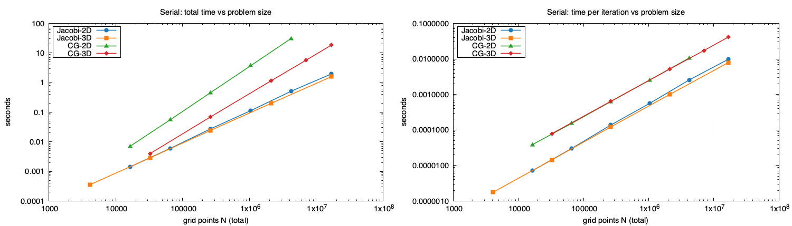
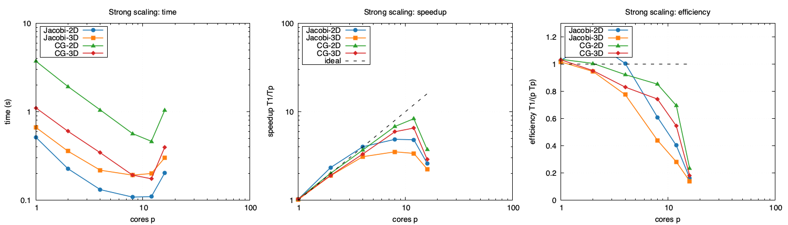
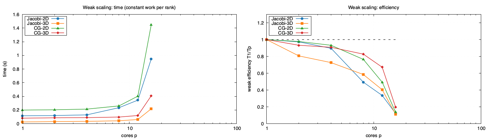
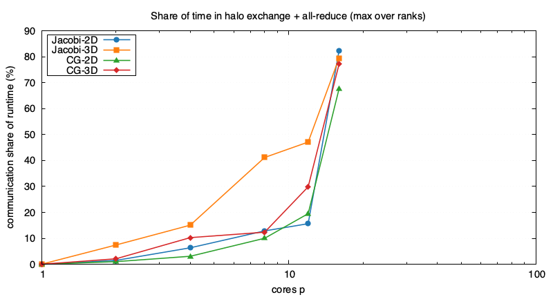
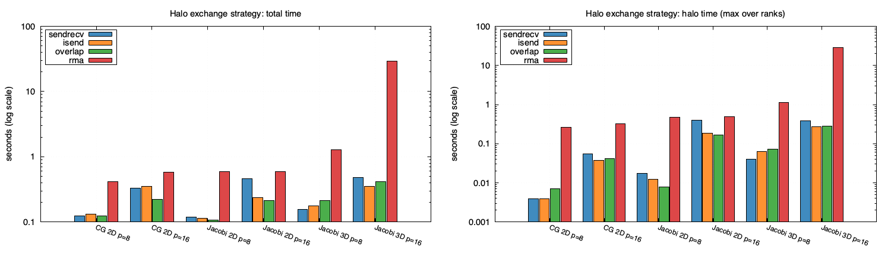
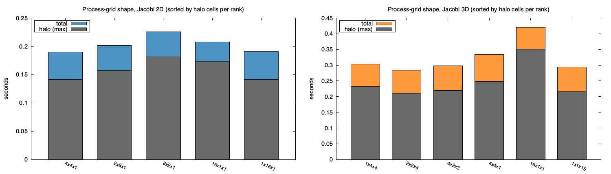
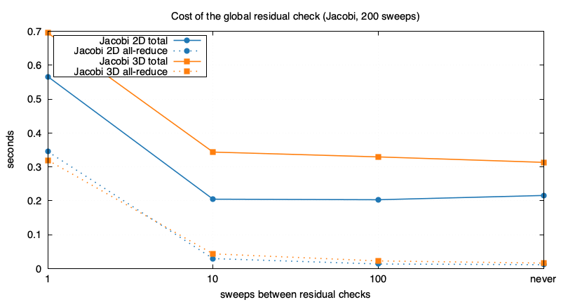
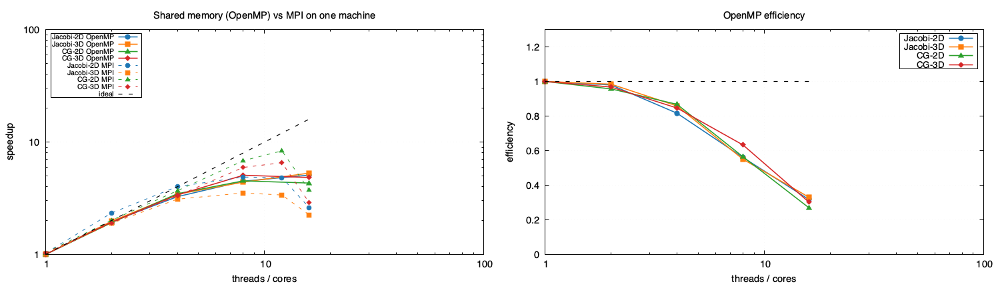
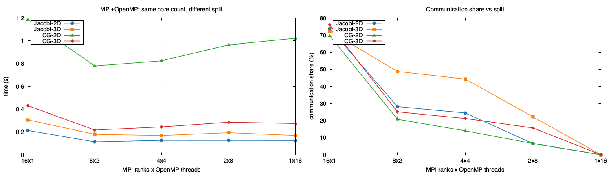

# Introduction

Satellites measure the temperature of the sea surface every day, but the infrared sensors that give the sharpest maps cannot see through clouds. Over the seas around India, where the monsoon keeps the sky covered for months, a single day's map from the VIIRS instrument can be missing more than nine tenths of its pixels. Anyone who wants a complete daily field, for a heat-wave study, for a coral-bleaching alert or as an input to a weather or fisheries model, has to fill the holes. The oldest and simplest way to fill them is to demand that the temperature in a hole varies as smoothly as possible while matching the observed pixels around it. That demand is the Laplace equation, the Poisson equation with zero source, solved on the missing pixels with the observed pixels as boundary data. In two dimensions the hole is filled from the clear pixels around it on the same day. In three dimensions a whole year of maps is stacked with time as the third axis, so a pixel hidden today is also filled from the same place yesterday and tomorrow.

The Poisson equation asks for a function whose curvature matches a prescribed source. It describes the steady temperature of a plate whose edges are held fixed, the shape of a stretched membrane under load, and the electric potential of a charge distribution, and it is the pressure-correction step inside most incompressible fluid solvers. Discretising it on a grid of $n^d$ points gives a sparse linear system that is too large to invert directly for any interesting $n$, so it is solved by iteration: start from a guess, apply a cheap update to every grid point, repeat until the change is negligible.

This project implements two such iterations in C++: Jacobi and conjugate gradient. They are validated and benchmarked on a manufactured Poisson problem with a known exact solution, and then applied to one year (2025) of daily 4 km sea-surface temperature maps of the Arabian Sea and the Bay of Bengal, $801 \times 534$ pixels per day and $365$ days, downloaded from NOAA CoastWatch. Each solver is written first serially and then in three parallel forms:

1. MPI only, using domain decomposition: the grid is cut into blocks, one per process, and processes swap the boundary layer of their blocks (the halo) before every update.
2. MPI+OpenMP: the same decomposition across processes, with the loops inside each block shared among threads.
3. MPI+CUDA: the same decomposition with each process's block held and updated on a GPU.

The problem is not embarrassingly parallel. Every update of a point needs its neighbours, so processes must communicate at every iteration, and conjugate gradient additionally needs two global sums per iteration. The interesting design questions are therefore how to cut the grid, how to exchange halos, how often to synchronise, and how to split a node's cores between processes and threads. Section 3 sets these out. Sections 5 to 7 measure them on the manufactured problem, whose size can be chosen freely, which is what strong and weak scaling need. Section 8 turns to the satellite data: how well the holes are filled, measured by hiding observed pixels and comparing, and how the same solver scales on a real field with coasts and with holes of every shape.

Both the 2D and 3D problems are implemented, as requested in the lecture 12 feedback, from a single source tree in which 2D is a 3D block of thickness one. The code is in the `poisson-mpi/` folder with a `README.md` that explains how to build and run it. Section 11 lists the exact commands that download the data and regenerate every figure in this report.

::: callout
**Status of the measurements.** All figures in this report were produced by the scripts in the repository from CSV files written by the solvers. The local figures come from one Apple M4 Max laptop with 16 cores. The 256-core and GPU figures must come from the NUS Atlas and Vanda clusters. The job scripts for them are in `scripts/atlas/` and `scripts/vanda/`, and Section 6.7 and Section 7.3 say which figures are waiting on those runs.
:::

# The algorithm

## The Poisson equation and its finite-difference form

We solve
$$-\Delta u = f \quad \text{in } \Omega = (0,1)^d, \qquad u = 0 \text{ on } \partial\Omega,$$
with $d = 2$ or $3$. The domain is covered by $n_x \times n_y$ (or $n_x \times n_y \times n_z$) interior grid points with spacings $h_x = 1/(n_x+1)$ and so on. The boundary points carry the known value zero. Replacing each second derivative by the central difference $(u_{i-1} - 2u_i + u_{i+1})/h^2$ gives, at every interior point $c$,
$$\Big(\tfrac{2}{h_x^2} + \tfrac{2}{h_y^2} + \tfrac{2}{h_z^2}\Big) u_c
 - \tfrac{u_{c-x} + u_{c+x}}{h_x^2} - \tfrac{u_{c-y} + u_{c+y}}{h_y^2} - \tfrac{u_{c-z} + u_{c+z}}{h_z^2} = f_c,$$
where $u_{c\pm x}$ denotes the neighbour of $c$ in the $x$ direction. In 2D the $z$ terms are absent, which the code expresses by setting $1/h_z^2 = 0$. This is the five-point (2D) or seven-point (3D) stencil. Written as a matrix equation $A u = f$, $A$ is symmetric positive definite with $2d+1$ non-zeros per row, so it is never stored: the code applies it on the fly (`apply_A` in `src/kernels.hpp`). The discretisation error is $O(h^2)$, which Section 4 verifies.

## Jacobi iteration

Solving the stencil equation at $c$ for $u_c$ with the neighbours frozen at their previous values gives the Jacobi sweep
$$u_c^{(k+1)} = \frac{1}{D}\Big(f_c + \tfrac{u^{(k)}_{c-x} + u^{(k)}_{c+x}}{h_x^2} + \tfrac{u^{(k)}_{c-y} + u^{(k)}_{c+y}}{h_y^2} + \tfrac{u^{(k)}_{c-z} + u^{(k)}_{c+z}}{h_z^2}\Big), \qquad D = \tfrac{2}{h_x^2} + \tfrac{2}{h_y^2} + \tfrac{2}{h_z^2}.$$
Every new value depends only on old values, so the sweep is perfectly parallel inside one iteration and needs two arrays, swapped after each sweep. Its weakness is speed of convergence: the error component that decays slowest shrinks by the factor $\cos(\pi h)\approx 1 - \pi^2 h^2/2$ per sweep, so reaching a tolerance $\varepsilon$ costs about $2\ln(1/\varepsilon)/(\pi^2 h^2)$ sweeps, proportional to $n^2$. For $\varepsilon = 10^{-10}$ that is roughly $4.7\,(n+1)^2$ sweeps. On a $1024^2$ grid that is five million sweeps. We therefore use Jacobi in two ways: run to convergence on small grids to validate it (Section 4), and run for a fixed number of sweeps (200) as a stencil benchmark whose cost per sweep is what the parallel study measures.

Jacobi converges only if a residual is checked, and checking the residual $r = f - Au$ needs the global norm $\|r\|_2$, which in parallel is an all-reduce. The parameter `--check-every C` controls how often that happens. For the fixed-sweep benchmark it is set to 0 (never), so the only communication is the halo exchange. Section 6.5 measures the price of each check.

## Conjugate gradient

Conjugate gradient (CG) is the standard Krylov method for symmetric positive definite systems. With $u_0 = 0$, $r_0 = p_0 = f$, each iteration computes
$$\alpha_k = \frac{r_k^\top r_k}{p_k^\top A p_k},\quad u_{k+1} = u_k + \alpha_k p_k,\quad r_{k+1} = r_k - \alpha_k A p_k,\quad
\beta_k = \frac{r_{k+1}^\top r_{k+1}}{r_k^\top r_k},\quad p_{k+1} = r_{k+1} + \beta_k p_k.$$
The only operation that touches neighbours is $A p_k$, so only the search direction $p$ needs a halo exchange, once per iteration. The two inner products $p^\top A p$ and $r^\top r$ are each a local sum followed by an `MPI_Allreduce`, so CG has two global synchronisation points per iteration where Jacobi (without residual checks) has none. In exchange, CG converges in $O(\sqrt{\kappa}) = O(n)$ iterations rather than $O(n^2)$, because the condition number of $A$ is $\kappa \approx 4/(\pi^2 h^2)$. The stopping rule in both solvers is the relative residual $\|r\|_2/\|f\|_2 < \varepsilon$ with $\varepsilon = 10^{-8}$ unless stated. No preconditioner is used. That is deliberate, to keep the communication pattern simple enough to analyse, and adding one is the obvious next step.

## Manufactured solution and validation metrics

To validate the solvers against a known answer we choose the solution first and derive the source from it (the method of manufactured solutions):
$$u(x,y,z) = e^{x}\sin(\pi x)\sin(\pi y)\,[\sin(\pi z)], \qquad
f = -\Delta u = e^{x}\sin(\pi y)[\sin(\pi z)]\big((d\pi^2 - 1)\sin(\pi x) - 2\pi\cos(\pi x)\big).$$
It vanishes on the boundary and is smooth, so the discrete solution should approach it with error $O(h^2)$. The factor $e^{x}$ is essential. The first version of the code used $u = \sin(\pi x)\sin(\pi y)$, which is an eigenvector of the discrete Laplacian. Its right-hand side is then a multiple of the same eigenvector, so $r_0$ lies in a one-dimensional Krylov space and CG converged in exactly one iteration on every grid. That made the CG timings meaningless. The exponential factor spreads the solution over many eigenvectors and restores the expected $O(n)$ iteration count (Section 4, Table 2).

Each run reports three quantities, all computed after the timed loop: the relative residual $\|f - Au\|_2/\|f\|_2$ (how well the linear system was solved), the discrete $L_2$ error $\big(\sum_c (u_c - u(x_c))^2\, h_x h_y h_z\big)^{1/2}$ and the maximum error $\max_c |u_c - u(x_c)|$ (how close the answer is to the true solution). Parallel correctness is established by running the same problem through every implementation and comparing these numbers.

## Cost per iteration

Let $N = n_x n_y n_z$ be the number of grid points and $P$ the number of ranks. One Jacobi sweep performs $2d + 2$ floating-point operations per point, reads $2d+2$ values and writes one, so it is memory-bound: on a machine with bandwidth $B$ bytes/s the sweep cannot take less than $16N/B$ seconds (two arrays streamed through once, plus the source). One CG iteration costs one stencil application plus roughly 10 more flops per point for the two dot products and three vector updates, and streams about six arrays. Per rank the compute cost is proportional to $N/P$.

Communication per iteration has two parts. The halo exchange moves the surface of each block: for a block with $m$ points per side in $d$ dimensions, that is $2d\,m^{d-1}$ values out and the same in, against $m^d$ values of work, a ratio of $2d/m$. With $N = 2048^2$ on 16 ranks arranged $4 \times 4$, $m = 512$ and each rank sends 2048 doubles (16 KB) against 262 144 updates, so communication volume is under one percent of the data touched. The cost that matters at this scale is latency: four messages per sweep. Arranged as $16 \times 1$ slabs each rank sends 4096 doubles in two messages. The second part is the all-reduce, whose time grows like $\log P$ and is pure latency. CG pays it twice per iteration. These two terms are what the strong-scaling study in Section 6 isolates with separate timers.

## The application: filling cloud gaps in satellite sea-surface temperature

The data are daily maps of sea-surface temperature from the VIIRS radiometer on the NOAA-20 satellite, gridded at $0.0375^\circ$ (about 4 km) by NOAA's ACSPO processing and served by the NOAA CoastWatch ERDDAP server [9, 10]. We take the box $5^\circ$N to $25^\circ$N, $65^\circ$E to $95^\circ$E, which holds the Arabian Sea, the Bay of Bengal, India, Sri Lanka and parts of the surrounding countries: $801 \times 534$ pixels per day, of which one third are land. The year is 2025, 365 days, $1.56 \times 10^8$ pixels in all. An infrared sensor cannot see the sea through cloud, so each daily map has holes wherever there was cloud at the overpass. Over this region the cloud fraction follows the monsoon: averaged over the sea pixels, 25% of the pixels were missing on a February day and 29% on a March day, rising to 70% in May, 84% in June, 88% in July and 84% in August, and falling back to 35% in December; over the whole year 57.5% of all sea-pixel-days are missing, so the gap-filling problem is the normal case here, not an exception. The day used for the 2D experiments, 10 April 2025 (day index 99), is missing 65% of its sea pixels: cloudy enough to be a real test, clear enough to leave anchors everywhere. A pixel is therefore in one of three states on a given day: observed (a temperature), missing (cloud) or land. The land mask comes from NOAA's gap-free blended analysis [11], resampled to the 4 km grid.

Filling a hole by "smoothest possible interpolation" means choosing the missing values $u_c$ to minimise the sum of squared differences between neighbouring sea pixels, $\sum_{(a,b)} w_{ab}(u_a - u_b)^2$, with the observed pixels held at their measured values $T_c$. Setting the derivative with respect to each missing value to zero gives, for every missing pixel $c$,
$$\sum_{n \in \mathcal N(c)} w_n\,(u_c - u_n) = 0, \qquad\text{i.e.}\qquad u_c = \frac{\sum_n w_n u_n}{\sum_n w_n},$$
where $\mathcal N(c)$ are the sea neighbours of $c$ (observed or missing; land neighbours are simply absent) and the weights are $w = 1$ for the four neighbours in space and $w = \lambda$ for the two neighbours in time when a year is stacked in 3D (`--tweight`, default 1). This is exactly the five- or seven-point Laplace stencil of Section 2.1 with three changes: the source is zero, the observed pixels are Dirichlet data in the middle of the domain rather than on its edge, and a pixel next to the coast averages over fewer neighbours, which is the natural (zero-flux) boundary condition: no heat is assumed to cross the coastline. Collecting the missing pixels into a vector $u_U$ gives a linear system $A_U u_U = b$ whose matrix has the sum of the weights of the active neighbours on the diagonal and $-w$ for every missing neighbour, and whose right-hand side $b_c = \sum_{n \in \mathcal N(c) \cap O} w_n T_n$ collects the observed neighbours. $A_U$ is symmetric, and it is positive definite as long as every connected set of missing pixels touches at least one observed pixel, so both Jacobi and conjugate gradient apply unchanged. A set of missing pixels enclosed entirely by land (a pond never observed all year) would make $A_U$ singular; the code gives such pixels the identity row, which assigns them the mean temperature. In practice the code solves for the anomaly $a = u - \bar T$ around the mean observed temperature $\bar T$, so that the initial guess $a = 0$ is already a sensible fill and the right-hand side only carries differences, which keeps the residual norms well scaled.

This is the classical harmonic (Laplace) in-painting, the baseline against which the operational gap-filling methods, optimal interpolation [12] and DINEOF [13], are usually judged. It has no tuned parameters apart from $\lambda$ and no training step, it is exactly the computation this project parallelises, and its weakness is known in advance: inside a large hole the solution is a smooth blend of the hole's rim, so fronts and eddies that lie entirely under a cloud are flattened. The 3D version is the interesting case for the data, because the sea changes slowly from day to day while clouds move, so yesterday's and tomorrow's clear pixels are strong evidence about today's hidden ones.

The accuracy of the fill is measured by hiding pixels that were actually observed. The option `--holdout 0.1` hides 10% of the observed pixels, chosen by a hash of the global pixel coordinates so that the same pixels are hidden whatever the number of ranks, and `--holdout-block B` hides them in square patches of $B \times B$ pixels instead of singly, because single hidden pixels are surrounded by observed ones and are trivially easy; patches of 16 to 64 pixels (60 to 250 km) resemble real cloud gaps. The hidden pixels are then filled like any other hole, and the root-mean-square error (RMSE), the mean absolute error and the maximum error between the fill and the hidden truth are reported, together with the RMSE of the trivial fill that sets every hole to $\bar T$, which is the baseline any method must beat. As an independent check, `--ref` compares the filled field against NOAA's blended analysis, a gap-free product that merges infrared, microwave and in-situ data with optimal interpolation [11]. It is not the truth either, so the comparison reports the disagreement between the two products on filled pixels next to their disagreement on observed pixels.

# Parallel design

## Domain decomposition

The ranks are arranged in a Cartesian process grid built with `MPI_Dims_create` and `MPI_Cart_create` (`make_decomp` in `src/decomp.hpp`). For a 2D problem the third dimension of the process grid is forced to one. Along each dimension the $n_d$ interior points are partitioned into $P_d$ contiguous blocks that differ in size by at most one point (`partition` in `src/common.hpp`: the first $n_d \bmod P_d$ ranks receive one extra point), so load imbalance is at most one layer. The user can force the shape with `--dims`, which Section 6.4 uses to compare slabs, pencils and blocks.

Every rank stores its block as a 3D array of $(n_x+2)(n_y+2)(n_z+2)$ doubles including a one-point halo on every side, indexed as $k\,s_z + j\,s_y + i$ with $i$ the contiguous direction. A 2D problem is a block with $n_z = 1$: the two $z$ halo planes exist but are multiplied by $1/h_z^2 = 0$, so the same kernels serve both dimensions with no branch in the inner loop and no wasted inner-loop trips (the $z$ loop is the outermost). Halo cells on the physical boundary are never written and stay at zero, which implements the Dirichlet condition for free: `MPI_Cart_shift` returns `MPI_PROC_NULL` for neighbours outside the grid and MPI treats sends and receives to it as no-ops.

## The masked stencil for the satellite data

For the data problem the decomposition is the same: longitude is $x$, latitude is $y$ and the day is $z$, so the one-day 2D case is cut into tiles of the map and the one-year 3D case into boxes of map tiles and day ranges. Each rank reads its own block, halo included, straight from the grid file with `fseek` and `fread` (`read_block` in `src/gridio.hpp`), so no rank ever holds the whole $1.56 \times 10^8$-pixel year, and the filled field is written back with one collective MPI-IO call through an `MPI_Type_create_subarray` view (`write_grid_mpi` in `src/decomp.hpp`). Next to the solution arrays every rank keeps one byte per cell, the mask: 0 missing, 1 observed, 2 land, 3 hidden for validation. The masked kernels (`jacobi_sweep_m`, `apply_A_m`, `residual_m` in `src/kernels.hpp`, and their CUDA twins) update only cells with mask 0 or 3, skip neighbours with mask 2, and rebuild the diagonal from the surviving neighbours' weights on the fly. Observed and land cells hold the value 0 in every solver array (their contribution sits in the right-hand side), so the halo exchange, the dot products and the vector updates of Sections 3.3 and 3.4 are used without any change, and the mask itself never needs exchanging because each rank reads its halo cells' mask from the file.

Two things differ from the manufactured problem. The masked kernel reads six extra bytes per cell and branches on them, so it moves about 20% more memory per update than the plain kernel and cannot be vectorised as cleanly. And the work is no longer uniform: a rank whose tile is mostly land or mostly clear sky has few unknowns, while a rank under the monsoon cloud has many. Because the kernel still visits every cell of the tile and the skipped cells are cheap, the imbalance in compute time is modest, and the measured ratio of the slowest rank's compute time to the mean is reported in Section 8 next to the uniform-problem value. The alternative, partitioning by the number of unknowns rather than by area, would need an irregular decomposition and is discussed in Section 9.

## Halo exchange strategies

The faces of a block are not contiguous in memory (except the $z$ faces), so they are described with `MPI_Type_create_subarray`: `face_type(nx, ny, nz, d, pos)` builds a datatype selecting the plane at index `pos` along dimension `d`, covering only the interior of the other two dimensions. Eight such types per rank (send and receive, low and high, per dimension) let MPI pack and unpack faces itself, with no user-level copy. Four strategies are implemented behind the `--exchange` option:

- `sendrecv`: for each dimension, two blocking `MPI_Sendrecv` calls (shift up, shift down). Simple, deadlock-free, but the dimensions are serialised.
- `isend`: all receives are posted first (`MPI_Irecv`), then all sends (`MPI_Isend`), then one `MPI_Waitall`. Up to 12 messages are in flight at once.
- `overlap`: as `isend`, but between posting and waiting the rank updates the deep interior of its block, the cells that do not touch any halo. After `MPI_Waitall` it updates the outer layer with the six slabs enumerated by `for_each_boundary_slab` in `src/kernels.hpp`, which visits every boundary cell exactly once. The communication is hidden if the interior work takes longer than the messages.
- `rma`: one-sided. Each rank exposes its array through an `MPI_Win` and uses `MPI_Put` to write its faces directly into the neighbours' halo planes inside an `MPI_Win_fence` epoch. The target datatype must describe the *neighbour's* layout, which may differ by one point from the sender's, so `make_decomp` recomputes the neighbour's block sizes with `partition` and builds a second set of datatypes (`nbr_lo_halo`, `nbr_hi_halo`). Jacobi exchanges alternating arrays, so one window per array is created once and selected by pointer.

Tags $10+d$ and $20+d$ distinguish the two directions in each dimension. The same tag scheme is reused by the CUDA driver.

## Global reductions and the residual check

All dot products are computed locally over the interior and combined with one `MPI_Allreduce` of a single double on the Cartesian communicator. The code counts time in three buckets with `MPI_Wtime`: compute (inside kernels), halo (inside the exchange functions, including waiting) and all-reduce. Each run reports the maximum and the mean over ranks. The maximum is what determines wall time, and the gap between them measures load imbalance or ranks waiting for a late neighbour. In Jacobi the residual check costs an extra halo exchange (the residual needs fresh halos of the new iterate), one residual sweep and one all-reduce. `--check-every` sets its frequency and 0 disables it.

## MPI+OpenMP

The hybrid version is the MPI code compiled with `-fopenmp`. The parallel work lives in `src/kernels.hpp`, where every loop over the block carries `#pragma omp parallel for collapse(2) schedule(static)` on the two outer ($k$, $j$) loops and `#pragma omp simd` on the contiguous inner loop. Reductions use `reduction(+:sum)` and `reduction(max:m)`. Static scheduling is correct here because every row costs the same. MPI is initialised with `MPI_Init_thread(MPI_THREAD_FUNNELED)`: only the master thread calls MPI, and all MPI calls sit outside parallel regions, so no finer thread support is needed. This is the simplest hybrid model and it has a known cost: each `parallel for` is a fork-join, and in `overlap` mode the six boundary slabs are six small parallel regions per sweep. The design question from lecture 9, how to divide a node's cores between ranks and threads, is answered empirically in Section 7.2 by holding ranks $\times$ threads constant.

## MPI+CUDA

The CUDA version (`src/cuda/`) keeps each rank's block in device memory and reimplements the kernels as CUDA kernels. A sweep is a 3D grid of $64 \times 4 \times 1$ thread blocks over the sub-range being updated. Consecutive threads in $x$ touch consecutive addresses, so loads coalesce. Dot products and residuals use a grid-stride loop over $1024 \times 256$ threads, each accumulating a partial sum and adding it once with `atomicAdd`, so one double per rank leaves the GPU for the `MPI_Allreduce`. Faces are packed by a kernel into contiguous device buffers. By default they are copied to pinned host memory and sent with `MPI_Isend`/`MPI_Irecv`, then copied back and unpacked. With `--cuda-aware` the device buffers are handed to MPI directly, which lets a CUDA-aware MPI use GPUDirect. The `overlap` mode launches the deep-interior kernel asynchronously after posting the messages. Each rank selects the GPU `node_rank mod device_count`, where `node_rank` comes from `MPI_Comm_split_type(MPI_COMM_TYPE_SHARED)`.

Because no GPU was available during development, the CUDA source was also compiled as plain C++ through a small emulation header (`src/cuda/cuda_compat.hpp`) that runs each kernel launch as a sequential loop over blocks and threads. That build (`bin/poisson_mpi_cuda_emul`) reproduces the serial results to all printed digits in 2D and 3D, for Jacobi and CG, for the staged and CUDA-aware paths and for the overlap mode, on the manufactured problem and on the satellite data (Section 4). It verifies the indexing, the packing, the mask handling and the solver logic. It says nothing about GPU performance, which needs the Vanda runs in `scripts/vanda/gpu.pbs`. For the data problem the mask is uploaded to the device once, and the masked kernels take it as an extra pointer argument.

## One source, five executables

The solver loop (`src/solver.hpp`) is written once and parameterised on a small policy object that supplies the wall clock, the halo exchange, the split-phase exchange for overlap, the global sum and max, and a barrier. `SerialComm` in `src/serial_main.cpp` makes every one of these a no-op. `MpiComm` in `src/mpi_main.cpp` maps them to the functions of `src/decomp.hpp`. Compiling `serial_main.cpp` with and without `-fopenmp` gives `poisson_omp` and `poisson_serial`, and compiling `mpi_main.cpp` the same two ways gives `poisson_mpi_omp` and `poisson_mpi`. This guarantees that the serial baseline executes exactly the same arithmetic as every parallel variant, which is what makes the speedup numbers meaningful and the bit-for-bit agreement in Section 4 possible. The CUDA driver is a separate file because its kernels are different, but it reuses the decomposition, the problem definition, the timers and the CSV writer. The same loop also serves both problems: with `--data` the solver receives a block of satellite data and switches to the masked kernels, and without it the manufactured right-hand side is generated in place.

# Validation

Three checks establish that the code solves the right problem and that every parallel variant solves it identically. All of them are run by the first block of `scripts/local/run_all.sh` and tabulated by `bin/summarize` (`analysis/summarize.cpp`).

## Discretisation error

Table 1 lists the error of the converged solution (CG to a relative residual of $10^{-10}$) against the manufactured solution as the grid is refined. The $L_2$ error falls by a factor that approaches 4.0 each time $h$ halves, and the fitted order is 2.00 in both 2D and 3D. The coarsest 3D grids give ratios of 3.58 and 3.77 because $8^3$ and $16^3$ grids are too coarse for the asymptotic regime. From $n = 64$ on, the ratio is 3.88 and above. The relative residual in every row is below $10^{-10}$, so the error is discretisation error and not solver error. This is the behaviour predicted in Section 2.1 and it would not hold if the stencil, the right-hand side or the boundary handling were wrong.

| nx | h | iters | rel_resid | l2_err | linf_err | ratio | order |
|---|---|---|---|---|---|---|---|
| 32 | 0.03030 | 44 | 2.49e-11 | 5.266e-04 | 1.110e-03 | nan | nan |
| 64 | 0.01538 | 93 | 5.99e-11 | 1.357e-04 | 2.866e-04 | 3.88 | 2.00 |
| 128 | 0.00775 | 187 | 4.38e-11 | 3.445e-05 | 7.280e-05 | 3.94 | 2.00 |
| 256 | 0.00389 | 371 | 9.28e-11 | 8.680e-06 | 1.834e-05 | 3.97 | 2.00 |
| 512 | 0.00195 | 738 | 8.16e-11 | 2.178e-06 | 4.604e-06 | 3.98 | 2.00 |
| 1024 | 0.00098 | 1467 | 3.65e-10 | 5.457e-07 | 1.153e-06 | 3.99 | 2.00 |

`ratio` is the error on the previous (coarser) grid divided by this one; 4.0 means the error quarters when h halves (second order). `order` is the measured convergence exponent.

| nx | h | iters | rel_resid | l2_err | linf_err | ratio | order |
|---|---|---|---|---|---|---|---|
| 8 | 0.11111 | 8 | 6.53e-12 | 5.406e-03 | 1.538e-02 | nan | nan |
| 16 | 0.05882 | 22 | 2.82e-11 | 1.511e-03 | 4.413e-03 | 3.58 | 2.00 |
| 32 | 0.03030 | 53 | 8.35e-11 | 4.005e-04 | 1.178e-03 | 3.77 | 2.00 |
| 64 | 0.01538 | 113 | 6.82e-11 | 1.032e-04 | 3.040e-04 | 3.88 | 2.00 |
| 128 | 0.00775 | 228 | 5.00e-11 | 2.620e-05 | 7.722e-05 | 3.94 | 2.00 |

`ratio` is the error on the previous (coarser) grid divided by this one; 4.0 means the error quarters when h halves (second order). `order` is the measured convergence exponent.

## Agreement of all implementations

Table 2 runs one 2D and one 3D problem through every executable: the serial baseline, OpenMP with 4 threads, MPI with 6 and 12 ranks under each of the four exchange modes, MPI+OpenMP with 2 threads per rank, and the CUDA driver through its emulation layer on 4 to 8 ranks. Jacobi is run for exactly 300 sweeps so that the arithmetic is identical in every case, and CG to a tolerance of $10^{-9}$.

For Jacobi the $L_2$ and maximum errors agree to all ten printed digits across the 14 runs of each problem. The largest absolute deviation of `l2_err` from the serial value, over every row in the table, is $3.2\times 10^{-15}$ (from `summary.json`). This is the rounding noise of summing the error over the grid in a different order. The iterates themselves are bitwise identical because each Jacobi update reads values that do not depend on where the block boundary falls. For CG the iteration counts agree exactly (432 and 76) and the errors agree to ten digits. The relative residual differs in its third significant figure (for example $5.665\times 10^{-10}$ serial against $5.660\times 10^{-10}$ on 6 ranks) because the dot products are summed in a different order on each rank count and CG's search directions amplify that difference slightly. Both effects are what floating-point arithmetic predicts (lecture 8), and neither affects the answer to the accuracy that matters.

| case | impl | ranks | threads | exchange | dims | iters | rel_resid | l2_err | linf_err |
|---|---|---|---|---|---|---|---|---|---|
| cg 2D n=300 | mpi_cuda_emul | 6 | 1 | isend | 3x2x1 | 432 | 5.666e-10 | 6.3277141917e-06 | 1.3372723175e-05 |
| cg 2D n=300 | mpi_omp | 6 | 2 | isend | 3x2x1 | 432 | 5.660e-10 | 6.3277141857e-06 | 1.3372723171e-05 |
| cg 2D n=300 | mpi_omp | 6 | 2 | overlap | 3x2x1 | 432 | 5.660e-10 | 6.3277141857e-06 | 1.3372723171e-05 |
| cg 2D n=300 | mpi_omp | 6 | 2 | rma | 3x2x1 | 432 | 5.660e-10 | 6.3277141857e-06 | 1.3372723171e-05 |
| cg 2D n=300 | mpi_omp | 6 | 2 | sendrecv | 3x2x1 | 432 | 5.660e-10 | 6.3277141857e-06 | 1.3372723171e-05 |
| cg 2D n=300 | serial | 1 | 1 | isend | 1x1x1 | 432 | 5.665e-10 | 6.3277141890e-06 | 1.3372723182e-05 |
| cg 3D n=45 | mpi_cuda_emul | 7 | 1 | overlap | 7x1x1 | 76 | 7.897e-10 | 2.0610511554e-04 | 6.0723682757e-04 |
| cg 3D n=45 | mpi_omp | 7 | 2 | isend | 7x1x1 | 76 | 7.969e-10 | 2.0610511554e-04 | 6.0723682759e-04 |
| cg 3D n=45 | mpi_omp | 7 | 2 | overlap | 7x1x1 | 76 | 7.969e-10 | 2.0610511554e-04 | 6.0723682759e-04 |
| cg 3D n=45 | mpi_omp | 7 | 2 | rma | 7x1x1 | 76 | 7.969e-10 | 2.0610511554e-04 | 6.0723682759e-04 |
| cg 3D n=45 | mpi_omp | 7 | 2 | sendrecv | 7x1x1 | 76 | 7.969e-10 | 2.0610511554e-04 | 6.0723682759e-04 |
| cg 3D n=45 | omp | 1 | 4 | isend | 1x1x1 | 76 | 8.031e-10 | 2.0610511554e-04 | 6.0723682758e-04 |
| cg 3D n=45 | serial | 1 | 1 | isend | 1x1x1 | 76 | 7.994e-10 | 2.0610511554e-04 | 6.0723682757e-04 |
| jacobi 2D n=300 | mpi | 6 | 1 | isend | 3x2x1 | 300 | 9.707e-01 | 8.3708880689e-01 | 1.7034276923e+00 |
| jacobi 2D n=300 | mpi | 6 | 1 | overlap | 3x2x1 | 300 | 9.707e-01 | 8.3708880689e-01 | 1.7034276923e+00 |
| jacobi 2D n=300 | mpi | 6 | 1 | rma | 3x2x1 | 300 | 9.707e-01 | 8.3708880689e-01 | 1.7034276923e+00 |
| jacobi 2D n=300 | mpi | 6 | 1 | sendrecv | 3x2x1 | 300 | 9.707e-01 | 8.3708880689e-01 | 1.7034276923e+00 |
| jacobi 2D n=300 | mpi_cuda_emul | 4 | 1 | isend | 2x2x1 | 300 | 9.707e-01 | 8.3708880689e-01 | 1.7034276923e+00 |
| jacobi 2D n=300 | mpi_cuda_emul | 4 | 1 | overlap | 2x2x1 | 300 | 9.707e-01 | 8.3708880689e-01 | 1.7034276923e+00 |
| jacobi 2D n=300 | omp | 1 | 4 | isend | 1x1x1 | 300 | 9.707e-01 | 8.3708880689e-01 | 1.7034276923e+00 |
| jacobi 2D n=300 | serial | 1 | 1 | isend | 1x1x1 | 300 | 9.707e-01 | 8.3708880689e-01 | 1.7034276923e+00 |
| jacobi 3D n=45 | mpi | 12 | 1 | isend | 3x2x2 | 300 | 4.699e-01 | 2.9523202694e-01 | 8.4158622086e-01 |
| jacobi 3D n=45 | mpi | 12 | 1 | overlap | 3x2x2 | 300 | 4.699e-01 | 2.9523202694e-01 | 8.4158622086e-01 |
| jacobi 3D n=45 | mpi | 12 | 1 | rma | 3x2x2 | 300 | 4.699e-01 | 2.9523202694e-01 | 8.4158622086e-01 |
| jacobi 3D n=45 | mpi | 12 | 1 | sendrecv | 3x2x2 | 300 | 4.699e-01 | 2.9523202694e-01 | 8.4158622086e-01 |
| jacobi 3D n=45 | mpi_cuda_emul | 8 | 1 | isend | 2x2x2 | 300 | 4.699e-01 | 2.9523202694e-01 | 8.4158622086e-01 |
| jacobi 3D n=45 | serial | 1 | 1 | isend | 1x1x1 | 300 | 4.699e-01 | 2.9523202694e-01 | 8.4158622086e-01 |

For Jacobi with a fixed sweep count every variant must agree to all printed digits (the arithmetic is identical; only the summation order of the diagnostics differs). For CG the dot products are summed in a different order on each rank count, so the residual differs in its last digits while the error agrees.

## Jacobi to convergence in serial and in parallel

Table 3 runs Jacobi to a tolerance of $10^{-8}$ with the residual checked every 50 sweeps. The serial run and the 4-rank run stop at the same sweep (15 700 in 2D on $64^2$, and 2350 in 3D on $24^3$ with 8 ranks) with the same residual, which confirms that the global residual, and therefore the stopping decision, is computed identically in parallel. The sweep counts are within 1% of the estimate $2\ln(1/\varepsilon)/(\pi^2 h^2)$ from Section 2.2 (15 790 and 2270).

| impl | dim | nx | ranks | iters | rel_resid | l2_err | t_total |
|---|---|---|---|---|---|---|---|
| serial | 2 | 64 | 1 | 15700 | 9.647e-09 | 1.3569e-04 | 0.035 |
| mpi | 2 | 64 | 4 | 15700 | 9.647e-09 | 1.3569e-04 | 0.017 |
| serial | 3 | 24 | 1 | 2350 | 7.766e-09 | 6.9806e-04 | 0.016 |
| mpi | 3 | 24 | 8 | 2350 | 7.766e-09 | 6.9806e-04 | 0.010 |

## Agreement on the satellite data

The data problem has no exact solution, but it has a quantity that every implementation must reproduce: the error on the hidden pixels, which depends only on the linear system and the stopping rule. The strong-scaling table of Section 8.3 is the first check: on the 2D day with 16-pixel hidden patches, the serial binary, MPI on 1, 2, 4, 8, 12 and 16 ranks and OpenMP with 16 threads all stop after 489 CG iterations and report a root-mean-square error of 0.1546 degrees on the hidden pixels, and on the 3D year the serial, MPI, OpenMP and MPI+OpenMP runs all stop after 199 iterations with 0.2318 degrees. Separate runs through the remaining variants give the same digits: the emulated CUDA build on 4 ranks in overlap mode and the MPI+OpenMP build with 3 ranks of 2 threads under one-sided exchange both report 489 iterations, RMSE 0.1546, mean absolute error 0.1074 and maximum error 1.4477 on the day, and on a 30-day slice of the year (days 90 to 119) the serial binary, 8 MPI ranks with blocking exchange and 4 emulated CUDA ranks all report 96 iterations, RMSE 0.2320, MAE 0.1700 and maximum 2.9684. The `rmse_hidden` column of the gap-filling tables in Section 8 therefore doubles as the correctness check of the masked kernels, the per-rank file reading and the MPI-IO output on a real, irregular domain.

# Serial performance against problem size

Figure 1 and Table 4 show the serial runtime as the problem grows. Jacobi runs 200 sweeps. CG runs to a relative residual of $10^{-8}$. Each configuration was run twice and the smaller time is kept throughout the report, because the minimum is the least noisy estimator of a program's intrinsic cost: interference from the operating system can only add time.

{width=100%}

The time per iteration grows linearly with the number of grid points $N$ in every case: the fitted slopes on the log-log plot are 1.05 (Jacobi 2D), 1.01 (Jacobi 3D), 1.01 (CG 2D) and 1.00 (CG 3D). Total CG time grows faster, with slopes 1.51 in 2D and 1.35 in 3D, because the iteration count grows like $n = N^{1/d}$. The predicted slopes are $1 + 1/d$, that is 1.50 and 1.33. The iteration counts themselves double with $n$: 183, 366, 731, 1458, 2909 for $n = 128$ to 2048 in 2D.

| case | n | points | iters | t_total | t_per_iter_ms | Mupdates_per_s |
|---|---|---|---|---|---|---|
| Jacobi 2D | 128 | 16384 | 200 | 0.001 | 0.007 | 2299.5 |
| Jacobi 2D | 256 | 65536 | 200 | 0.006 | 0.030 | 2172.9 |
| Jacobi 2D | 512 | 262144 | 200 | 0.028 | 0.138 | 1905.0 |
| Jacobi 2D | 1024 | 1048576 | 200 | 0.113 | 0.567 | 1848.5 |
| Jacobi 2D | 2048 | 4194304 | 200 | 0.512 | 2.559 | 1639.2 |
| Jacobi 2D | 4096 | 16777216 | 200 | 1.957 | 9.783 | 1715.0 |
| Jacobi 3D | 16 | 4096 | 200 | 0.000 | 0.002 | 2301.1 |
| Jacobi 3D | 32 | 32768 | 200 | 0.003 | 0.015 | 2257.5 |
| Jacobi 3D | 64 | 262144 | 200 | 0.024 | 0.122 | 2151.0 |
| Jacobi 3D | 128 | 2097152 | 200 | 0.198 | 0.992 | 2113.1 |
| Jacobi 3D | 256 | 16777216 | 200 | 1.581 | 7.903 | 2122.8 |
| CG 2D | 128 | 16384 | 183 | 0.007 | 0.039 | 422.6 |
| CG 2D | 256 | 65536 | 366 | 0.056 | 0.153 | 429.4 |
| CG 2D | 512 | 262144 | 731 | 0.460 | 0.629 | 416.8 |
| CG 2D | 1024 | 1048576 | 1458 | 3.748 | 2.571 | 407.9 |
| CG 2D | 2048 | 4194304 | 2909 | 30.850 | 10.605 | 395.5 |
| CG 3D | 32 | 32768 | 51 | 0.004 | 0.079 | 413.6 |
| CG 3D | 64 | 262144 | 109 | 0.070 | 0.640 | 409.7 |
| CG 3D | 128 | 2097152 | 222 | 1.145 | 5.160 | 406.5 |
| CG 3D | 192 | 7077888 | 334 | 5.766 | 17.262 | 410.0 |
| CG 3D | 256 | 16777216 | 446 | 18.408 | 41.273 | 406.5 |

Per-iteration time should grow linearly with N (slope 1 on log-log axes). Jacobi runs a fixed 200 sweeps, so total time is also linear; CG runs to tolerance 1e-8 and its iteration count grows like n, so total time grows like N^(1+1/dim).

The update rate explains what limits the serial code. Jacobi sustains 1.6 to 2.3 billion point updates per second. A Jacobi update reads one value of $f$, reads one value of $u$ that is not already in cache (the neighbours are reused from the previous rows) and writes one value of $u_{\text{new}}$, about 24 bytes of main-memory traffic, so 2 billion updates per second is 48 GB/s from one core, which is the single-core memory bandwidth of this laptop. CG sustains about 0.41 billion point-iterations per second, roughly a fifth of Jacobi's rate, and one CG iteration streams about five times as much data per point (the stencil, two dot products and three vector updates touch the six arrays $u, r, p, Ap, f$ and the residual scratch). Both solvers are therefore memory-bound, not compute-bound: the floating-point units are idle most of the time, waiting for data. This matters for the parallel results, because cores on one node share memory bandwidth, and adding cores to a memory-bound loop stops helping once the bandwidth is saturated.

# MPI performance

All MPI measurements in this section were made on one laptop with 16 cores, of which 12 are performance cores and 4 are efficiency cores running at a lower clock. Runs with 1 to 12 ranks sit on performance cores. The 16-rank runs necessarily place four ranks on efficiency cores. The job scripts for the 256-core study on the NUS clusters are described in Section 6.7, and their results replace Figures 2 to 4 when they are available.

## Strong scaling

Strong scaling holds the problem fixed and adds ranks. The problems are a $2048^2$ grid (Jacobi, 200 sweeps), a $192^3$ grid (Jacobi, 200 sweeps), a $1024^2$ grid (CG to $10^{-8}$, 1458 iterations) and a $128^3$ grid (CG to $10^{-8}$, 222 iterations). Speedup is measured against the separate serial executable, not against the MPI code on one rank. The two agree within 3%, which is the first line of Table 5.

{width=100%}

| case | n | cores | dims | iters | t_total | speedup | efficiency | t_compute_max | imbalance | t_halo_max | t_allreduce_max | comm_frac |
|---|---|---|---|---|---|---|---|---|---|---|---|---|
| Jacobi 2D | 2048 | 1 | 1x1x1 | 200 | 0.515 | 1.03 | 1.03 | 0.515 | 1.00 | 0.000 | 0.000 | 0.0% |
| Jacobi 2D | 2048 | 2 | 2x1x1 | 200 | 0.227 | 2.33 | 1.17 | 0.224 | 1.00 | 0.003 | 0.001 | 1.5% |
| Jacobi 2D | 2048 | 4 | 2x2x1 | 200 | 0.132 | 4.02 | 1.00 | 0.125 | 1.00 | 0.007 | 0.001 | 6.3% |
| Jacobi 2D | 2048 | 8 | 4x2x1 | 200 | 0.108 | 4.88 | 0.61 | 0.102 | 1.03 | 0.013 | 0.001 | 12.9% |
| Jacobi 2D | 2048 | 12 | 4x3x1 | 200 | 0.110 | 4.83 | 0.40 | 0.098 | 1.03 | 0.016 | 0.001 | 15.6% |
| Jacobi 2D | 2048 | 16 | 4x4x1 | 200 | 0.203 | 2.60 | 0.16 | 0.100 | 1.46 | 0.150 | 0.018 | 82.4% |
| Jacobi 3D | 192 | 1 | 1x1x1 | 200 | 0.666 | 1.02 | 1.02 | 0.666 | 1.00 | 0.000 | 0.000 | 0.0% |
| Jacobi 3D | 192 | 2 | 2x1x1 | 200 | 0.358 | 1.89 | 0.95 | 0.334 | 1.00 | 0.024 | 0.002 | 7.4% |
| Jacobi 3D | 192 | 4 | 2x2x1 | 200 | 0.218 | 3.10 | 0.78 | 0.189 | 1.01 | 0.032 | 0.001 | 15.1% |
| Jacobi 3D | 192 | 8 | 2x2x2 | 200 | 0.192 | 3.52 | 0.44 | 0.124 | 1.04 | 0.078 | 0.001 | 41.2% |
| Jacobi 3D | 192 | 12 | 3x2x2 | 200 | 0.200 | 3.38 | 0.28 | 0.112 | 1.02 | 0.093 | 0.001 | 47.1% |
| Jacobi 3D | 192 | 16 | 4x2x2 | 200 | 0.301 | 2.25 | 0.14 | 0.108 | 1.14 | 0.226 | 0.014 | 79.4% |
| CG 2D | 1024 | 1 | 1x1x1 | 1458 | 3.733 | 1.04 | 1.04 | 3.729 | 1.00 | 0.000 | 0.000 | 0.0% |
| CG 2D | 1024 | 2 | 2x1x1 | 1458 | 1.923 | 2.01 | 1.00 | 1.901 | 1.00 | 0.005 | 0.015 | 1.0% |
| CG 2D | 1024 | 4 | 2x2x1 | 1458 | 1.047 | 3.69 | 0.92 | 1.016 | 1.00 | 0.007 | 0.025 | 3.1% |
| CG 2D | 1024 | 8 | 4x2x1 | 1458 | 0.567 | 6.82 | 0.85 | 0.537 | 1.03 | 0.010 | 0.047 | 10.0% |
| CG 2D | 1024 | 12 | 4x3x1 | 1458 | 0.463 | 8.34 | 0.70 | 0.398 | 1.02 | 0.020 | 0.070 | 19.5% |
| CG 2D | 1024 | 16 | 4x4x1 | 1458 | 1.037 | 3.73 | 0.23 | 0.499 | 1.28 | 0.091 | 0.610 | 67.6% |
| CG 3D | 128 | 1 | 1x1x1 | 222 | 1.107 | 1.03 | 1.03 | 1.103 | 1.00 | 0.000 | 0.000 | 0.0% |
| CG 3D | 128 | 2 | 2x1x1 | 222 | 0.600 | 1.90 | 0.95 | 0.586 | 1.00 | 0.008 | 0.005 | 2.1% |
| CG 3D | 128 | 4 | 2x2x1 | 222 | 0.344 | 3.32 | 0.83 | 0.312 | 1.01 | 0.021 | 0.014 | 10.3% |
| CG 3D | 128 | 8 | 2x2x2 | 222 | 0.192 | 5.95 | 0.74 | 0.175 | 1.01 | 0.013 | 0.011 | 12.4% |
| CG 3D | 128 | 12 | 3x2x2 | 222 | 0.175 | 6.54 | 0.55 | 0.138 | 1.02 | 0.019 | 0.033 | 29.9% |
| CG 3D | 128 | 16 | 4x2x2 | 222 | 0.396 | 2.88 | 0.18 | 0.163 | 1.15 | 0.058 | 0.248 | 77.1% |

`imbalance` is the slowest rank's compute time divided by the mean over ranks; 1.0 means perfectly balanced work. A value well above 1 means some ranks (here, those on the laptop's efficiency cores) finish late and the others wait for them inside the halo exchange or the all-reduce.

Three regimes appear. Up to 4 ranks every case scales almost ideally, with efficiency 0.92 to 1.17. The values above 1 for Jacobi 2D at 2 ranks are a cache effect, since each rank's $1024 \times 2048$ block is closer to fitting in the per-core cache. From 4 to 12 ranks the two solvers part company. CG keeps scaling, to a speedup of 8.34 at 12 ranks (efficiency 0.70) in 2D and 6.54 (efficiency 0.55) in 3D, with communication under 20% of the time in 2D. Jacobi flattens: its speedup is 4.88 at 8 ranks and 4.83 at 12 ranks. The `t_compute_max` column shows why: the compute time per rank stops falling at about 0.10 s from 8 ranks onward, although each rank's share of the grid shrinks by a third. Eight ranks updating $4.2\times 10^6$ points 200 times in 0.10 s is 8.4 billion updates per second, or about 200 GB/s of memory traffic, which is this laptop's total memory bandwidth. Jacobi has hit the bandwidth ceiling of the machine and no decomposition can push it further. CG, which does more arithmetic per byte in its dot products and vector updates, saturates later.

At 16 ranks every case gets slower, by a factor of 1.8 to 2.3 against 12 ranks. This is not communication in the sense of network cost. The `imbalance` column, the slowest rank's compute time divided by the mean, jumps from 1.02 to 1.46 (Jacobi 2D), 1.28 (CG 2D) and 1.14 to 1.15 (3D): the four ranks on efficiency cores take up to 46% longer per sweep, and the twelve fast ranks wait for them at every halo exchange and every all-reduce. The waiting is booked under `t_halo_max` and `t_allreduce_max`, which is why the communication share leaps from 10 to 20% to 68 to 82% without any change in message size. The 16-rank points are a measurement of core heterogeneity, not of the algorithm, and the 12-rank points are the honest upper end of what this machine can show.

## Weak scaling

Weak scaling grows the grid with the rank count so that every rank always owns the same block: $1024^2$ points per rank for Jacobi 2D, $64^3$ for Jacobi 3D, $512^2$ and $48^3$ for CG, which runs a fixed 300 iterations here because the iteration count to a tolerance would otherwise grow with the global grid and confound the measurement. Ideal weak scaling is a flat line.

{width=100%}

| case | cores | global_grid | points | dims | iters | t_total | weak_efficiency | imbalance | comm_frac |
|---|---|---|---|---|---|---|---|---|---|
| Jacobi 2D | 1 | 1024x1024 | 1048576 | 1x1x1 | 200 | 0.116 | 1.00 | 1.00 | 0.0% |
| Jacobi 2D | 2 | 2048x1024 | 2097152 | 2x1x1 | 200 | 0.119 | 0.97 | 1.00 | 2.0% |
| Jacobi 2D | 4 | 2048x2048 | 4194304 | 2x2x1 | 200 | 0.129 | 0.90 | 1.00 | 4.8% |
| Jacobi 2D | 8 | 4096x2048 | 8388608 | 4x2x1 | 200 | 0.234 | 0.49 | 1.01 | 7.4% |
| Jacobi 2D | 12 | 4096x3072 | 12582912 | 4x3x1 | 200 | 0.345 | 0.34 | 1.02 | 9.2% |
| Jacobi 2D | 16 | 4096x4096 | 16777216 | 4x4x1 | 200 | 0.948 | 0.12 | 1.54 | 86.3% |
| Jacobi 3D | 1 | 64x64x64 | 262144 | 1x1x1 | 200 | 0.025 | 1.00 | 1.00 | 0.1% |
| Jacobi 3D | 2 | 128x64x64 | 524288 | 2x1x1 | 200 | 0.031 | 0.81 | 1.00 | 18.5% |
| Jacobi 3D | 4 | 128x128x64 | 1048576 | 2x2x1 | 200 | 0.034 | 0.73 | 1.00 | 24.7% |
| Jacobi 3D | 8 | 128x128x128 | 2097152 | 2x2x2 | 200 | 0.042 | 0.58 | 1.03 | 38.9% |
| Jacobi 3D | 12 | 192x128x128 | 3145728 | 3x2x2 | 200 | 0.061 | 0.40 | 1.03 | 35.6% |
| Jacobi 3D | 16 | 256x128x128 | 4194304 | 4x2x2 | 200 | 0.218 | 0.11 | 1.24 | 85.4% |
| CG 2D | 1 | 512x512 | 262144 | 1x1x1 | 300 | 0.199 | 1.00 | 1.00 | 0.0% |
| CG 2D | 2 | 1024x512 | 524288 | 2x1x1 | 300 | 0.203 | 0.98 | 1.00 | 2.4% |
| CG 2D | 4 | 1024x1024 | 1048576 | 2x2x1 | 300 | 0.213 | 0.93 | 1.00 | 2.4% |
| CG 2D | 8 | 2048x1024 | 2097152 | 4x2x1 | 300 | 0.260 | 0.76 | 1.02 | 8.9% |
| CG 2D | 12 | 2048x1536 | 3145728 | 4x3x1 | 300 | 0.403 | 0.49 | 1.02 | 20.4% |
| CG 2D | 16 | 2048x2048 | 4194304 | 4x4x1 | 300 | 1.449 | 0.14 | 1.32 | 78.1% |
| CG 3D | 1 | 48x48x48 | 110592 | 1x1x1 | 300 | 0.080 | 1.00 | 1.00 | 0.0% |
| CG 3D | 2 | 96x48x48 | 221184 | 2x1x1 | 300 | 0.086 | 0.93 | 1.00 | 6.1% |
| CG 3D | 4 | 96x96x48 | 442368 | 2x2x1 | 300 | 0.088 | 0.91 | 1.00 | 7.8% |
| CG 3D | 8 | 96x96x96 | 884736 | 2x2x2 | 300 | 0.097 | 0.83 | 1.03 | 13.4% |
| CG 3D | 12 | 144x96x96 | 1327104 | 3x2x2 | 300 | 0.120 | 0.67 | 1.02 | 21.2% |
| CG 3D | 16 | 192x96x96 | 1769472 | 4x2x2 | 300 | 0.408 | 0.20 | 1.09 | 69.7% |

CG holds a weak efficiency of 0.76 (2D) and 0.83 (3D) at 8 ranks and 0.49 and 0.67 at 12. Jacobi is worse, 0.49 and 0.58 at 8 ranks, for the bandwidth reason above: in weak scaling the total memory traffic grows with the rank count while the bandwidth does not, so a memory-bound sweep must slow down. Note that this is specific to ranks sharing one memory system. On a cluster, ranks on different nodes bring their own bandwidth, and the weak-scaling curve across nodes is governed by communication alone. The local curve is therefore a pessimistic preview. The 16-rank collapse has the same cause as in strong scaling (imbalance 1.54 and 1.32 in 2D).

## The impact of communication

{width=70%}

Figure 4 separates the communication share. Up to 12 ranks it grows from under 2% to 16% for Jacobi 2D, 47% for Jacobi 3D, 20% for CG 2D and 30% for CG 3D. The 3D cases pay more because a $192^3$ grid split 12 ways gives blocks of about $64 \times 96 \times 96$ whose six faces hold 7% of the block's points, against 0.8% for the 2D blocks (Section 2.5), and because the $x$ faces are strided in memory, so MPI must gather them element by element. Within the communication, the halo exchange dominates for Jacobi (0.016 s against 0.001 s of all-reduce at 12 ranks in 2D) and the all-reduce dominates for CG (0.070 s against 0.020 s), as the operation counts predict: Jacobi without residual checks performs no all-reduce at all, while CG performs two per iteration, 2916 in this run. At 12 ranks each all-reduce costs 24 microseconds, which on shared memory is mostly synchronisation.

The maximum-over-ranks communication time contains waiting as well as transfer. The `t_halo_mean` and `t_allreduce_mean` columns in the CSV files are consistently lower than the maxima, and the ratio widens exactly where the imbalance column does. On a cluster the same two timers will contain real network latency (a few microseconds per message on InfiniBand) and the $\log_2 P$ steps of the reduction tree, so the all-reduce cost of CG is the quantity to watch at 256 ranks. Section 8 returns to this.

## Halo exchange strategies

{width=100%}

| case | cores | exchange | t_total | t_compute_max | t_halo_max | t_allreduce_max | vs_isend |
|---|---|---|---|---|---|---|---|
| CG 2D | 8 | isend | 0.132 | 0.119 | 0.004 | 0.019 | 1.00 |
| CG 2D | 8 | overlap | 0.125 | 0.113 | 0.007 | 0.015 | 0.94 |
| CG 2D | 8 | rma | 0.415 | 0.129 | 0.262 | 0.021 | 3.14 |
| CG 2D | 8 | sendrecv | 0.123 | 0.112 | 0.004 | 0.014 | 0.93 |
| CG 2D | 16 | isend | 0.352 | 0.120 | 0.038 | 0.257 | 1.00 |
| CG 2D | 16 | overlap | 0.223 | 0.089 | 0.042 | 0.129 | 0.63 |
| CG 2D | 16 | rma | 0.578 | 0.097 | 0.319 | 0.180 | 1.64 |
| CG 2D | 16 | sendrecv | 0.329 | 0.106 | 0.056 | 0.237 | 0.93 |
| Jacobi 2D | 8 | isend | 0.114 | 0.106 | 0.012 | 0.001 | 1.00 |
| Jacobi 2D | 8 | overlap | 0.106 | 0.101 | 0.008 | 0.001 | 0.94 |
| Jacobi 2D | 8 | rma | 0.591 | 0.127 | 0.476 | 0.005 | 5.20 |
| Jacobi 2D | 8 | sendrecv | 0.119 | 0.108 | 0.018 | 0.001 | 1.04 |
| Jacobi 2D | 16 | isend | 0.236 | 0.098 | 0.184 | 0.014 | 1.00 |
| Jacobi 2D | 16 | overlap | 0.214 | 0.095 | 0.165 | 0.010 | 0.90 |
| Jacobi 2D | 16 | rma | 0.593 | 0.136 | 0.483 | 0.012 | 2.51 |
| Jacobi 2D | 16 | sendrecv | 0.461 | 0.139 | 0.399 | 0.011 | 1.95 |
| Jacobi 3D | 8 | isend | 0.176 | 0.119 | 0.063 | 0.001 | 1.00 |
| Jacobi 3D | 8 | overlap | 0.214 | 0.150 | 0.073 | 0.001 | 1.22 |
| Jacobi 3D | 8 | rma | 1.286 | 0.144 | 1.149 | 0.001 | 7.31 |
| Jacobi 3D | 8 | sendrecv | 0.157 | 0.120 | 0.041 | 0.001 | 0.89 |
| Jacobi 3D | 16 | isend | 0.354 | 0.125 | 0.276 | 0.024 | 1.00 |
| Jacobi 3D | 16 | overlap | 0.411 | 0.173 | 0.279 | 0.014 | 1.16 |
| Jacobi 3D | 16 | rma | 28.984 | 0.156 | 28.990 | 0.020 | 81.82 |
| Jacobi 3D | 16 | sendrecv | 0.479 | 0.139 | 0.390 | 0.017 | 1.35 |

Non-blocking `isend` is the baseline. Blocking `sendrecv` is within 10% of it at 8 ranks and in one case faster (Jacobi 3D, 0.89), because with few ranks the messages are large and the serialisation of directions costs little. At 16 ranks it is 1.35 to 1.95 times slower, since a rank blocked in one direction cannot absorb a late neighbour in another. Overlapping communication with the interior update helps in 2D, 0.90 to 0.94 of the baseline for Jacobi and 0.63 for CG at 16 ranks, where there is the most waiting to hide, but hurts 3D Jacobi by 16 to 22%. The reason is in the kernel: the overlap mode finishes with six boundary slabs, four of which are strided planes of one cell's thickness, and in 3D those slabs touch a larger share of the block than in 2D, so the extra passes over poorly laid-out memory cost more than the latency they hide. One-sided `rma` with `MPI_Win_fence` is 2.5 to 7 times slower everywhere and produced a 29 s outlier for Jacobi 3D at 16 ranks (the run completed with the correct answer). Open MPI 5 implements fence-synchronised one-sided communication over its point-to-point layer on shared memory, so each epoch costs two collective fences plus emulated puts. This result is specific to that implementation on this machine. Hardware RMA on the cluster's interconnect may behave differently, which is one of the questions the cluster runs answer.

## Shape of the process grid

{width=100%}

| case | dims | halo_cells_per_rank | t_total | t_compute_max | t_halo_max |
|---|---|---|---|---|---|
| Jacobi 2D | 4x4x1 | 2048 | 0.190 | 0.088 | 0.141 |
| Jacobi 2D | 2x8x1 | 2560 | 0.202 | 0.084 | 0.157 |
| Jacobi 2D | 8x2x1 | 2560 | 0.226 | 0.101 | 0.182 |
| Jacobi 2D | 16x1x1 | 4096 | 0.208 | 0.095 | 0.173 |
| Jacobi 2D | 1x16x1 | 4096 | 0.191 | 0.086 | 0.142 |
| Jacobi 3D | 1x4x4 | 36864 | 0.304 | 0.096 | 0.232 |
| Jacobi 3D | 2x2x4 | 36864 | 0.284 | 0.105 | 0.211 |
| Jacobi 3D | 4x2x2 | 36864 | 0.298 | 0.119 | 0.220 |
| Jacobi 3D | 4x4x1 | 36864 | 0.334 | 0.118 | 0.248 |
| Jacobi 3D | 16x1x1 | 73728 | 0.420 | 0.109 | 0.351 |
| Jacobi 3D | 1x1x16 | 73728 | 0.295 | 0.110 | 0.216 |

With 16 ranks on a $2048^2$ grid the $4 \times 4$ arrangement sends 2048 halo values per rank per sweep and the $16 \times 1$ or $1 \times 16$ slabs send 4096, yet all five shapes finish within 15% of each other and the $1 \times 16$ slabs tie with $4 \times 4$ for fastest. In 3D the surface-to-volume argument and the memory layout pull in different directions. The two slab shapes both send 73 728 values, twice as many as the block shapes, but $1 \times 1 \times 16$ (slabs stacked along $z$, whose faces are contiguous planes) is the fastest shape at 0.295 s while $16 \times 1 \times 1$ (slabs along the contiguous $x$ direction, whose faces are gathers of single doubles with a stride of 194) is the slowest at 0.420 s. The block shapes with 36 864 halo values sit between them. At this scale, on shared memory, the cost of a message is dominated by how many separate memory locations MPI has to touch to pack it, not by how many bytes it carries. This is the practical content of the lecture 12 remark that data layout and communication pattern must be designed together. On a network with higher latency per message, the volume argument gains weight and the block shapes are expected to win.

## Residual check interval

{width=70%}

| case | check_every | cores | t_total | t_compute_max | t_halo_max | t_allreduce_max |
|---|---|---|---|---|---|---|
| Jacobi 2D | never | 16 | 0.216 | 0.087 | 0.170 | 0.012 |
| Jacobi 2D | 1 | 16 | 0.566 | 0.230 | 0.166 | 0.345 |
| Jacobi 2D | 10 | 16 | 0.205 | 0.093 | 0.123 | 0.030 |
| Jacobi 2D | 100 | 16 | 0.203 | 0.108 | 0.152 | 0.014 |
| Jacobi 3D | never | 16 | 0.313 | 0.106 | 0.244 | 0.017 |
| Jacobi 3D | 1 | 16 | 0.695 | 0.254 | 0.268 | 0.320 |
| Jacobi 3D | 10 | 16 | 0.344 | 0.132 | 0.228 | 0.044 |
| Jacobi 3D | 100 | 16 | 0.330 | 0.115 | 0.248 | 0.023 |

Checking the residual after every sweep costs 2.6 times the runtime in 2D (0.566 s against 0.216 s): the check adds a halo exchange, a residual sweep that reads the whole block again, and an all-reduce, so it roughly doubles the memory traffic and adds a synchronisation point per sweep, visible as 0.345 s of all-reduce time. Checking every 10 sweeps is free within measurement noise, and every 100 sweeps is indistinguishable from never. Since Jacobi's residual decreases smoothly, checking every 10 to 100 sweeps loses at most that many unnecessary sweeps out of tens of thousands, so the code's default when a tolerance is requested is 10.

## Status of the 256-core measurements

The rubric asks for strong and weak scaling to at least 256 cores. The laptop measurements above stop at 16. The repository contains `scripts/atlas/gen_jobs.sh`, which writes 19 PBS jobs. A serial job repeats Section 5 at the cluster's problem sizes ($8192^2$ and $512^3$ for Jacobi, $4096^2$ and $256^3$ for CG) and provides the serial baselines. One job per rank count 1, 2, 4, 8, 16, 32, 64, 128, 256 runs the strong-scaling problems and the weak-scaling problems ($1024^2$ and $64^3$ points per rank for Jacobi, $512^2$ and $48^3$ for CG). Two jobs repeat the exchange-mode and residual-check studies at 64 and 256 ranks and the process-grid study at 256. Seven hybrid jobs are discussed in Section 7.2. The ranks per node default to 64 so that 256 ranks is exactly four nodes. Once `results/cluster/*.csv` exist, `make figures RESULTS=results/cluster` regenerates every figure and table in this section with the same code, and the discussion in Section 8 states what we expect them to show. Those runs had not been completed at the time of writing. The figures in this report are therefore the laptop figures, labelled as such.

# MPI+X performance

## OpenMP threads alone

{width=100%}

| case | threads | t_total | speedup | efficiency |
|---|---|---|---|---|
| Jacobi 2D | 1 | 0.645 | 1.00 | 1.00 |
| Jacobi 2D | 2 | 0.329 | 1.96 | 0.98 |
| Jacobi 2D | 4 | 0.197 | 3.27 | 0.82 |
| Jacobi 2D | 8 | 0.144 | 4.48 | 0.56 |
| Jacobi 2D | 16 | 0.127 | 5.08 | 0.32 |
| Jacobi 3D | 1 | 0.880 | 1.00 | 1.00 |
| Jacobi 3D | 2 | 0.447 | 1.97 | 0.98 |
| Jacobi 3D | 4 | 0.256 | 3.43 | 0.86 |
| Jacobi 3D | 8 | 0.200 | 4.40 | 0.55 |
| Jacobi 3D | 16 | 0.166 | 5.29 | 0.33 |
| CG 2D | 1 | 4.408 | 1.00 | 1.00 |
| CG 2D | 2 | 2.303 | 1.91 | 0.96 |
| CG 2D | 4 | 1.270 | 3.47 | 0.87 |
| CG 2D | 8 | 0.976 | 4.52 | 0.56 |
| CG 2D | 16 | 1.022 | 4.31 | 0.27 |
| CG 3D | 1 | 1.330 | 1.00 | 1.00 |
| CG 3D | 2 | 0.687 | 1.94 | 0.97 |
| CG 3D | 4 | 0.393 | 3.39 | 0.85 |
| CG 3D | 8 | 0.263 | 5.06 | 0.63 |
| CG 3D | 16 | 0.275 | 4.84 | 0.30 |

The OpenMP build of the serial driver (`poisson_omp`) reaches a speedup of 5.1 (Jacobi 2D), 5.3 (Jacobi 3D), 4.3 (CG 2D) and 4.8 (CG 3D) on 16 threads, with efficiency 0.96 to 0.98 at 2 threads, 0.82 to 0.87 at 4, 0.55 to 0.63 at 8 and about 0.3 at 16. Up to 8 threads OpenMP and MPI track each other closely, which is expected since both are limited by the same memory bandwidth. At 16 threads OpenMP degrades more gracefully than MPI (5.1 against 2.6 for Jacobi 2D). A static schedule hands the slow efficiency cores the same share of rows, but a thread that finishes late only delays the one barrier at the end of the loop, whereas a slow MPI rank delays every neighbour at every message. The 1-thread OpenMP time is 20% slower than the serial binary (0.645 s against 0.529 s) because the `collapse(2)` loops lose some vectorisation and add scheduling overhead. This is the fixed price of the hybrid build.

## Dividing the cores between ranks and threads

{width=100%}

| case | ranks | threads | cores | dims | t_total | t_compute_max | t_halo_max | t_allreduce_max |
|---|---|---|---|---|---|---|---|---|
| Jacobi 2D | 16 | 1 | 16 | 4x4x1 | 0.214 | 0.094 | 0.148 | 0.011 |
| Jacobi 2D | 8 | 2 | 16 | 4x2x1 | 0.114 | 0.095 | 0.029 | 0.003 |
| Jacobi 2D | 4 | 4 | 16 | 2x2x1 | 0.127 | 0.113 | 0.030 | 0.001 |
| Jacobi 2D | 2 | 8 | 16 | 2x1x1 | 0.127 | 0.121 | 0.007 | 0.002 |
| Jacobi 2D | 1 | 16 | 16 | 1x1x1 | 0.126 | 0.126 | 0.000 | 0.000 |
| Jacobi 3D | 16 | 1 | 16 | 4x2x2 | 0.306 | 0.120 | 0.207 | 0.014 |
| Jacobi 3D | 8 | 2 | 16 | 2x2x2 | 0.180 | 0.110 | 0.083 | 0.005 |
| Jacobi 3D | 4 | 4 | 16 | 2x2x1 | 0.170 | 0.121 | 0.072 | 0.004 |
| Jacobi 3D | 2 | 8 | 16 | 2x1x1 | 0.195 | 0.155 | 0.040 | 0.003 |
| Jacobi 3D | 1 | 16 | 16 | 1x1x1 | 0.170 | 0.170 | 0.000 | 0.000 |
| CG 2D | 16 | 1 | 16 | 4x4x1 | 1.186 | 0.481 | 0.096 | 0.729 |
| CG 2D | 8 | 2 | 16 | 4x2x1 | 0.780 | 0.641 | 0.028 | 0.134 |
| CG 2D | 4 | 4 | 16 | 2x2x1 | 0.825 | 0.714 | 0.016 | 0.099 |
| CG 2D | 2 | 8 | 16 | 2x1x1 | 0.964 | 0.901 | 0.014 | 0.050 |
| CG 2D | 1 | 16 | 16 | 1x1x1 | 1.022 | 1.018 | 0.000 | 0.000 |
| CG 3D | 16 | 1 | 16 | 4x2x2 | 0.431 | 0.176 | 0.064 | 0.263 |
| CG 3D | 8 | 2 | 16 | 2x2x2 | 0.217 | 0.170 | 0.017 | 0.038 |
| CG 3D | 4 | 4 | 16 | 2x2x1 | 0.245 | 0.196 | 0.021 | 0.031 |
| CG 3D | 2 | 8 | 16 | 2x1x1 | 0.286 | 0.243 | 0.026 | 0.019 |
| CG 3D | 1 | 16 | 16 | 1x1x1 | 0.274 | 0.271 | 0.000 | 0.000 |

Lecture 9 asked whether a node should run one rank with many threads, many ranks with one thread each, or something between. On this machine the answer is nearly the same for all four problems: 8 ranks with 2 threads each is fastest for Jacobi 2D, CG 2D and CG 3D, and within 6% of the fastest for Jacobi 3D (0.180 s against 0.170 s for 4 ranks with 4 threads). It beats 16 ranks with 1 thread by a wide margin (0.114 s against 0.214 s for Jacobi 2D, and 0.780 s against 1.186 s for CG 2D) and 1 rank with 16 threads by 10 to 25%. The two ends fail for different reasons. Sixteen single-threaded ranks suffer the efficiency-core imbalance at every message (communication share 70 to 76%). A single rank with 16 threads has no communication at all but pays the fork-join and reduced vectorisation of the threaded kernels on every loop, and a static schedule still puts a quarter of each loop on slow cores. The middle splits keep the number of synchronising partners small while giving each rank a block large enough for threads to share efficiently. The communication share falls monotonically from 16 to 1 rank, as it must, but total time does not, which is the point: the best split is the one that balances communication against threading overhead, and it has to be measured. On a 72-core Vanda node with homogeneous cores the balance will differ, and the seven hybrid jobs in `scripts/atlas/gen_jobs.sh` sweep the splits from 64 ranks per node with 1 thread to 1 rank per node with 64 threads, at 256 cores in total.

## MPI+CUDA

The rubric requires at least one GPU test when OpenMP is the intra-node layer. The CUDA driver (`src/cuda/mpi_cuda_main.cu`) is complete and has been validated in two ways short of a GPU. First, it compiles and runs as plain C++ through the emulation header, which executes every kernel launch as a sequential loop over blocks and threads. In that form it reproduces the serial results to the digits shown in Table 2 for Jacobi and CG, in 2D and 3D, through the staged and the CUDA-aware exchange paths, and in overlap mode. Second, the parts it shares with the CPU code (decomposition, tags, problem setup, timers, CSV output) are the parts measured throughout Sections 4 to 6. What has not been done is to compile it with `nvcc` and run it on a GPU, because none was available during development. The job script `scripts/vanda/gpu.pbs` compiles for the installed GPU, runs one rank on one GPU over grids from $1024^2$ to $8192^2$ and $64^3$ to $512^3$, and runs the MPI+OpenMP code with 36 threads on the same node for comparison. `gpu_multi.pbs` runs two ranks on two GPUs in staged and CUDA-aware mode and a weak-scaling pair. `analysis/summarize.cpp` and `analysis/plots.gp` already contain the table and plot code for both CSV files (`do_gpu`, `do_gpu_multi`), so the figure of time per iteration against grid size for GPU and CPU node appears as soon as the CSVs exist.

The expectation for that figure follows from Section 5. The stencil is memory-bound, and a data-centre GPU offers 1 to 3 TB/s of memory bandwidth against roughly 200 GB/s for a two-socket CPU node, so for grids large enough to fill the GPU (above about $2048^2$ or $128^3$) the per-iteration time should be 5 to 10 times lower on one GPU than on one CPU node, and the halo exchange, which now includes two device-host copies per face unless the MPI library is CUDA-aware, will take a larger share than on the CPU. For small grids the kernel launch latency (a few microseconds each, about ten launches per CG iteration) dominates and the GPU will not win. Two known inefficiencies in the current kernels are the reductions, which end with one `atomicAdd` per thread (about 262 000 per dot product, which a shared-memory block reduction would cut by 256), and the overlap mode, whose asynchronous interior kernel is timed under the halo bucket because the device synchronisation sits inside `halo_finish`. The GPU job also runs the two satellite cases (one day in 2D, the year in 3D) on the GPU and on the CPU node, so the data problem gets the same comparison.

# Results on the satellite data

## The filled maps

Figure 10 shows 10 April 2025. In the observed map (top left) the Bay of Bengal is almost entirely cloud, with a few clear streaks running south-west to north-east, and the Arabian Sea is clear in the north-west and patchy in the south. The 2D fill (top right) is complete and faithful close to every cloud edge, but the interior of the Bay of Bengal, where the nearest clear pixel is hundreds of kilometres away, is a smooth blend of the rim at 29 to 30 degrees with no structure at all. The 3D fill (bottom left) is complete too and keeps the fronts and eddies that the 2D fill erased: the filaments of the Arabian Sea eddy field continue under the cloud, and the Bay of Bengal shows the warmer western boundary and the cooler north-eastern corner that the neighbouring days saw. The two fills differ (bottom right) by about 0.19 degrees root-mean-square over the filled pixels of the day, close to zero within a few pixels of any observation and by up to one degree in the middle of the largest holes, where the 2D fill has no information and the 3D fill is carrying over yesterday and tomorrow.

{width=100%}

## Accuracy of the fill

The table below and Figure 11 give the error on hidden pixels. Three things stand out. First, the fill works: with 16-pixel patches (64 km squares) the 2D fill of the day is off by 0.15 degrees root-mean-square and 0.11 degrees on average, against 0.92 degrees for filling with the mean temperature, and even the 250 km patches are filled to 0.38 degrees. The error grows with the hole, from 0.09 degrees for single pixels to 0.13, 0.15 and 0.38 for 4, 16 and 64 pixels, as it must for a method that only knows the rim. Second, the third dimension does not help automatically. Measured on the same hidden pixels of the same day, the year-long 3D fill with equal space and time weights is worse than the 2D fill for every patch up to 16 pixels (0.12 against 0.09 for single pixels, 0.19 against 0.13 for 4 pixels, 0.21 against 0.15 for 16 pixels) and better only for the 64-pixel patches (0.29 against 0.38). The sea surface changes from one day to the next by a few tenths of a degree, through diurnal warming, cloud-biased sampling and sensor noise, and when the hole is small the clear pixels a few kilometres away are better witnesses than the same pixel a day earlier. When the hole is wider than the distance over which the sea is spatially coherent, the days win. Third, the time weight has to be small: lowering $\lambda$ from 1 to 0.01 brings the 3D error on 16-pixel patches from 0.213 down to 0.159 degrees on the day and from 0.232 to 0.193 over the year, which is as good as the 2D fill on that day, at the price of more CG iterations (499 instead of 199, because weak coupling in time makes the system closer to 365 independent 2D problems). The right panel of Figure 11 shows the monotone trend: no weight between 0.01 and 3 beats the 2D fill on 16-pixel patches, so for holes of that size the day alone is the better estimator. The comparison with NOAA's blended analysis adds a calibration point. The observed VIIRS pixels of the day differ from the analysis by 0.38 degrees root-mean-square (0.26 over the year), while our filled pixels differ from it by 0.24 to 0.27 degrees: the fill is closer to the smooth analysis than the raw observations are, because both the analysis and the fill average out the pixel-level noise of the sensor.

{width=100%}

| case | solver | patch | tweight | n_hidden | rmse | mae | max | baseline | rmse_ref_fill | rmse_ref_obs | iters | t_total |
|---|---|---|---|---|---|---|---|---|---|---|---|---|
| 2D (one day) | cg | 1 | 1 | 9978 | 0.0892 | 0.0509 | 1.603 | 0.9668 | 0.2639 | 0.3767 | 459 | 0.16 |
| 2D (one day) | cg | 4 | 1 | 9781 | 0.1273 | 0.0696 | 2.113 | 1.0163 | 0.2636 | 0.3759 | 483 | 0.13 |
| 2D (one day) | cg | 16 | 1 | 10732 | 0.1546 | 0.1074 | 1.448 | 0.9223 | 0.2607 | 0.3769 | 489 | 0.13 |
| 2D (one day) | cg | 64 | 1 | 4840 | 0.3754 | 0.2336 | 3.163 | 0.9371 | 0.2709 | 0.3750 | 555 | 0.15 |
| 3D (year), all days | cg | 16 | 0.01 | 4412908 | 0.1931 | 0.1238 | 7.403 | 1.4679 | 0.2705 | 0.2591 | 499 | 50.81 |
| 3D (year), all days | cg | 16 | 0.03 | 4412908 | 0.1931 | 0.1282 | 7.401 | 1.4679 | 0.2641 | 0.2591 | 403 | 39.38 |
| 3D (year), all days | cg | 16 | 0.1 | 4412908 | 0.2024 | 0.1396 | 7.317 | 1.4679 | 0.2624 | 0.2591 | 328 | 31.68 |
| 3D (year), all days | cg | 16 | 0.3 | 4412908 | 0.2160 | 0.1529 | 7.073 | 1.4679 | 0.2659 | 0.2591 | 261 | 25.42 |
| 3D (year), all days | cg | 1 | 1 | 4420814 | 0.1340 | 0.0895 | 7.068 | 1.4768 | 0.2721 | 0.2587 | 191 | 18.54 |
| 3D (year), all days | cg | 4 | 1 | 4426110 | 0.1912 | 0.1349 | 7.239 | 1.4778 | 0.2723 | 0.2588 | 199 | 19.05 |
| 3D (year), all days | cg | 16 | 1 | 4412908 | 0.2318 | 0.1670 | 6.539 | 1.4679 | 0.2746 | 0.2591 | 199 | 18.77 |
| 3D (year), all days | cg | 64 | 1 | 4393450 | 0.2483 | 0.1802 | 5.491 | 1.4795 | 0.2771 | 0.2595 | 199 | 18.91 |
| 3D (year), all days | cg | 16 | 3 | 4412908 | 0.2451 | 0.1778 | 6.065 | 1.4679 | 0.2861 | 0.2591 | 184 | 17.20 |
| 3D (year), error on the 2D day | cg | 16 | 0.01 | 4412908 | 0.1595 | 0.1123 | 1.464 | 1.1686 | 0.2426 | 0.3769 | 499 | 49.45 |
| 3D (year), error on the 2D day | cg | 16 | 0.03 | 4412908 | 0.1695 | 0.1214 | 1.463 | 1.1686 | 0.2397 | 0.3769 | 403 | 39.86 |
| 3D (year), error on the 2D day | cg | 16 | 0.1 | 4412908 | 0.1861 | 0.1352 | 1.422 | 1.1686 | 0.2402 | 0.3769 | 328 | 31.05 |
| 3D (year), error on the 2D day | cg | 16 | 0.3 | 4412908 | 0.2005 | 0.1474 | 1.417 | 1.1686 | 0.2431 | 0.3769 | 261 | 24.76 |
| 3D (year), error on the 2D day | cg | 1 | 1 | 4420814 | 0.1179 | 0.0777 | 1.438 | 1.2011 | 0.2458 | 0.3767 | 191 | 18.94 |
| 3D (year), error on the 2D day | cg | 4 | 1 | 4426110 | 0.1942 | 0.1307 | 2.052 | 1.2086 | 0.2463 | 0.3759 | 199 | 19.13 |
| 3D (year), error on the 2D day | cg | 16 | 1 | 4412908 | 0.2131 | 0.1583 | 1.348 | 1.1686 | 0.2484 | 0.3769 | 199 | 18.80 |
| 3D (year), error on the 2D day | cg | 64 | 1 | 4393450 | 0.2854 | 0.2069 | 2.416 | 1.2105 | 0.2539 | 0.3750 | 199 | 19.37 |
| 3D (year), error on the 2D day | cg | 16 | 3 | 4412908 | 0.2224 | 0.1662 | 1.398 | 1.1686 | 0.2555 | 0.3769 | 184 | 17.20 |

`patch` is the side of the hidden squares in 4 km pixels; `baseline` fills every hole with the mean observed temperature of the data used (the day in 2D, the year in 3D, which is why the two baselines differ); `rmse_ref_fill` and `rmse_ref_obs` are the root-mean-square differences from NOAA's blended analysis on the filled and on the observed pixels.

## Scaling on the real data

The irregular field scales much like the manufactured problem. The 2D day is small, -e.43 pixels of which -e.18 are unknowns, so it runs in 0.59 s serially (CG, 489 iterations) and reaches a speedup of 5.97 on 8 ranks (efficiency 0.75) and 7.12 on 12 (0.59) before the efficiency-core collapse at 16, the same shape as the ^2 case of Section 6.1. The 3D year is  pixels with  unknowns. The serial CG run takes 102 s for 199 iterations, 8 ranks bring it to 20.0 s (speedup 4.9, efficiency 0.61), and the best 16-core configuration is again a hybrid one, 4 ranks of 4 threads at 18.7 s, with 16 pure ranks at 20.9 s and 16 OpenMP threads at 19.6 s. Jacobi tells the new part of the story. Its `imbalance` column, the slowest rank's compute time over the mean, is 1.00 on the manufactured problem but 1.40 to 1.51 on the 2D day from 4 ranks upwards and 1.28 to 1.39 on the 3D year: the masked sweep is cheap on land and on observed pixels and expensive on the unknowns, and the unknowns are not spread evenly over the tiles (the Bay of Bengal tiles are nearly all cloud, the north-western Arabian Sea tiles nearly all clear). The waiting shows up as a communication share of 63% at 4 ranks and 76% at 8, although the messages are the same size as before. CG is less affected (imbalance 1.07 to 1.09) because its dot products and vector updates cost the same on every cell, and so dilute the uneven stencil. The masked kernel is also slower per cell: the 3D Jacobi sweep runs at 0.84 billion cells per second on one core against 2.1 billion for the plain kernel of Section 5, the price of the six mask bytes and the branch in the inner loop. Both effects are within the scope of a cheap fix (partition by the number of unknowns instead of by area), which Section 9 discusses.

{width=100%}

| case | impl | grid | cores | dims | iters | t_total | speedup | efficiency | imbalance | comm_frac | rmse_hidden |
|---|---|---|---|---|---|---|---|---|---|---|---|
| SST 2D (one day), CG | mpi | 801x534 | 1 | 1x1x1 | 489 | 0.615 | 0.95 | 0.95 | 1.00 | 0.0% | 0.1546 |
| SST 2D (one day), CG | mpi | 801x534 | 2 | 2x1x1 | 489 | 0.332 | 1.76 | 0.88 | 1.03 | 6.6% | 0.1546 |
| SST 2D (one day), CG | mpi | 801x534 | 4 | 2x2x1 | 489 | 0.177 | 3.31 | 0.83 | 1.07 | 19.1% | 0.1546 |
| SST 2D (one day), CG | mpi | 801x534 | 8 | 4x2x1 | 489 | 0.098 | 5.97 | 0.75 | 1.07 | 26.6% | 0.1546 |
| SST 2D (one day), CG | mpi | 801x534 | 12 | 4x3x1 | 489 | 0.082 | 7.12 | 0.59 | 1.08 | 34.6% | 0.1546 |
| SST 2D (one day), CG | mpi | 801x534 | 16 | 4x4x1 | 489 | 0.152 | 3.84 | 0.24 | 1.21 | 71.9% | 0.1546 |
| SST 2D (one day), CG | omp | 801x534 | 16 | 1x1x1 | 489 | 0.242 | 2.42 | 0.15 | 1.00 | 0.0% | 0.1546 |
| SST 2D (one day), Jacobi | mpi | 801x534 | 1 | 1x1x1 | 1000 | 0.362 | 0.96 | 0.96 | 1.00 | 0.0% | 0.1595 |
| SST 2D (one day), Jacobi | mpi | 801x534 | 2 | 2x1x1 | 1000 | 0.209 | 1.67 | 0.84 | 1.14 | 25.7% | 0.1595 |
| SST 2D (one day), Jacobi | mpi | 801x534 | 4 | 2x2x1 | 1000 | 0.128 | 2.72 | 0.68 | 1.40 | 62.7% | 0.1595 |
| SST 2D (one day), Jacobi | mpi | 801x534 | 8 | 4x2x1 | 1000 | 0.077 | 4.55 | 0.57 | 1.49 | 75.8% | 0.1595 |
| SST 2D (one day), Jacobi | mpi | 801x534 | 12 | 4x3x1 | 1000 | 0.053 | 6.60 | 0.55 | 1.51 | 86.4% | 0.1595 |
| SST 2D (one day), Jacobi | mpi | 801x534 | 16 | 4x4x1 | 1000 | 0.089 | 3.94 | 0.25 | 1.47 | 92.6% | 0.1595 |
| SST 3D (year), CG | mpi | 801x534x365 | 1 | 1x1x1 | 199 | 101.565 | 0.96 | 0.96 | 1.00 | 0.0% | 0.2318 |
| SST 3D (year), CG | mpi | 801x534x365 | 2 | 2x1x1 | 199 | 53.230 | 1.84 | 0.92 | 1.02 | 5.1% | 0.2318 |
| SST 3D (year), CG | mpi | 801x534x365 | 4 | 2x2x1 | 199 | 31.462 | 3.11 | 0.78 | 1.09 | 16.3% | 0.2318 |
| SST 3D (year), CG | mpi | 801x534x365 | 8 | 2x2x2 | 199 | 20.004 | 4.89 | 0.61 | 1.08 | 14.0% | 0.2318 |
| SST 3D (year), CG | mpi | 801x534x365 | 12 | 3x2x2 | 199 | 21.427 | 4.57 | 0.38 | 1.09 | 23.0% | 0.2318 |
| SST 3D (year), CG | mpi_omp | 801x534x365 | 16 | 2x2x1 | 199 | 18.736 | 5.22 | 0.33 | 1.06 | 16.8% | 0.2318 |
| SST 3D (year), CG | mpi | 801x534x365 | 16 | 4x2x2 | 199 | 20.854 | 4.69 | 0.29 | 1.09 | 33.0% | 0.2318 |
| SST 3D (year), CG | omp | 801x534x365 | 16 | 1x1x1 | 199 | 19.604 | 4.99 | 0.31 | 1.00 | 0.0% | 0.2318 |
| SST 3D (year), Jacobi | mpi | 801x534x365 | 1 | 1x1x1 | 200 | 37.164 | 1.00 | 1.00 | 1.00 | 0.0% | 0.2336 |
| SST 3D (year), Jacobi | mpi | 801x534x365 | 2 | 2x1x1 | 200 | 19.731 | 1.88 | 0.94 | 1.04 | 8.4% | 0.2336 |
| SST 3D (year), Jacobi | mpi | 801x534x365 | 4 | 2x2x1 | 200 | 13.071 | 2.84 | 0.71 | 1.28 | 40.4% | 0.2336 |
| SST 3D (year), Jacobi | mpi | 801x534x365 | 8 | 2x2x2 | 200 | 8.035 | 4.62 | 0.58 | 1.31 | 43.0% | 0.2336 |
| SST 3D (year), Jacobi | mpi | 801x534x365 | 12 | 3x2x2 | 200 | 8.125 | 4.57 | 0.38 | 1.39 | 70.2% | 0.2336 |
| SST 3D (year), Jacobi | mpi | 801x534x365 | 16 | 4x2x2 | 200 | 6.662 | 5.58 | 0.35 | 1.35 | 65.9% | 0.2336 |

`imbalance` is the slowest rank's compute time divided by the mean; `comm_frac` the share of the slowest rank's time in halo exchange and all-reduce. The last column is the correctness check: the hidden-pixel error must not change with the rank count.

# Discussion

## How the problem was parallelised, and where the communication is

The problem decomposes along one line. The grid is cut into blocks of equal size, one per MPI rank. Inside a rank the block's rows are shared among OpenMP threads or its points among GPU threads. Everything a point needs is its $2d$ neighbours and its own source value, so the only data that must cross a rank boundary is the one-cell halo, once per iteration, and the only global information is a handful of scalar sums. Table 6 sets out which technique parallelises which part.

| Part of the algorithm | Parallelised with | Communication |
|---|---|---|
| Stencil sweep (Jacobi) or $Ap$ (CG) over the interior | MPI across blocks, then OpenMP `parallel for collapse(2)` or CUDA 3D thread grid inside a block | halo exchange before the sweep: $2d$ messages per rank, each a face |
| Dot products $p^\top Ap$, $r^\top r$, residual norm | OpenMP `reduction(+)` or CUDA grid-stride loop + `atomicAdd` inside a block | one `MPI_Allreduce` of one double per product |
| Vector updates (`axpy`, `xpay`), Jacobi array swap | threads inside a block, none across blocks | none |
| Right-hand side and error evaluation | threads inside a block | one all-reduce each at the end, not timed |
| Residual check in Jacobi | as a sweep plus a dot product | one extra halo exchange plus one all-reduce every `check_every` sweeps |

Table: Which part of the algorithm is parallelised with which technique, and what it communicates.

Measured on the laptop, the part that needs the most communication depends on the solver. For Jacobi it is the halo exchange, and its cost is set by how many strided memory locations the faces touch, not by their byte count: at 16 ranks the $x$-slab decomposition is 40% slower than the $z$-slab decomposition with identical message sizes. For CG it is the all-reduce, two per iteration, which at 12 ranks already accounts for three quarters of CG's communication time and which on a cluster will add a $\log_2 P$ tree of network latencies per call. The halo exchange grows in relative cost as blocks shrink (strong scaling) and stays constant in weak scaling. The all-reduce grows with $\log P$ in both. At 256 ranks we therefore expect Jacobi's weak scaling to stay nearly flat and CG's to drift down by the growth of the reduction tree from 4 to 8 levels, and we expect the all-reduce to overtake the halo as CG's limiting term somewhere between 64 and 256 ranks. Pipelined or communication-avoiding CG variants, which overlap the all-reduce with the stencil or perform several steps between reductions, are the standard answer and the natural next step.

## What the design study showed

Five results generalise beyond this machine. First, the stencil is memory-bound at about 24 bytes per update, so the useful parallelism inside a node is bounded by the node's memory bandwidth, not its core count. Jacobi stopped gaining at 8 of 12 fast cores. Any discussion of efficiency on a node must start from that ceiling, and it is also the reason a GPU should win by roughly its bandwidth ratio. Second, cores of unequal speed destroy the scaling of a bulk-synchronous algorithm, because every iteration waits for the slowest rank. The 16-rank points lost a factor of two to four efficiency cores. The remedy on heterogeneous hardware is to size blocks to core speed or to pin ranks to the fast cores, and the diagnostic is the ratio of maximum to mean compute time, which the code reports. Third, non-blocking exchange is the right default. Overlapping it with interior work paid off in 2D and cost in 3D, because the boundary slabs the overlap leaves for last are strided and in 3D are a large fraction of the block. Fourth, fence-synchronised one-sided communication was uniformly slow in this MPI implementation on shared memory. It should be reconsidered only with hardware RMA and a lighter synchronisation (`MPI_Win_lock_all` with `MPI_Win_flush`), and it was not worth its complexity here. Fifth, global synchronisation is cheap if it is rare: a residual check every 10 sweeps is free and every sweep costs 2.6 times the runtime.

## What the data say

Two conclusions come from the data itself. The first concerns the method. Harmonic in-painting fills cloud gaps in a daily 4 km temperature map with an RMSE of about 0.15 degrees for holes up to 60 km and 0.4 degrees for holes of 250 km, against 0.9 to 1.5 degrees when every hole is set to the mean, and it agrees with NOAA's operational analysis as closely as that analysis agrees with the raw satellite pixels. For small holes it is good enough for most uses of a daily field; for the monsoon months, when nine tenths of the Bay of Bengal is missing for weeks, no method that only knows the rim of the hole can recover the fronts inside it, and that is where the 3D fill earns its cost: on 250 km holes the year-long solve is 25% more accurate than the single day, and the difference map of Figure 10 shows it restoring eddies that the 2D fill smooths away. The second conclusion is a caution about the third dimension that the hold-out experiment made visible and that would have been missed by looking at the maps alone. Stacking the days with equal weight makes small holes worse, not better, because consecutive days differ by more than neighbouring pixels do. The time weight should be small (0.01 to 0.1 in our units) and, ideally, should depend on the size of the hole, trusting the days where the space neighbours are far away and the space neighbours where they are near. A weight that varies with the local distance to the nearest observation is a one-line change to the masked kernel and is the first thing we would try next. For the parallel computation, the data problem confirmed the manufactured one and added one lesson: an area decomposition of a field with land and clouds leaves some ranks with three times the unknowns of others, and the fixed-sweep Jacobi benchmark exposed this as a 40 to 50% imbalance that conjugate gradient hides behind its uniform vector operations. Weighting the partition by the number of unknowns per column of the grid, which the mask makes easy to count, would remove most of it.

## Limitations

The report's main limitation is that its parallel measurements stop at 16 cores on one laptop with heterogeneous cores and shared memory. The 256-core and GPU figures that the rubric asks for are prepared but not run. The scripts, the sizes and the analysis are fixed, so the gap is one of machine access, and the laptop study is designed to transfer: every design axis measured here is re-measured by the cluster jobs at 64 and 256 ranks. Within the measurements, the minimum of two repeats is a modest sample, and the 16-rank points should be read as a study of core heterogeneity. CG is unpreconditioned, which makes its iteration count grow with $n$ and would be the first thing to change in a production solver, and Jacobi is used as a benchmark rather than as a method anyone would run to convergence on a large grid. The halo is one cell deep. A deeper halo would allow several Jacobi sweeps per exchange at the price of redundant computation, and that trade is worth measuring on a network with higher latency than shared memory.

## Future work

In order of expected value: run the prepared cluster and GPU jobs and replace the laptop figures. Add a Jacobi or incomplete-Cholesky preconditioner to CG. Implement pipelined CG to hide the all-reduce. Replace the per-thread `atomicAdd` reduction on the GPU with a block reduction. Add a multigrid cycle, which would turn the $O(n)$ iteration count of CG into $O(1)$ and change the communication profile entirely. For the application: weight the time neighbours by how far the days are apart and by the local variability of the sea, so that the 3D fill trusts yesterday more in a calm gyre than in a western boundary current, and balance the decomposition by the number of unknown pixels rather than by area.

# AI usage

Claude (Anthropic, model Claude Fable 5.1, used through Claude Code) was used throughout this project as a programming and writing assistant. It drafted the C++ source files, the Makefile, the data download and conversion tools, the job scripts, the C++ summariser and the gnuplot scripts from a design we specified in conversation. It ran the local validation and timing experiments and the data download. It drafted this report, the README and the accompanying handbook. We reviewed, ran and edited the outputs. Three technical decisions came out of that review loop and are recorded in the text because they matter: the manufactured solution was changed from a product of sines to $e^x\sin(\pi x)\sin(\pi y)$ after the first version made CG converge in one iteration (Section 2.4); the CUDA code was validated through a CPU emulation layer because no GPU was available during development (Section 3.6); and the application was built on NOAA CoastWatch data after the NASA Earth Observations server we first planned to use was retired in September 2026 (Section 2.6). All numbers in this report were produced by running the code in the repository on the downloaded data. None were generated by the assistant from memory. The lecture slides for DSA5208 (Lectures 7 to 12, A. Chen) were the reference for the definitions of speedup and efficiency, for strong and weak scaling, and for the MPI, OpenMP and CUDA constructs.

# Reproducibility

The repository is `poisson-mpi/`. `make all CXX=clang++` (macOS) or `make all` (Linux) builds the four CPU executables and `bin/gridtool`. `make cuda CUDA_ARCH=sm_80` builds the GPU executable where `nvcc` exists. `scripts/data/download.sh india 2025 ref` downloads the 365 daily maps, the land mask and the reference analysis from NOAA CoastWatch (about 1.1 GB), and `bin/gridtool convert` and `bin/gridtool regrid` turn them into `data/india_2025.grid` and `data/india_2025_ref.grid` (exact commands in the README). `scripts/local/run_all.sh 16 2` runs every local experiment, including the satellite stage, and writes `results/local/*.csv`, the filled fields in `results/fields/` and the map figure. `make figures` compiles `analysis/summarize.cpp`, which derives every table in Sections 4 to 8 from the CSV files, and runs `analysis/plots.gp` with gnuplot to draw every figure. On the cluster, copy the two grid files up, edit `scripts/atlas/env.sh` (queue name, ranks per node, module lines), run `scripts/atlas/gen_jobs.sh --submit` for the CPU study and `qsub scripts/vanda/gpu.pbs` for the GPU study, copy `results/cluster/` back and run `make figures RESULTS=results/cluster FIGDIR=results/figures_cluster`. The `README.md` repeats these instructions with the full option table.

# References

1. A. Chen, DSA5208 lecture slides 7 (Concepts of Parallel Computing), 8 (MPI), 9 (OpenMP), 10 (GPU Programming with CUDA), 12 (The Design of Parallel Algorithms), National University of Singapore, 2026.
2. G. M. Amdahl, "Validity of the single processor approach to achieving large scale computing capabilities," AFIPS Conference Proceedings 30, 483-485, 1967.
3. J. L. Gustafson, "Reevaluating Amdahl's law," Communications of the ACM 31(5), 532-533, 1988.
4. J. R. Shewchuk, "An introduction to the conjugate gradient method without the agonizing pain," Technical report CMU-CS-94-125, Carnegie Mellon University, 1994.
5. Y. Saad, *Iterative Methods for Sparse Linear Systems*, 2nd ed., SIAM, 2003 (Jacobi convergence factor, Chapter 4; CG, Chapter 6).
6. Message Passing Interface Forum, *MPI: A Message-Passing Interface Standard*, Version 4.1, 2023 (Cartesian topologies, Chapter 8; derived datatypes, Chapter 5; one-sided communication, Chapter 12).
7. OpenMP Architecture Review Board, *OpenMP Application Programming Interface*, Version 5.2, 2021.
8. NVIDIA, *CUDA C++ Programming Guide*, 2025.
9. NOAA CoastWatch, "Sea Surface Temperature, NOAA-20 VIIRS ACSPO L3 Collated, Global 0.0375 degree, Daily" (ERDDAP dataset `noaacwN20ACSPOSSTL3GCDaily`), https://coastwatch.noaa.gov/erddap/griddap/noaacwN20ACSPOSSTL3GCDaily.html, accessed 2 November 2026.
10. A. Ignatov et al., "Advanced Clear-Sky Processor for Oceans (ACSPO) sea surface temperature products," *Remote Sensing of Environment* 294, 113611, 2023 (the VIIRS SST processing behind reference 9).
11. NOAA CoastWatch, "Sea-Surface Temperature, NOAA Geo-polar Blended Analysis Night Only, GHRSST, Global 5 km, Daily" (ERDDAP dataset `noaacwBLENDEDsstDaily`), https://coastwatch.noaa.gov/erddap/griddap/noaacwBLENDEDsstDaily.html, accessed 2 November 2026; E. Maturi et al., "A new high-resolution sea surface temperature blended analysis," *Bulletin of the American Meteorological Society* 98(5), 1015-1026, 2017.
12. R. W. Reynolds et al., "Daily high-resolution-blended analyses for sea surface temperature," *Journal of Climate* 20(22), 5473-5496, 2007 (optimal interpolation gap filling).
13. A. Alvera-Azcárate, A. Barth, M. Rixen and J.-M. Beckers, "Reconstruction of incomplete oceanographic data sets using empirical orthogonal functions: application to the Adriatic Sea surface temperature," *Ocean Modelling* 9(4), 325-346, 2005 (DINEOF).
